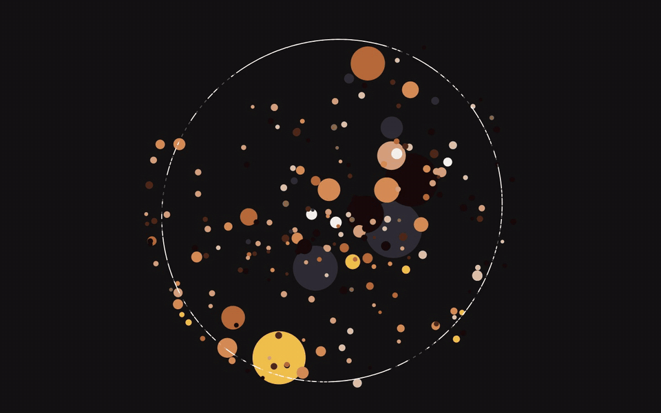
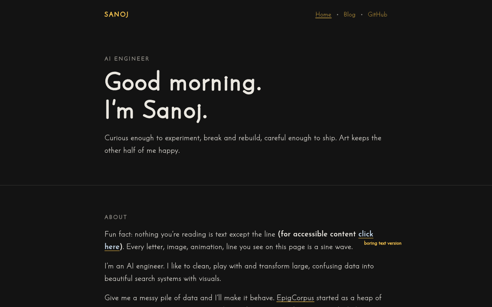
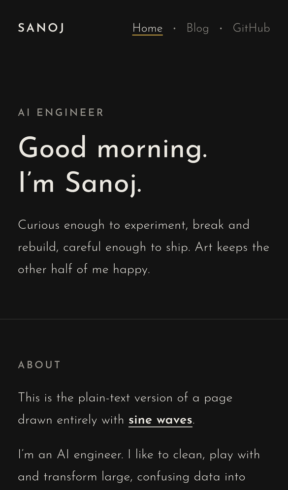
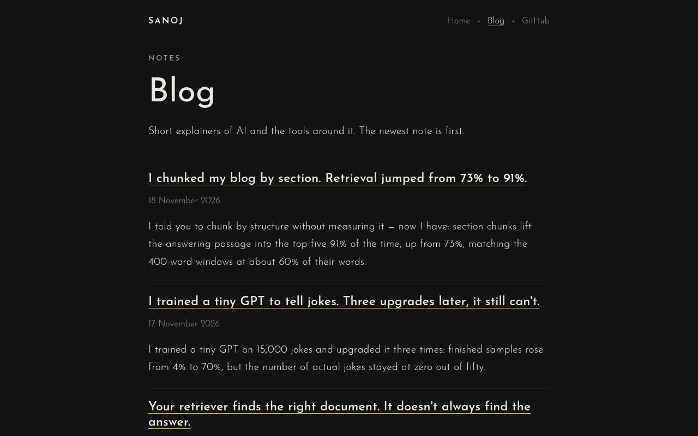

# sine.portfolio

<p align="center">
  <a href="https://sanoj.dev/"></a>
</p>

<p align="center">
  <b>A portfolio where every letter, picture and line is a sine wave.</b><br>
  You write an ordinary HTML page. The build turns it into sums of sine waves, and the browser animates them on a canvas.
</p>

<p align="center">
  <a href="https://sanoj.dev/"></a>
  <a href="https://github.com/d-sanoj/sine-portfolio/actions/workflows/ci.yml"></a>
  
  
  <a href="https://github.com/d-sanoj/sine-portfolio/stargazers"></a>
</p>

<p align="center">
  <a href="https://sanoj.dev/"><b>Live demo</b></a> ·
  <a href="https://sanoj.dev/boring/">Plain text version</a> ·
  <a href="https://sanoj.dev/blog/">Blog</a> ·
  <a href="#make-it-yours">Use it for your own site</a>
</p>

My portfolio website — https://sanoj.dev/

The whole site is drawn entirely from sine waves. Every letter is one sine curve, and the home page has no text or images in the usual sense: it is built from an ordinary HTML page, so you only ever edit that page.

## How it works

Each stroke on the page is a closed curve written as a Fourier series: a list of `[frequency, amplitude, phase]` terms that are added together to trace it (`src/core/sine/series.js`). Nothing else about the shape is stored.

1. **You write HTML.** All the words live in `apps/plain/index.html`, which is also a normal, readable page at [`/boring/`](https://sanoj.dev/boring/).
2. **The build measures it.** A headless Chrome lays the plain page out at a wide and a narrow width and saves where every word sits.
3. **Words become waves.** Each letter comes from a set of 161 designed sine glyphs (`data/source/sine-glyphs.json`). Headings, bold, lists and links are baked in as sizes and line weights.
4. **The browser animates the sums.** A small canvas app draws the waves frame by frame. No framework and no runtime dependencies.

## What you see

- **A portrait loader.** While the page data loads, a circle becomes a portrait drawn from sine waves, colour fills included. It then dissolves into a circle that pops into one bead per letter, and each letter forms where its bead lands.
- **Letters that form as you scroll.** Content coming into view grows out of small circles that fly in from nearby.
- **Link hints in the same letters.** Hover a link and the word "click" grows out of its yellow underline. The link to the plain page says "boring text version" instead.
- **A greeting that follows the clock.** "Good morning", "Good afternoon" or "Good evening", depending on your time of day.
- **Press <kbd>Space</kbd> to replay** the animation.

<p align="center">
  
</p>

## Accessible and fast

- **A plain HTML twin.** Every word is also on a normal page at `/boring/`, linked near the top of the sine page. Phones get that page at the main address (`functions/_middleware.js`), so a shared link works everywhere.
- **Reduced motion is respected.** With `prefers-reduced-motion`, the loader and the scroll animation are skipped.
- **Checked on every push.** CI checks the blog, builds the site, runs an axe-core accessibility check and checks internal links.
- **Smooth on big screens.** See [Smooth animation](#smooth-animation).

<p align="center">
  
  &nbsp;&nbsp;
  
</p>

## Tech stack

- Plain JavaScript (ES modules) and a `<canvas>`. No framework.
- Node.js 18 or newer for the build and the dev server.
- [esbuild](https://esbuild.github.io/), only to minify the published scripts.
- [axe-core](https://github.com/dequelabs/axe-core) for the accessibility check.
- Chrome or Chromium to measure the page. If none is installed, the build downloads Chrome for Testing's headless shell once.
- Published on Cloudflare Pages, with one small Pages Function for phones.

## Run it locally

```sh
npm install   # once
npm run dev   # http://localhost:5173/
```

`npm run build:dist` builds the site into `dist/`, which is what gets published.

| Address | What it is |
|---|---|
| `/` | the sine site |
| `/boring/` | the plain HTML site |
| `/blog/` | the notes, newest first |

The dev server also has tools that are never published, such as `/designer/`, where the sine letters are designed, and `/measure/`, which measures the plain page by hand.

The same checks CI runs:

```sh
npm run check:blog   # checks the notes in content/blog/
npm run check:a11y   # axe-core accessibility check (after build:dist)
```

## Edit the content

All the words on the site live in one file: `apps/plain/index.html`. Edit it, then rebuild. The sine home page is measured from that page, so your changes show up there automatically.

## Blog

Notes are Markdown files in `content/blog/`, one folder per note. To add one, create `content/blog/blog-<number>-<MM>-<DD>-<YYYY>/`, where `<number>` counts the notes from 1 in date order, and put `content/blog/blog-<number>-<MM>-<DD>-<YYYY>/<slug>.md` inside it:

```markdown
---
title: How a model reads a word
date: 2026-11-05
description: One sentence about the note.
cover: img/cover.png
coverAlt: What the cover image shows.
---

Your writing here. `#` is a section, `##` is a sub-section.
```

Images for that note go in `content/blog/blog-<number>-<MM>-<DD>-<YYYY>/img/` and are linked as `img/<file>`, for example ``. Every image needs alt text, or the build stops. Downloadable files (a script, a results file) sit next to the `.md` at the folder root and are linked by their file name.

The build also fills the latest three notes into the home page, so a new note shows up there in sine letters.

## Smooth animation

The sine page draws on a canvas that is only a little taller than the screen and follows the page as it scrolls (`BAND_MARGIN` in `apps/site/app/config.js`). The canvas is never drawn sharper than 1.5 pixels per CSS pixel (`MAX_PIXEL_RATIO`). The loader adds up only the waves that change from one frame to the next. Together these keep the animation smooth on big screens and slower computers.

## Make it yours

Want a site like this for yourself? Fork the repo, put your own words in `apps/plain/index.html`, add your own notes under `content/blog/`, and point Cloudflare Pages (or any static host) at `main` with the build command above. The typeface is Josefin Sans, under the SIL Open Font License (`assets/fonts/OFL.txt`).

Where to change other things:

| To change | Look in |
|---|---|
| Your words, links and sections | `apps/plain/index.html` |
| Your notes | `content/blog/` |
| Timing, colours, line widths, the link hint | `apps/site/app/config.js` (for example `FORM_TIME`, `LINK_YELLOW`, `HINT`) |
| The loader's timing | `src/widgets/loader/config.js` |
| The shapes of the letters | `/designer/` in the dev server, which saves `data/source/sine-glyphs.json` |
| The page title and favicon | `apps/site/index.html`, `assets/` |

The portraits and pictures are personal to this site, so swap them for your own before you publish.

## Project structure

```text
apps/
  site/        the sine site: models, views and controllers for the canvas
  plain/       the plain HTML page, where all the words live (/boring/)
  designer/    the letter designer (dev only)
  measure/     measures the plain page in a browser (dev only)
  portraits/   traces a picture into a sine-wave portrait (dev only)
src/
  core/        the sine maths, the layout and the canvas drawing
  widgets/     the portrait loader
content/blog/  the notes, one folder per note
data/          the sine letters, the portraits, and the layouts the build makes
scripts/       the build, the blog, the checks
server/        the local dev server
functions/     the Cloudflare Pages Function that sends phones the plain page
assets/        fonts, favicons, images
docs/readme/   the images in this README
```

## Publishing

The site is published by Cloudflare Pages from the `main` branch: every push builds it with `npm ci && npm run build:dist` and publishes it at https://sanoj.dev/.

## Credits

- Built by [Sanoj](https://sanoj.dev/) ([@d-sanoj](https://github.com/d-sanoj)).
- Typeface: Josefin Sans by The Josefin Sans Project Authors, under the SIL Open Font License 1.1 (`assets/fonts/OFL.txt`).

---

If this gave you an idea for your own site, a ⭐ helps other people find it. Issues and questions are welcome.
