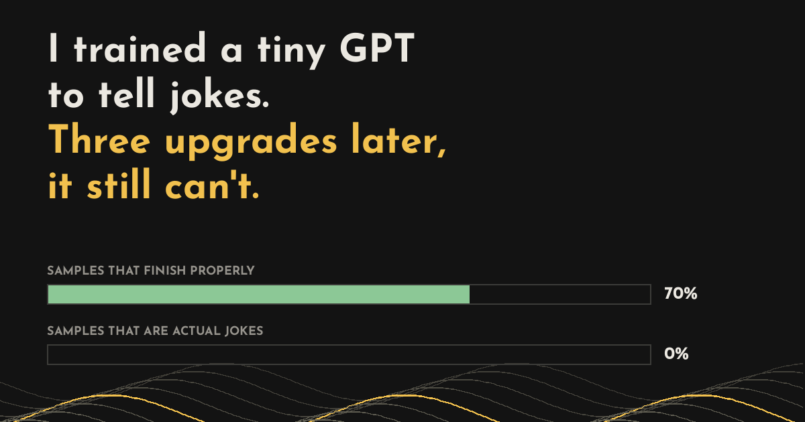
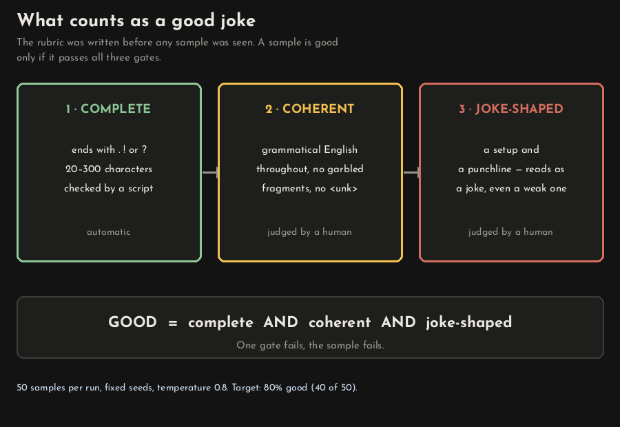
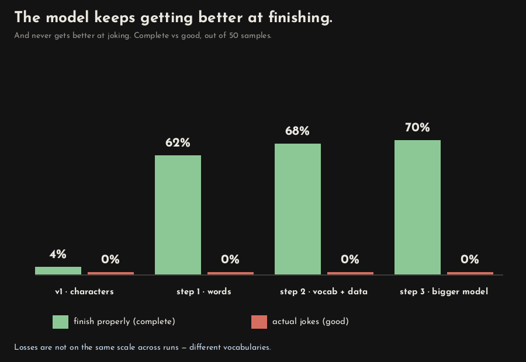
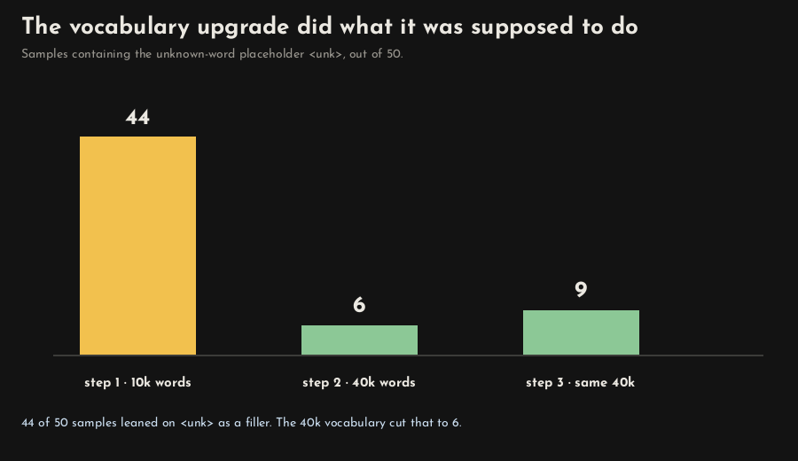

The loss curve looked great. After 1,500 training steps the loss had fallen from 4.55 — what random guessing over 95 characters scores — to 2.06, the samples were full of real words and question marks, and the model had clearly learned what a joke *looks* like. Then I read the samples. Out of fifty, two finished as proper sentences. None was a joke a person would recognise as one.

So I did what the experiment was for: I fixed the way I was measuring, wrote down what "a joke" means before looking at another sample, and upgraded the model one lever at a time — word-level tokens, then a bigger vocabulary with more data, then a bigger model. The finished samples kept climbing, 4% to 70%. The number of actual jokes stayed at zero. Four runs, 200 samples, 0 good jokes. This is the story of what each upgrade actually bought, and why the number on the loss curve was never the number that mattered.

# The setup: a tiny GPT, 15,000 jokes, no GPU

The model is a small GPT in the style of Andrej Karpathy's nanoGPT: it predicts the next token, one at a time, and a joke is whatever comes out when you let it keep predicting. The first version predicted one *character* at a time — 95 possible characters — with 4 transformer layers, 819,840 parameters, and 1,500 training steps. The corpus is 15,000 short jokes from the public Short Jokes dataset on Hugging Face (a mirror of the Kaggle set, 231,657 jokes, mostly from Reddit), cleaned down from 219,175 survivors of dedup and filtering. The machine is an ordinary box with about 1.5 shared CPUs and 6 GB of RAM, no GPU. The whole first training run took 33 minutes and 38 seconds.

A word about loss, because the whole post turns on it. Loss is how surprised the model is by the next token, averaged over the data it is shown. Lower means less surprised. A model guessing at random over 95 characters scores about 4.55; mine reached 2.06. That sounds like real learning, and in one sense it is — the model got much better at predicting the next letter of joke text. But "predicts the next letter well" and "tells a joke" are different jobs, and loss only measures the first one.

The other thing loss hides is that it is only comparable between runs that share the same vocabulary. A character model guessing over 95 symbols and a word model guessing over 10,000 words are scored on different scales — random guessing is 4.55 for the first and 9.21 for the second. So a word model's loss of 5.03 is not "worse" than a character model's 2.06. I learned to stop comparing the numbers across runs and compare the samples instead.

# The rubric: write down "good" before you look

After the first version, I did the thing that made the rest of the experiment honest: I wrote down what counts as a good joke *before* generating another sample, so the bar could not move to suit the results. Fifty samples per run, fixed seeds, temperature 0.8 — the randomness knob, kept the same every time so the runs are comparable. A sample is good only if it passes all three gates:

- **Complete** — it ends with `.`, `!`, or `?` and is 20–300 characters long. This one is automatic: a script checks it, so it cannot drift.
- **Coherent** — it reads as grammatical English throughout, with no garbled fragments and no `<unk>` in the text. `<unk>` is the model's "unknown word" token — a placeholder it emits when it doesn't have a real word — and a single one fails the sample, because `<unk>` is not a word a person would read.
- **Joke-shaped** — it has a setup and a punchline. It reads as a joke even if the joke is weak. A grammatical sentence that is not a joke fails here.

Good means all three at once. The target was 80% good — 40 of 50 — with a stop rule: if two upgrades in a row each gain under 5 points of good%, stop and say so. With only 50 samples, one sample is 2 points, so differences under about 6 points are noise, and I say so wherever a small difference appears.

That rubric is also the download with this post. I turned it into a skill, [output-eval](https://github.com/d-sanoj/claude-skills/tree/main/output-eval), that sets up the same three-gate test for any generative model — the rubric template, a scorer that recomputes the numbers from the samples and cross-checks the verdicts, and this experiment as its worked example. More on that at the end.

# Version 1: it learned to spell, not to tell jokes

The first model learned the *look* of jokes fast. The loss fell quickly for the first 200 steps, then ground down slowly to 2.06 by step 1500. The samples have real words, question marks, and the right openings — "What do you…", "Why did the…", "How do you…" appear again and again, in the right places. It learned where a joke starts. It just can't get to the punchline.

Read any sample to the end and it falls apart into misspelled fragments. The least-bad five of the fifty include "the sblacte. Well Me Fight? OSt and with is with no that Gades, toy that fingit? Phoweest? A slean spine to becwion? Why" — recognisable English at a glance, nonsense on a second look. The worst include "ather sbarted his nivens you shrom I idd a band to mee some and the pust her an for hout abor\* she so, Docking Illbay th". Only 2 of 50 samples (4%) ended with proper punctuation and read as a finished sentence. None of the 50 is a joke.

Two details from this version stayed with me. First, the temperature knob barely mattered: colder sampling (0.5) gave 6% complete, the default (0.8) gave 4%, hotter (1.2) gave 4%. The problem was in the model, not the sampling. Second, greedy decoding — always taking the single most likely next character — collapses into a loop: "the say the so the so the the some the the some…". The model falls back on its favourite word and never escapes.

And one warning about small numbers: an early checkpoint at step 500 actually "beat" the final model on the complete metric, 8% against 4%. That is noise, not a real effect — with 50 samples, the difference is two samples. The final model is better on loss by a wide margin and its words are visibly more real. A small sample makes a weak metric jump around, which is worth remembering before trusting any single percentage in this post — including mine.

# Step 1: whole words instead of letters

The first upgrade was the obvious one: predict whole words instead of single letters. Same 15,000 jokes, same-ish model (2,079,488 parameters), but the vocabulary is now the 10,000 most frequent words, and the model predicts one word at a time. Predicting a word is a much easier job than predicting a letter, and the same size of model should produce readable sentences far sooner.

It did. Complete samples jumped from 4% to 62% — 31 of 50. Every sample is made of real words now; the letter soup is gone. The samples have the rhythm of jokes, and the openings are even better: "What do you call a…", "Why did the…", "My wife…", "Knock…" in the right places.

But good stayed at 0 of 50, because of `<unk>`. The model leans on the unknown-word token as a filler — it appears in **44 of 50 samples**, often several times each. "What do you call a `<unk>` `<unk>`? `<unk>` `<unk>`". "The `<unk>`, `<unk>` is the `<unk>`, I have a bar.................................. and the `<unk>`." The rubric fails any sample containing `<unk>` on coherence, and rightly so. Even the 6 samples without `<unk>` are not jokes — the three coherent ones are "When I guess I'll go over the head to be the other day.", "Did you mean you need? So you see a good joke!", and "I think I don't know this is not not good." Grammatical sentences with no setup and no punchline.

The model learned the shape of a joke even more convincingly, and still cannot deliver one. The `<unk>` crutch was the single biggest blocker — and it was a decoding problem as much as a training problem, because the model was trained with `<unk>` as a real token, so at sampling time it reaches for it whenever it is unsure.

# Step 2: a bigger vocabulary and more data

The next step went straight at the `<unk>` problem, with two levers at once: the vocabulary grew from 10,000 words to 40,000 — measured first, 40k covers 99.59% of the corpus, so only 0.41% of training tokens are `<unk>` — and the data grew from 15,000 to 50,000 jokes from the same cleaned pool. Same architecture otherwise. 5,919,488 parameters, 2,500 steps, about two hours and twenty minutes of training.

The vocabulary lever worked exactly as designed. `<unk>` collapsed from 44 of 50 samples to **6 of 50**. Coherent samples tripled, 3 to 9. The samples got longer and more developed — 18.1 words on average, up from 12.8. Complete crept up to 68%.

And for the first time, a sample has a real punchline shape: "What do you cross a dog with sex with a light bulb? A baby." The cross-breeding setup with "A baby" as the answer is a genuine punchline shape, the first in the whole sequence. But the setup mashes two "with" phrases together, so it fails coherence — and good stays at **0 of 50**.

The blocker had moved. The 9 coherent samples are all grammatical plain statements or question-and-answer pairs with no twist — "How do you get a woman with me? I got a girl.", "My wife said he made the same house.", "What do you call a lot of a dog? A: The same night." None reads as a joke. And the one sample that does have a punchline shape is garbled in the setup. So no sample is complete *and* coherent *and* joke-shaped at the same time. The model can now spell, finish sentences, and mostly avoid `<unk>` — but it still cannot put a setup and a punchline together in one sample.

The loss, meanwhile, had flattened: 5.291 at step 1750, 5.267 at 2000, 5.262 at 2500. More steps at this size were not buying much.

{poster=img/samples-evolve-poster.png}

*Still frame: the step-3 sample — "How many dog does it take to change a light paper? One to screw in the other day." Complete 70%, good 0%.*

# Step 3: a bigger model

The third upgrade was capacity, on my recommendation: the loss had flattened at the small size, and decoding can't teach joke structure. d_model 128 to 256, 4 layers to 6, 8 heads, context 64 words to 96. Everything else identical to step 2 — same 40k vocabulary, same 50,000 jokes. 14,997,504 parameters, two and a half times step 2. 1,500 steps, about four and a half hours of training, five and a half hours wall-clock — the runtime restarted twice and killed the training process at steps 750 and 1250, and each time it resumed cleanly from the latest checkpoint, which is why checkpoints every 500 steps matter.

The result: validation loss improved from 5.262 to **5.225**, the best of the 40k-vocabulary runs — but only by 0.037, about half the resume effect (~0.07), so treat it as a small win, not a breakthrough. Complete crept up 68% to 70%. And good stayed at **0 of 50**. Coherent samples fell 9 to 4, joke-shaped 1 to 0. The bigger model is not composing better jokes — it is composing slightly worse ones, or at best the same, with 2.5x the parameters.

The closest thing to a joke in step 3 is the classic light-bulb joke with the punchline's last words swapped out: "How many dog does it take to change a light paper? One to screw in the other day." The model knows the shape; it cannot land it. The templates are all there — light-bulb, cross-breeding, walks-into-a-bar — and the composition is not.

At this scale, capacity is ruled out as the bottleneck. The loss says the model predicts the next word a little better; the samples say it still cannot put a setup and a punchline together in one sample. More capacity bought a better loss number and nothing the rubric can see.

# What four runs actually bought

| run | params | val loss | complete | coherent | joke-shaped | good |
| --- | --- | --- | --- | --- | --- | --- |
| v1 (characters) | 819,840 | 2.064 | 4% | — | — | 0% |
| step 1 (words) | 2,079,488 | 5.026 | 62% | 6% | 0% | 0% |
| step 2 (vocab + data) | 5,919,488 | 5.262 | 68% | 18% | 2% | 0% |
| step 3 (bigger model) | 14,997,504 | 5.225 | 70% | 8% | 0% | 0% |

Two warnings before you read that table. First, the losses are not on the same scale — v1's 95-character vocabulary against 10,000 and 40,000 words — so the only honest comparison between runs is good%, complete%, and the samples themselves. Second, the coherent and joke-shaped numbers move by a few samples at a time, and with 50 samples a few points is noise. The movement that matters is the big one: complete 4% to 70%, while good never leaves zero.

The pattern is the lesson. Every upgrade fixed the thing it was aimed at, and none of them fixed the job:

- **Word-level tokens** fixed the spelling. Complete went 4% to 62%.
- **A bigger vocabulary** fixed the `<unk>` crutch. Samples containing one fell 44 to 6, and coherent samples tripled.
- **A bigger model** fixed nothing a reader can see. The best loss of the 40k-vocabulary runs, and fewer coherent samples than the run before it.

The model learns joke *surface* — the openings, the question marks, the templates — and not joke *structure*. A setup and a punchline is a relationship between two halves of a text: the second half has to answer the first in a way that reframes it. Next-word prediction rewards the locally plausible word, and the locally plausible word after "What do you cross a dog with…" is another dog thing, not a twist. Nothing in the training signal says "the ending has to change what the beginning meant". That is what 0 of 50 is telling me, four times.

# What would actually fix it

The sequence ends here. I stopped at step 3: the decoding sweep is cancelled, and the full 219,175-joke run is not happening. Three upgrades, 0 good jokes, and the pattern is consistent enough to call it — the levers that were supposed to fix the job each fixed something else instead, and the one number that says the model tells jokes never moved. Next-word prediction on this data, at this scale, learns joke surface but not joke structure, and the fix, if there is one, is a different approach, not a bigger version of the same one. That is a different experiment, for another day. Either way, the rubric decides — not the loss curve. That was the point of writing it down first.

# Try it on your own model

The evaluation harness from this experiment is now a skill, [output-eval](https://github.com/d-sanoj/claude-skills/tree/main/output-eval). It is the rubric template, a scorer, and this experiment as the worked example — the rubric, all 150 samples across the three word-level runs, their verdicts, and the recomputed results. If you are training or fine-tuning a small model, or prompting a big one and wondering whether the outputs are actually improving:

1. Write the rubric before you sample — three gates, with the third one naming what "does the job" means for your task.
2. Sample 50 outputs with fixed seeds, save them verbatim, and judge every one with a one-line note.
3. Score it and compare runs on good%, not on loss. Report all three gates — they say *where* a run fails, which is the part that tells you what to try next.

The failure mode this catches is not rare. Anyone who has watched a loss curve fall and shipped the model has shipped this bug. The loss is a useful instrument and a terrible judge. Read the outputs.

{poster=img/gates-poster.png}

*Still frame: fifty samples in, zero good out — the step-2 funnel, complete 34, coherent 9, joke-shaped 1 (not among the coherent nine), good 0.*

# Sources

- The model code and the first version are in [jokeGPT](https://github.com/d-sanoj/jokeGPT) (a small GPT in the style of Andrej Karpathy's [nanoGPT](https://github.com/karpathy/nanoGPT)). The upgrade steps — the 150 samples from the three word-level runs, their verdicts, and the scoring — are in the [output-eval](https://github.com/d-sanoj/claude-skills/tree/main/output-eval) skill's worked example, `examples/jokeGPT/`. The first version's 50 samples are in the jokeGPT repo's `experiments/runs.json`.
- Short Jokes dataset: Hugging Face [`ysharma/short_jokes`](https://huggingface.co/datasets/ysharma/short_jokes) (MIT licence), a mirror of the Kaggle Short Jokes set — 231,657 user-submitted jokes, mostly from Reddit. 219,175 survived cleaning; 15,000 sampled for the first version, 50,000 for steps 2 and 3.
- All numbers are from the experiment's own records: `FINDINGS.md` and `experiments/runs-v2.json` in the jokeGPT repo, and the verdict files in the skill's worked example. Sampling: 50 samples per run, fixed seeds, temperature 0.8, top-k 40. Machine: ~1.5 shared CPUs, ~6 GB RAM, no GPU. The loss values for the word-level runs are not comparable to the character-level run's loss — different vocabulary sizes, different random-guessing baselines — and the post compares runs on good%, not on loss.
