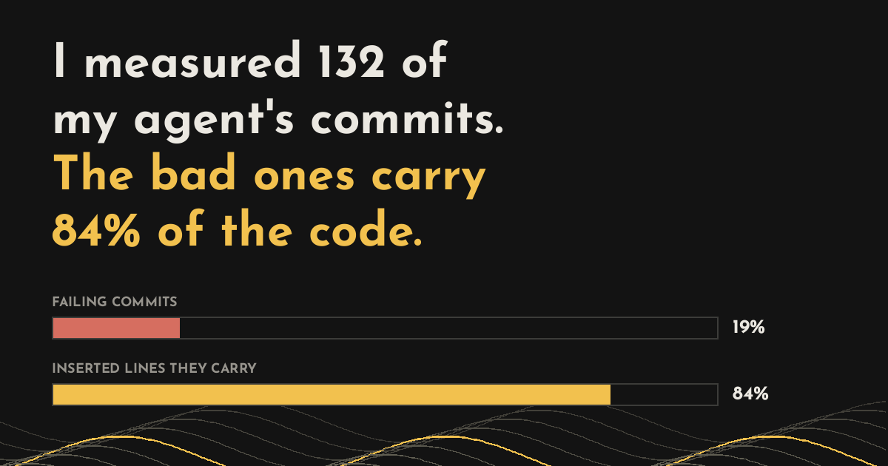
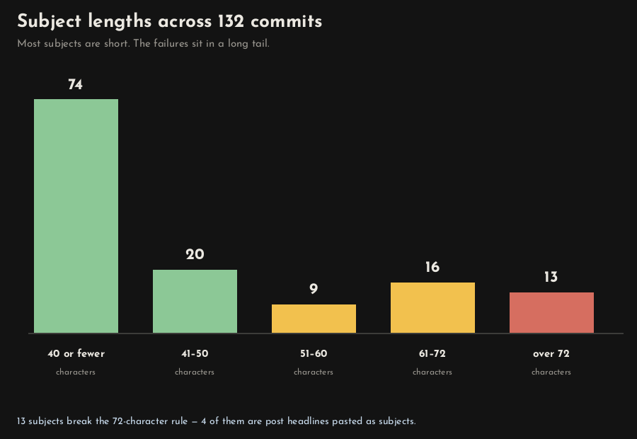
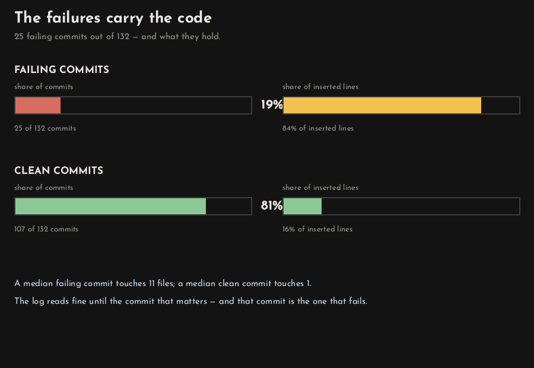

A commit message is signed with your name and stored in a public history. Your agent treats it as one more place to narrate the session — a paragraph of what it tried, a list of everything it touched, a co-author trailer, sometimes your own words quoted back at you. I have been letting an agent write most of my commits for two weeks, and I assumed the log was fine, because the recent ones looked fine. Then I measured all of them. The log is fine until the commit that matters, and that is the one nobody can review.

## The complaints are real, and they are not about taste

This is not a style preference. In a September 2026 Hacker News thread about writing with an LLM, one comment puts it flatly: "The long-ass Claude commit messages & PR descriptions suck. But they are 100% better than 'fix'." Another comment in the same thread is from a developer who already has "use conventional commit messages and to keep it nice and tight" in their `claude.md` — and reports that the agent "still dumps multi-paragraph comments of Claude speak everywhere." The instruction file does not work. Another developer, in a July 2025 thread about two weeks with Claude Code, puts the other half of the problem plainly: "I'm never sure how granular to make my commits. Sometimes I make them *very* granular because I'm experimenting with Claude and I want to be able to revert to any point in the conversation — but now I have to write a message each time to keep track of which is which."

It gets worse than long. Eva Martin's November 2026 survey of public GitHub commit messages found "Stupid claude" filling a page of commit search, and developers' angry words committed verbatim — "fix the fix, stupid f**king claude", "F**K YOU COPILOT F**K OFF STOP TRYING TO GENERATE COMMIT MESSAGES" — because an agent that records what it was told to do wants to show it was asked. One agent's instruction file, committed to a public repository, preserves a developer's rant with the note "His words, kept exact". Of 195 commit messages in her dataset, 10% contain "you" or "your" — developers talking about the tool in the record. And 13 of 244 lines (5%) are pre-emptive saves, commits made before letting the tool loose in case it wrecks the code: "saving before gemini deletes my whole codebase", "before windsurf f**ks it up".

The survey also measured what the shouting sounds like: capital letters as a share of all letters, Claude at 9.9% (68 lines) against Cursor at 4.6% (29 lines) — with the honest caveat that the widest gap is not statistically significant (p=0.11). And the leak is not only the message: a code search of public GitHub on November 3, 2026 found 15,040 SpecStory chat-history files and 5,592 Aider chat-history files sitting on public default branches — whole conversations, prompts and pasted secrets included, published by a bare `git add .`. About a quarter of the SpecStory files exceed 100 KB.

So the question is not whether agents write bad commit messages. They do, publicly, under your name. The question is whether *mine* does — and by how much.

## What I measured

I took every non-merge commit from my five agent-assisted repos — the portfolio, the skills repo, the retriever experiment, the local RAG service, and jokeGPT — from November 5 to November 18, 2026. That is 132 commits. November 5 is when the daily blog workflow began and the agent started writing most of the commits; the November 3–4 commits built the sites themselves and predate that workflow, so they are out of scope. Merge commits are excluded: they are GitHub's wording, not the agent's. Nearly all of these commits were written by my coding agent working as me, so this is a measurement of agent-written history, not of human commits.

I scored each one against five rules, the same rules the skill I built enforces:

- **R1** — subject at most 72 characters, no trailing period.
- **R2** — body at most 5 non-empty lines.
- **R3** — no co-author trailer, no "Generated with" line, no robot emoji.
- **R4** — at most 10 files, unless the commit is a pure move (under 2 insertions per file), which gets a warning instead of a fail.
- **R5** — no generated or accidental files: `dist/`, `data/generated/`, `node_modules/`, chat transcripts, `.pyc`, `.DS_Store`, logs, credentials.

The scorer is the same script the skill ships — a Python file with no
dependencies — and the numbers below are its output, not a separate
analysis. The measurement script and the full results are downloadable
with this post: `commit-craft-measure.py` and `commit-craft-results.json`.

## The result: a clean log with a rotten tail

25 of 132 commits fail at least one rule (19%). 107 are clean. By
component: 13 subjects run over 72 characters, 6 bodies run over 5
lines, 12 commits touch more than 10 files with real changes in them,
8 commits carry generated files, and there are zero co-author
trailers. The median subject is 34.5 characters; the median commit
touches 1 file and has no body at all. On the averages, this log looks
disciplined.

The averages are lying by omission. Here is the distribution of subject lengths:



And here is the finding that matters. The 25 failing commits touch 511 of 788 files (65%) and carry 89,890 of 106,935 inserted lines (84%). Failing commits touch a median of 11 files against 1 for clean commits, and their median subject is 73 characters against 30. The log reads fine until the commit that matters — the launch, the big feature, the restructure — and that is exactly the commit that breaks the rules, because that is the commit with the most to say and the most files to say it about.



The failure modes overlap, too: 8 of the 14 commits over 10 files also fail a subject or body rule. Size and sloppiness travel together. When the diff is big, the agent writes a longer subject to cover it, writes a body that lists what the diff already shows, and ships it all as one commit because splitting takes three times the messages.

## Three failure modes, with my own commits as evidence

**The headline as a subject.** 4 of the 13 over-long subjects carry a whole post headline as the subject — and a fifth is a blog-link fix ("Blog: link retriever post to retriever-doc-answer repo instead of downloads") with the same habit of writing the whole job into the subject. The worst overall is 122 characters, from the repo's first week: "Remove the draggable word: the heading and the line below it are back; keep the scroll lock until the letters have arrived" — a whole sentence, with a semicolon, as a subject. The blog-post version of the same failure is 92 characters: "Add blog post: Your agent's code looks nothing like yours. Stop writing rules. Write checks." A subject is not a title — it is the one line `git log --oneline` shows, and at 92 characters it wraps in every tool. The rewrite is 47 characters: "Blog: your agent's code needs checks, not rules". The post title still exists — in the post, and in the PR title. The same pattern produced the 91-character local-RAG launch subject and the 90-character retriever post subject. The agent copies the headline because the headline is in front of it; nobody told it the subject has a budget.

**The essay body.** 115 of 132 commits have no body at all, which is correct for most of them. The six that break the rule break it by a lot: the longest is 14 lines, and three sit at 10 lines. The 13-line body on the CI commit is a table of contents for the whole commit — five bullets: the CI pipeline, the example documents, the smoke-test script it runs, the Streamlit GUI, and a dependency pin, faster-whisper held below av 19, that has nothing to do with any of them. The commit itself should have been four commits: the CI pipeline with its smoke-test script, the example data, the GUI, and the pin. The 10-line body on the local-RAG launch lists the architecture — MVC layout, every chunker, the retrieval formula — most of which the code already shows and the README should carry. A body should hold the one thing the diff cannot: why. When it holds what the diff already says, it is narration, and narration is the agent proving it did the work.

{poster=img/split-commit-poster.png}

*Still frame: four commits, each reviewable — "CI: run lint, unit tests, and a real-model smoke test", "Add example documents for every supported file type", "Add a Streamlit client for the API", "Pin faster-whisper to av<19". The gate passes all four, because the split did the work.*

**The giant commit.** 14 commits touch more than 10 files; the largest touches 147. That one is the honest exception on size: 204 insertions across 147 files is a pure move, the blog restructure, and the checker warns on its file count instead of failing it — splitting a rename across commits would leave the tree half-moved at every step. But the commit still fails overall, because a generated build stamp (`data/generated/home-stamp.txt`) rode along with the move. The move was right; the stowaway file was not, and it is the file nobody looks at, because the diff is 147 files long. The other generated-file failures follow the same pattern, and they cluster: six of the eight are from November 5, the repo's first day, when the layout JSONs and the build stamp were committed with six different site commits, before the ignore rules existed. After that day they almost never appear again — this stamp, and one training log (`logs/experiments.log`) committed with the first jokeGPT version, are the only two later cases. Eight commits, twenty files, all build output that should never have been committed — and all of them in commits too big to read carefully.

The other 12 big commits are not moves. The 62-file local-RAG launch (3,941 insertions) is the service, the chunkers, the retrieval, and the folder sync in one commit. The 61-file jokeGPT first version is the model, the training script, the data pipeline, and the evaluation in one commit. Reverting either would revert four ideas at once, and reviewing either means reading the whole thing before forming an opinion on any part of it.

One more number, for fairness: the zero. Zero co-author trailers in 132 commits, because the standing rule on these repos is that commits are made as me, with no tool attribution — and that rule held. The rule that is enforced by setup holds; the rules that depend on the agent's judgement at write time are the ones that fail. That is the whole argument for a gate.

## The fix is a gate, not a doc

The Hacker News thread already contains the fix that does not work: "just tell the agent to use conventional commit messages." The developer who tried it says it still dumps multi-paragraph comments everywhere. Martin's survey has a `CLAUDE.md` that says it outright: "DOCUMENTATION IS NOT ENFORCEMENT — BUILD THE GATE."

So I built the gate. The skill is [commit-craft](https://github.com/d-sanoj/claude-skills/tree/main/commit-craft) in the skills repo — five rules, a checker script, and a split workflow — and the checker is the enforcement. The workflow is small enough to be a habit: stage one logical change with `git add -p`, write the message in a file (subject on line one, blank line, body only if the "why" needs it), run the checker on what is staged, and if it fails, rewrite the message or split the commit. Never `git add .`. The message file itself is never committed.


```bash
python3 scripts/check-commit.py --staged --message-file msg.txt
git commit -F msg.txt
```

{poster=img/checker-run-poster.png}

*Still frame: the whole history, scored by the same checker — 25 fail, 107 clean, 0 warn-only. The gate runs before the commit lands, not after.*

The checker enforces what can be checked — subject length, body lines, trailers, file count with the rename exception, generated paths — and it says plainly what it cannot: whether the subject is imperative, whether the body explains the "why", whether two concerns are hiding in ten files. That part is still the author's job, and the skill's test is the revert test: could someone revert this commit without losing an unrelated change? If not, split it.

The skill's own tests run the checker against the real messages from this measurement: the 92-character subject fails, the 47-character rewrite passes, the 62-file import fails, and the 147-file restructure warns on R4 but still fails R5 on its stowaway stamp file. All 30 tests pass.

## What this does not prove

Three limits, stated plainly. First, this sample is biased toward good behavior: the agent writing these commits already writes tight subjects most of the time, with a median of 34.5 characters, because the repos' conventions push it that way. A log written by an agent with no conventions would fail more than 19% — the Hacker News thread and the Hapax survey suggest much more. So 19% is a floor measured on a good log, not a typical rate, and the concentration finding is the durable part: whatever your failure rate is, the failures will sit in the commits carrying the most code.

Second, the checker measures shape, not quality. A 40-character subject can still be wrong ("Fix stuff"), and a 10-file commit can still mix two concerns that happen to live in the same directory. The numbers say the log is shaped right 81% of the time; they say nothing about whether the subjects describe the change accurately. That needs a human reading the diff, which is rule five.

Third, the "one logical change" rule has a real cost: splitting the local-RAG launch into four commits takes four messages, four checker runs, and four chances to get the order wrong. For a change you will never revisit, that cost buys nothing. The skill's answer is that you cannot know in advance which changes you will revisit — the launch commit is the one you revisit most — so the default is to split, and the exception is the pure move.

## Try it on your own history

The fastest way to see whether this is your problem too is to run the checker over your own log. Copy the skill folder into `~/.claude/skills/`, then score your last month:

```bash
git log --no-merges --since="2026-10-19" --pretty=format:%H | while read sha; do
  python3 ~/.claude/skills/commit-craft/scripts/check-commit.py --ref "$sha"
done | grep -c FAIL
```

That counts the failures. Read the failing subjects yourself — that is the part no script can do for you. If the failures cluster in your biggest commits the way mine do, the fix is not a better instruction file. It is the gate, run before the commit lands, every time. The commit message is the one thing about your agent's work that is public, permanent, and signed with your name. It is worth the thirty seconds.

## Sources

- Eva Martin, ["I WILL HAVE YOU ULTRATHINK ON WHAT A BAD CLAUDE YOU WERE"](https://hapax.fi/note-what-leaks.html), Hapax, November 2026. Survey of public GitHub commit messages found by searching for angry phrases about AI coding tools, October 27–November 3, 2026: "Stupid claude" filling a page of commit search; 10% of 195 commit messages containing "you" or "your"; 13 of 244 lines (5%) pre-emptive saves; shouting index Claude 9.9% (68 lines) vs Cursor 4.6% (29 lines), widest gap not significant (p=0.11); 15,040 SpecStory and 5,592 Aider chat-history files on public default branches (code search, November 3, 2026).
- Hacker News comment, September 2026, in the thread ["How to Write with an LLM"](https://news.ycombinator.com/item?id=49761858): "The long-ass Claude commit messages & PR descriptions suck. But they are 100% better than 'fix'." Another comment in the same thread ([September 20, 2026](https://news.ycombinator.com/item?id=49777755)) reports that the agent "still dumps multi-paragraph comments of Claude speak everywhere" with "use conventional commit messages and keep it nice and tight" already in `claude.md`.
- Hacker News comment, July 2025, in the thread ["My experience with Claude Code after two weeks of adventures"](https://news.ycombinator.com/item?id=44605742): "I'm never sure how granular to make my commits" — the granularity dilemma.
- [Conventional Commits](https://www.conventionalcommits.org/), the short-imperative-subject convention the skill's rules follow in shape.
- The measurement: `commit-craft-measure.py` and `commit-craft-results.json`, downloadable with this post. 132 non-merge commits, November 5–18, 2026, from `sine-portfolio` (56), `claude-skills` (54), `retriever-doc-answer` (13), `local-rag` (3), and `jokeGPT` (6). Scored by `check-commit.py` from the [commit-craft skill](https://github.com/d-sanoj/claude-skills/tree/main/commit-craft).
