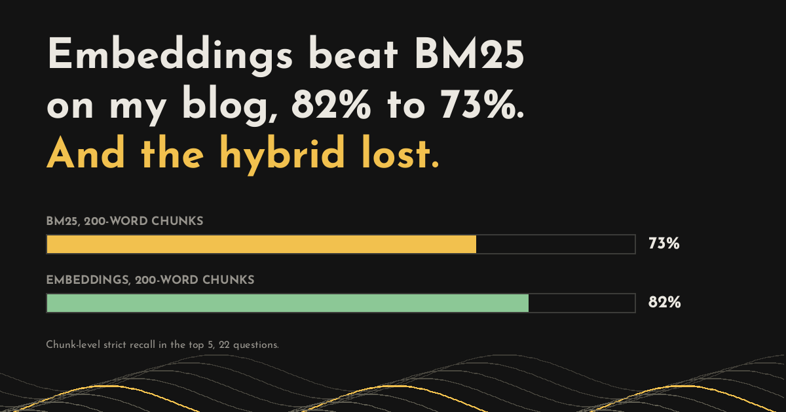
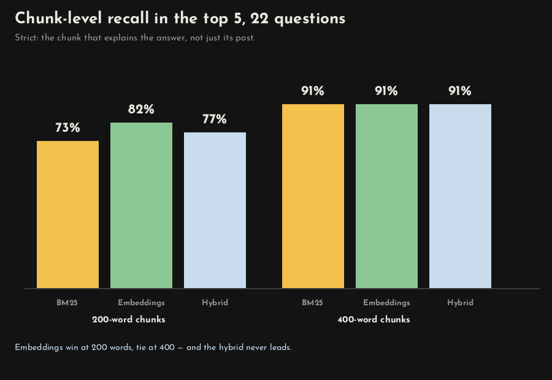
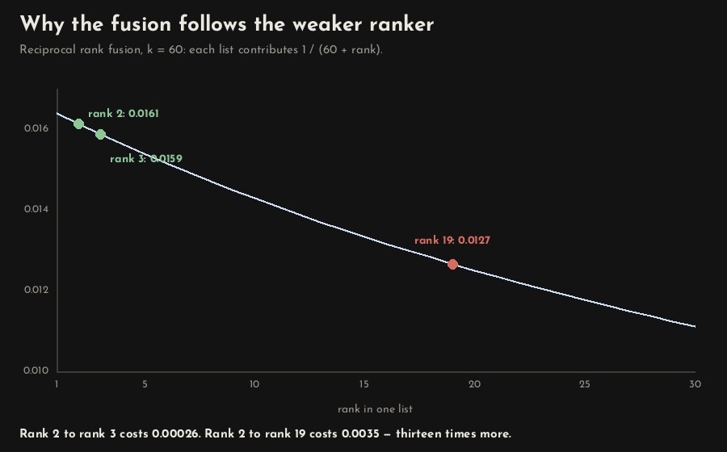
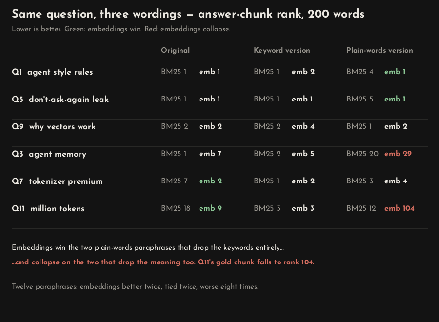

Four days ago I ended a post with a sentence I had not earned: "Embeddings fix the synonym failures and introduce their own." I wrote that embeddings would change the rewording results "probably for the better," and then I did not test it — no embedding model was available in that run. The model is available now, so this post is the receipt: same 22 questions, same corpus, same strict grading, three rankers. Embeddings win. The hybrid loses. And the rewording result is not what I predicted.

## What I ran

The setup is the same one from the [first retrieval post](/blog/retriever-finds-the-document-not-the-answer/): 22 questions a real reader would ask, each labeled with the post that answers it and the terms the answering passage must contain. A chunk counts only if it comes from the right post and contains at least two of those terms — the strict rule, because a chunk that mentions the topic without explaining it is exactly what a model turns into a confident wrong answer. The corpus has grown by one post since the [chunking post](/blog/chunk-by-section-not-by-word-count/), so it is now 16 posts and 44,153 words, and the two posts that quote the questions are excluded as before.

The model is `sentence-transformers/all-MiniLM-L6-v2`: a 6-layer MiniLM that maps a sentence or short paragraph to a 384-dimensional vector, trained with a contrastive objective on more than 1.17 billion sentence pairs. It has 22.7 million parameters, the download is about 90 MB, and the model card says inputs longer than 256 word pieces are truncated — remember that number, it matters below. The three rankers are BM25 (k1 1.5, b 0.75, implemented from scratch, same code as the first post), embeddings (cosine similarity on the MiniLM vectors), and hybrid (reciprocal rank fusion of the two lists, k = 60, the default from the 2009 paper). Chunk sizes are 200 and 400 words, same as before. The script, the questions, and the full results are in the [retriever repo](https://github.com/d-sanoj/retriever-doc-answer/tree/experiment/embeddings-vs-bm25/data/embeddings).

One check before the numbers: I re-ran BM25 as the baseline, and it reproduces the Nov 18 fixed-200 result — 73% strict recall@5 at 200 words, 16 of 22, the same six misses (Q6, Q7, Q8, Q11, Q19, Q20). Five per-question ranks shifted by one after the corpus grew by a post (Q6 12→13, Q7 8→7, Q10 4→5, Q20 22→23, Q21 4→3), so the aggregate is stable while the individual ranks are not frozen. The comparison is apples to apples at the level that matters.

## The headline: 82% vs 73%, and a tie at 400 words

Chunk-level strict recall@5 — the answering passage in the top five:

| Chunk size | BM25 | Embeddings | Hybrid (RRF) |
| --- | --- | --- | --- |
| 200 words | 73% (16/22) | **82% (18/22)** | 77% (17/22) |
| 400 words | 91% (20/22) | 91% (20/22) | 91% (20/22) |

At the post level, embeddings are perfect: 22 of 22 at both chunk sizes, the right post ranked first for all 22. BM25 gets 21 of 22 at 200 words. And the average rank of the answer chunk (MRR) at 200 words is 0.748 for embeddings against 0.635 for BM25 — embeddings don't just find two more answers, they rank them higher.

So the short version: embeddings close about a third of the gap BM25 leaves at 200 words — two of its six misses — and at 400 words they tie. But read the table again before you conclude "embeddings win." The best number measured so far is still 91% — the chunking post reached it with plain BM25 and section chunks, at a median of 236 words per chunk, on the 15-post corpus; it has not been re-measured on this 16-post corpus. The combination — embeddings over section chunks — is the obvious next measurement, and I have not run it yet. Quote 82% at 200 words and 91% at 400 — and remember the 400-word number comes with a catch, below.

## What embeddings fix

The wins are exactly the synonym failures BM25 was built to lose. Three questions move from outside the top five to rank 1, and a fourth climbs from rank 5:

- **Q6, the nerf-watch question, BM25 rank 13 → embeddings rank 1.** "How can I tell if my model got worse after an update? Is there a way to measure it?" The answer chunk is about a "frozen regression suite" — the question shares almost no words with it. BM25 needs shared words; the embedding needs shared meaning.
- **Q8, weight-space editing, 9 → 1.** "What does it mean to edit a model's weights directly, without retraining?" The answer never uses the question's phrasing.
- **Q19, token costs across languages, 6 → 1.** The question contains none of the answer's words: Amharic, Devanagari, UDHR Article 1.
- **Q10, how a model learns, 5 → 1.** The question asks about "learn"; the post says "learning" and "learned" — and with no stemming, BM25 matches exactly or not at all.

Two more improve without clearing the bar: Q7 7 → 2, Q20 23 → 10, Q11 18 → 9. That is the whole case for dense retrieval, and on my corpus it is real.

## What embeddings break

Embeddings lose two questions BM25 had, both about the claude-mem post: Q3 goes 1 → 7, Q18 goes 3 → 9. For both, the top chunk is an early paragraph of the post's intro — "OpenCode, and eleven other agents — a memory that survives between sessions." It is semantically close to every question about agent memory, so it tops both lists — but it holds at most one answer term (none for Q3, one, "watches", for Q18), so the strict rule counts it a miss, and the chunk that holds them sits at rank 7 and 9.

Two things are true at once. First, the ruler favors BM25: the strict rule demands literal answer terms, and a ranker that matches literal terms will always look better under it than one that matches meaning. A human reading embeddings' top chunk for Q3 would call it "the right post, the wrong paragraph" — BM25's failure shape from the first post, one level up. Second, the failure is real: embeddings love generic intro chunks. The same paragraph tops two questions, and for Q11 the ERNIE intro tops the list at cosine 0.690 while the explaining chunk sits 9th. An intro summarizes the whole post, so it is a little similar to everything the post is about — and that beats "very similar to one passage" when the query is short.

Q11 and Q20 still miss for embeddings at 200 words (ranks 9 and 10), and Q20 gets *worse* at 400 words — its two gold chunks rank 19th and 67th for embeddings, while BM25 puts one first. That reversal has a mechanism, and it is the 256-word-piece limit from the setup. I tokenized Q20's two gold chunks: in the worse one, both answer terms sit past token 256 ("rent" at 449, "moving target" at 451, of 535) — the embedding is built without either. In the better one, "benchmark" sits at token 386, past the cutoff, while "rent" and "moving target" are visible — and it still ranks 19th, behind eight other chunks from the same post. The embedding is built from the first half of each 400-word chunk, and the words that make a chunk the answer are spread across the whole 400. BM25 sees all of it. I measured the token lengths: 70% of my 200-word chunks already exceed 256 word pieces (median 265), and 100% of the 400-word chunks do (median 532). So the 400-word tie is not "embeddings catch up at 400 words" — it is "embeddings are blind to the second half of every 400-word chunk, and still tie." Chunk to fit the model, or use a model with a longer window: the chunk size and the model's limit are one decision, not two.

## The hybrid lost — and I can show you why

This is the result I did not expect. Hybrid search — BM25 plus embeddings, fused with reciprocal rank fusion — is the default advice in every retrieval guide, and the 2009 paper it comes from reports that fusion beats the best individual system. On my corpus it does the opposite: 77% against embeddings' 82% at 200 words, and it breaks two questions embeddings had at rank 1. Q8 and Q10 both go from embeddings rank 1 to hybrid rank 6.

The mechanism is in the formula. RRF scores a chunk as 1/(60 + rank) from each list and adds them. With k = 60, the curve is nearly flat at the top: the gap between rank 2 and rank 3 in one list is 1/62 − 1/63, about 0.00026. The gap between rank 2 and rank 19 in the other list is 1/62 − 1/79, about 0.0035 — thirteen times bigger. So when the two rankers disagree, the fusion follows whichever ranker has the bigger spread in its ranks — and here that is BM25, the weaker ranker.

Take Q8. The chunk embeddings rank 2nd — "You can download the edited model and try it yourself" — sits at BM25 rank 19. Its fused score is 1/62 + 1/79 = 0.0288, good for 6th. The chunk that wins the fusion is ranked 2nd by BM25 and 3rd by embeddings: 1/62 + 1/63 = 0.0320. And the chunk embeddings rank 1st is at BM25 rank 31, so its fused score is 1/61 + 1/91 = 0.0274 — 9th. Q10 is the same shape: embeddings' rank-1 chunk is at BM25 rank 39, fused 9th; the hybrid's first gold chunk is 6th.

{poster=img/rrf-fusion-poster.png}

*Still frame: the hybrid top six — the chunk embeddings rank 2nd is 6th, behind five chunks that are merely decent in both lists. The fusion rewards being decent twice more than being best once.*

One subtlety: k = 60 was picked in a pilot that fused *thirty* configurations of one search engine, not two different rankers, and the paper's own table shows the choice barely mattered there. In a two-ranker hybrid it matters a lot, because the flat curve lets the worse ranker's mediocre ranks swamp the better ranker's confident ones. I have not tested a smaller k or a score-based fusion — that is the next measurement, not a recommendation. The recommendation is narrower: do not fuse with the default and assume it helped. Measure the fusion against each ranker alone. Mine lost.

## Rewording: better where it matters, worse where it's vague

The first post guessed embeddings would improve the rewording results "probably for the better." Half right: I re-ran the same six questions in two paraphrases each — keyword-dense and plain-words — and compared answer-chunk ranks at 200 words:

| Question | Original (BM25 / emb) | Keyword version | Plain-words version |
| --- | --- | --- | --- |
| Q1, agent style rules | 1 / 1 | 1 / 2 | 4 / **1** |
| Q5, don't-ask-again leak | 1 / 1 | 1 / 1 | 5 / **1** |
| Q9, why vectors work | 2 / 2 | 2 / 4 | 1 / 2 |
| Q3, agent memory | 1 / 7 | 2 / 5 | 20 / 29 |
| Q7, tokenizer premium | 7 / 2 | 1 / 2 | 3 / 4 |
| Q11, million tokens | 18 / 9 | 3 / 3 | 12 / **104** |

Across the twelve paraphrases, embeddings beat BM25 twice, tie twice, and lose eight times — but the two wins are the ones that matter. Q1's plain-words version ("My AI helper writes code that doesn't match how our team writes") and Q5's ("I told Claude Code to stop asking for approval and now I'm worried my credentials leaked") both drop the question's keywords entirely, and BM25 falls to ranks 4 and 5 while embeddings hold rank 1. That is the synonym case, and embeddings handle it exactly as advertised.

{poster=img/paraphrase-poster.png}

*Still frame: the plain-words version — BM25 rank 12, embeddings rank 104. No million, no tokens, no Ernie, no gist — nothing left to match.*

The eight losses split in two. Six are small — rank 1 to 2, 2 to 4 — the paraphrase kept keyword-like words and BM25 was already good. Two are catastrophic, and they share a cause. Q11's plain-words version is "What breaks when you paste a whole book into a chatbot?" — it contains none of the answer's anchors: no "million," no "tokens," no "Ernie," no "gist." BM25 ranks the gold chunk 12th; embeddings rank it 104th. Q3's is "Can an AI coding helper remember what we did yesterday?" — BM25 20th, embeddings 29th, and the word "yesterday" pulls two news posts into BM25's top five — "Yesterday morning, Alibaba opened…" at rank 2 and "Yesterday, Thinking Machines Lab released…" at rank 4 — while the memory post's answer chunk sits at rank 20. The word matches the news, not the memory post.

The mechanism for the collapse is the mirror image of the win. An embedding ranks by overall semantic closeness, so a vague paraphrase — a generic question about a generic situation — is a little bit close to every generic chunk, and the specific passage drowns. BM25 at least keeps the few exact words the paraphrase retained. So the honest version of the first post's guess is: embeddings fix the paraphrases that keep the meaning and drop the keywords, and they make the paraphrases that drop the meaning worse — sometimes catastrophically. Two more paraphrases keep their distinctive words and still lose by a rank (Q7: 3→4, Q9: 1→2), so the losses are not all about dropped meaning. If your users ask in plain words, the vague case is the one to design against — and the fix is not a better ranker, it is asking what the user means, or keeping the exact-match ranker around for the words they did use.

## What it costs

The bill: a one-time 90 MB download, about 2 seconds to load, about 42 seconds to encode 281 chunks on this machine's CPU (~150 ms per chunk), an index of 281 × 384 floats (about 430 KB), and about 41 ms per query through all three rankers. BM25 costs none of that. The price of embeddings is paid once, at index time, and it is small. The price that matters is the one above: the failure modes.

## What to do with this

1. **If you have one ranker to pick, pick embeddings — at 200-word chunks.** 82% against 73% on the strict number, perfect at the post level. But chunk to fit the model: keep chunks under ~250 word pieces, or the embedding never sees the second half.
2. **Keep BM25 for exact tokens.** Names, version numbers, error strings, code identifiers — embeddings discard them, BM25 catches them instantly. Q3 and Q18 are the receipt.
3. **Do not fuse with the default and assume it helped.** RRF with k = 60 lost to pure embeddings here, because the flat curve lets the weaker ranker decide. If you fuse, measure the fusion against each ranker alone — and try a smaller k or a score-based fusion as a measurement, not a guess.
4. **Measure rewordings, not just originals.** I wrote the originals knowing the answers, so they flatter every ranker. The paraphrases are where the differences show up — including the catastrophic ones.
5. **Section chunking still holds the best number measured so far.** 91% with BM25 and sections on the 15-post corpus, at about 60% of the words of the 400-word windows. The measurement I have not run is embeddings over section chunks. That is next.

## What this doesn't prove

Twenty-two questions is small enough that one question is four and a half points — read 82% against 73% as a two-question difference, not a law of nature. The corpus is sixteen posts by one author on distinct topics, with no near-duplicates to confuse the ranking, and the questions are mine, written by the same person who wrote the posts, which almost certainly flatters every number here. The strict rule is a judgment call: it demands literal answer terms, which favors BM25. The loose version would score at least as high by construction, but I did not run it, so I won't claim a number. And the hybrid result is about RRF with k = 60 fusing these two rankers on this corpus — not a verdict on hybrid search in general. The next run is embeddings over section chunks, and a smaller k for the fusion. If those change the story, I will write that too.

## Sources

- All retrieval numbers are from `measure-embeddings.py`, run on this blog's sixteen posts on 2026-11-20 (44,153 words; BM25 k1 1.5, b 0.75; embeddings all-MiniLM-L6-v2, cosine; hybrid RRF k = 60). Full script, questions, and results: [retriever-doc-answer, data/embeddings](https://github.com/d-sanoj/retriever-doc-answer/tree/experiment/embeddings-vs-bm25/data/embeddings).
- Sentence Transformers, [all-MiniLM-L6-v2 model card](https://huggingface.co/sentence-transformers/all-MiniLM-L6-v2) — 384-dimensional vectors, fine-tuned on 1,170,060,424 sentence pairs, inputs longer than 256 word pieces truncated.
- Sentence Transformers, [pretrained models](https://www.sbert.net/docs/pretrained_models.html) — all-MiniLM-L6-v2 is 5 times faster than all-mpnet-base-v2.
- Cormack, Clarke, and Büttcher, ["Reciprocal Rank Fusion Outperforms Condorcet and Individual Rank Learning Methods"](https://plg.uwaterloo.ca/~gvcormac/cormacksigir09-rrf.pdf) (SIGIR 2009) — k = 60 from a pilot fusing 30 systems; fusion beat the best individual system by 4–5% on average.
- My earlier posts: [Why embeddings make search work](/blog/why-embeddings-make-search-work/), [Your retriever finds the right document. It doesn't always find the answer.](/blog/retriever-finds-the-document-not-the-answer/), [I chunked my blog by section. Retrieval jumped from 73% to 91%.](/blog/chunk-by-section-not-by-word-count/).
