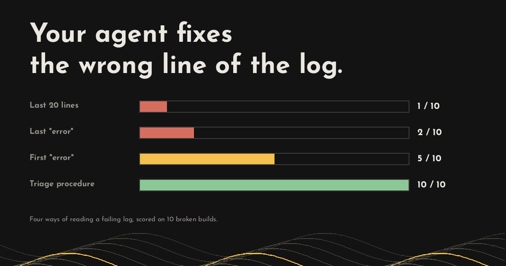
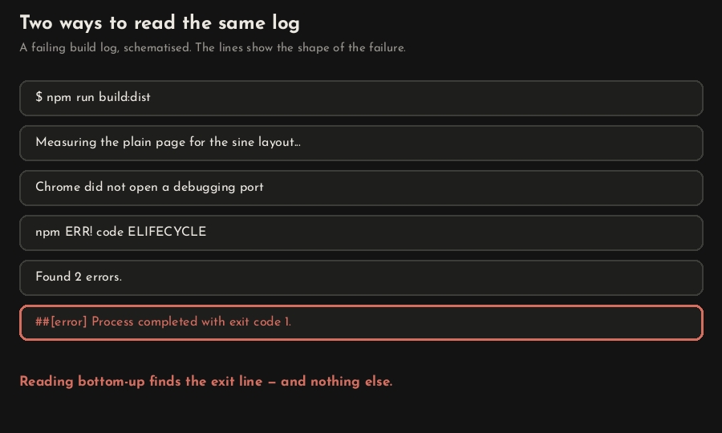
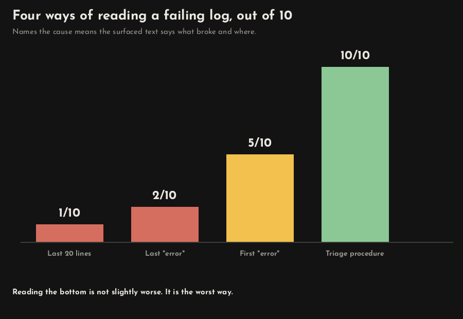
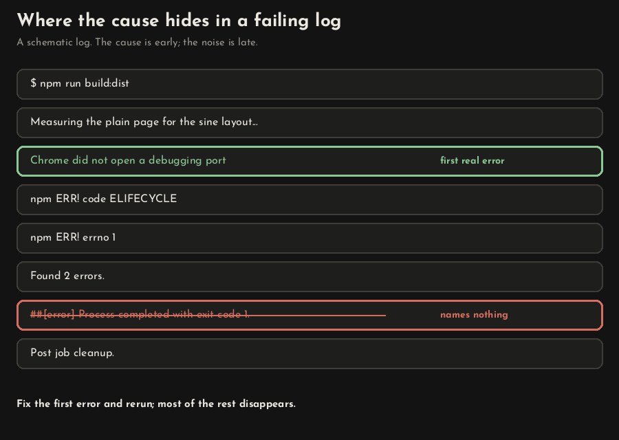
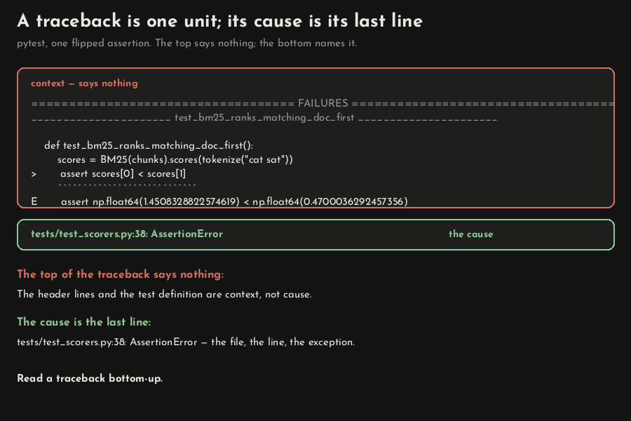
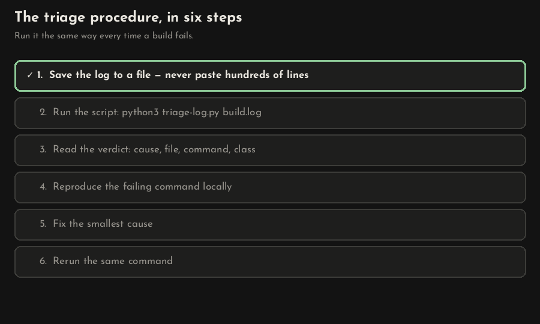

On November 17, the CI run for my site failed. The log was 185 lines long. I opened it, and the only line in the whole file containing the word "error" was this one:

```text
##[error]Process completed with exit code 1.
```

That line says the build step died. It does not say why. The actual cause was one line above it, in a sentence that contains no alarming word at all:

```text
Chrome did not open a debugging port
```

Every earlier step had passed — checkout, install, the blog check. The post content was fine; Chrome simply never started. The failure was environmental in character — a flaky launcher, not a bug in the change — and the fix, [PR #29 later that day](https://github.com/d-sanoj/sine-portfolio/pull/29), hardened the launcher itself: install Chrome for Testing, let Chrome pick the debug port, wait up to 60 seconds, retry up to three times. But an agent reading that log the way agents read logs — scroll to the bottom, take the last line — would have gone looking for a bug in the build script that did not exist.

I have been letting an agent read my failing builds for two weeks, and I assumed it was fine, because the failures it handled looked handled. Then I measured how it reads. It does not read. It guesses from the bottom of the file.

## What I measured

I collected 10 broken builds from my own repos and scored four ways of reading each one. A way of reading "names the cause" only if what it surfaces identifies both what broke and where — the error and the file:line, not one without the other. Ground truth is the root cause as established by the fix that actually resolved each failure.

The corpus is 975 lines. Four logs are verbatim GitHub Actions downloads. Six are reproductions: the real tool run on a real repo copy with a real defect introduced — the same defect class that actually failed in these repos before. The mypy case is the exact error that failed my LearnLLM capstone twice. Nothing was edited in the real repos, and the script that built the corpus ships with this post.

| Log | What failed | True cause |
|---|---|---|
| 1. Chrome port | CI build step | Chrome never opened a debugging port — environment |
| 2–4. Missing cover, ×3 | CI blog check, Nov 18/19/20 | `cover.png` did not exist at the intermediate commit — config |
| 5. mypy stubs | LearnLLM capstone-ci | `Library stubs not installed for "yaml"` — config |
| 6. pytest traceback | One flipped assertion | `test_scorers.py:38: AssertionError` — defect |
| 7. ruff | Lint violations | `F401` unused import at `messy.py:2` — defect |
| 8. node syntax | Build script | `SyntaxError` in `scripts/build.js:13` — defect |
| 9. npm lockfile | `npm ci` | Lockfile disagrees with the manifest on esbuild — config |
| 10. pytest cascade | One bad import | `ModuleNotFoundError` in `conftest.py:1`, failing every test — defect |

The four ways of reading:

- **Last 20 lines** — read the last screenful, take the last line matching `error` or `fail`. This is what "scroll to the bottom" actually does.
- **First "error"** — `grep -i error`, first hit. The obvious one-liner.
- **Last "error"** — `grep -i error`, last hit. What you get when you grep and then look at the end.
- **The triage procedure** — the skill I built: first real error, traceback as one unit, summaries ignored, repeats collapsed. Described below.

## The result

| Way of reading | Correct |
|---|---|
| Last 20 lines | **1 / 10** |
| Last line containing "error" | **2 / 10** |
| First line containing "error" | **5 / 10** |
| **The triage procedure** | **10 / 10** |

Reading the bottom is not slightly worse. It is the worst way to read a log. And the last "error" is worse than the first, because the last line containing the word "error" is usually the generic exit line or a summary — the eulogy, not the diagnosis.

{poster=img/bottom-up-poster.png}

*Two ways to read the same log. Bottom-up finds the exit line; first-error-first finds the cause. The lesson does not depend on the animation.*



:::describe
Four vertical bars, one per way of reading, out of 10 logs. Last 20 lines: 1. Last line containing "error": 2. First line containing "error": 5. The triage procedure: 10, the only full bar.
:::

## Why the obvious ways fail

Each naive method has a characteristic failure, and each one shows up in the corpus.

**The last line is the eulogy.** In the Chrome log, the last 20 lines and the last "error" both surface the same line: `##[error]Process completed with exit code 1.` It names nothing. The same thing happens in the three missing-cover logs — the generic exit line is the last error-looking line, so bottom-up reading fails all three, even though the real cause (`BlogError: ... image "img/cover.png" was not found`) is right there in the middle of the file. The exit line exists to tell the runner the process died. It was never meant to tell you why.

**Summaries name nothing.** The ruff log ends with `Found 2 errors.` The mypy log ends with `Found 1 error in 1 file (checked 1 source file)`. Both are counts, not causes — they say how many, not which. Grep-first, grep-last, and the last 20 lines all surface the summary in the ruff log, because the two actual violations (`F401` at `messy.py:2:8`, `F821` at `messy.py:6:22`) never contain the word "error". A count is not a diagnosis. Neither is a pointer to a debug log: the npm log's last "error" line is `npm error A complete log of this run can be found in: /home/hatch/.npm/_logs/...` — a pointer to a different file, not an answer.

**Grep matches code, not just diagnostics.** The npm log's first "error" is `npm error code EUSAGE` — a bare code that says the install was refused but not which package or why. The real cause is four lines down: `npm error Invalid: lock file's esbuild@99.99.99 does not satisfy esbuild@0.24.2`, one of 25 lines of the same pattern in a 49-line log. Grep-first stops at the code. And in the pytest cascade log, the first "error" is `ImportError while loading conftest '...'` — it names the file but not the missing module. The cause, `ModuleNotFoundError: No module named '_missing_dep_xyz'`, is four lines later.

**The first "error" can be noise, too.** My first version of the triage script picked `npm cache is not found` as the Chrome log's cause — a status line from the Node setup step, not an error at all. It matched "not found" and nothing else. I had to teach the script that "not found" only counts when it comes with a path or an error marker (`was not found at ...`, `No such file`), because plain English is full of "not found" that means nothing. The same trap is everywhere in real logs: a passing test named `test_handles_error`, a fixture description that mentions a failure case, a deprecation warning. A word match is not a diagnosis.



:::describe
Eight rows of a schematic log. Row 1 runs the build command, row 2 measures the page. Row 3, highlighted green, reads "Chrome did not open a debugging port" and is labelled "first real error". Rows 4 to 6 are grey cascade: an npm error code, an npm error number, "Found 2 errors." Row 7, outlined red and struck through, is the generic exit line, labelled "names nothing". Row 8 is post-job cleanup. The cause sits near the top; the noise sits at the bottom.
:::

## The procedure

The skill is called `log-triage`, and it is the eighth skill in [d-sanoj/claude-skills](https://github.com/d-sanoj/claude-skills/tree/main/log-triage). It has six rules, and a script that does the mechanical part deterministically — Python, no packages, no network:

```bash
python3 scripts/triage-log.py build.log
```

```text
ROOT CAUSE: Chrome did not open a debugging port
STEP:       Build
COMMAND:    node scripts/build.js --dist
CLASS:      environment
NEXT:       rerun first: if it passes, it was the environment, not your change.
```

**R1 — The first real error is the cause; everything after it is cascade.** Failures compound: one broken import fails every test, one missing file fails two checks, one bad version prints 25 lines of the same pattern. Fix the first one and rerun; most of the rest disappears. Never fix the last error first.

**R2 — A traceback is one unit; its cause is its last line.** `Traceback (most recent call last):` says nothing. The exception is at the bottom. In the pytest log, the cause is `tests/test_scorers.py:38: AssertionError` — the last line of the traceback, not the `def test_...` lines above it and not the `E assert ...` line in the middle. Read a traceback bottom-up.



**R3 — Summaries are not causes.** `Found 2 errors.`, `Process completed with exit code 1.`, `npm error Usage: ...`, the debug-log pointer — skip them all, along with warning noise and passing lines that happen to contain the word "error". If a line does not say what broke and where, it is not the cause.

**R4 — If a step has no error line, the cause is the step's last substantive line.** The Chrome log has no error line at all — one line in 185 contains the word "error", and it is the generic exit. So the script takes the last substantive line of the failing step, just above the exit-code line: the process's last words before it died. Everything after the exit line is post-job cleanup and belongs to a different step; the script stops there.

**R5 — Collapse repeats, then count once.** Twenty-five lines of the same pattern are one failure. The script reports the repeat count — the missing-cover error appears twice in its log, printed once by each of the two checks it breaks — and then moves on. If the same error repeats with different file names, it is one broken thing failing everywhere it is used. Fix the one thing.

**R6 — Name the failing command, then reproduce it locally before fixing.** The verdict's command line is the command to run. Run it yourself and watch it fail the same way. If it passes locally, the failure is a difference between the two environments — tool versions, environment variables, caches, file ordering — and changing code will not fix it.

Then classify before fixing. **Defect** means the code is wrong: reproduce, fix the smallest cause, rerun. **Config** means the setup is wrong: fix the config or dependency, do not touch the code. **Environment** means the machine is wrong: rerun first, and if it passes, it was the environment, not your change.

{poster=img/triage-steps-poster.png}

*The procedure in six steps: save the log, run the script, read the verdict, reproduce the command, fix the smallest cause, rerun. The lesson does not depend on the animation.*

## The one the script gets wrong

The script's classification guess was right in 9 of 10. The miss is instructive. In the pytest cascade log, the cause is a bad import — `import _missing_dep_xyz` at the top of `conftest.py` — and the script classifies it as **config**, because its rule says "no module named" means a missing dependency. But the module does not exist at all: it is a typo, a defect, not a package to install. No keyword rule can tell a typo from a missing package. The script names the cause correctly in all 10; its classification is a guess to verify, and the skill says so. Reproduce first, then decide what kind of fix it is. A keyword is not a verdict.

## What this does not do

One log cannot prove flakiness. Flaky means "passes on rerun" — a failure that passes on rerun is environment or flake, a failure that repeats is a defect or config, and you cannot tell which from a single run. Do not declare a failure flaky from one log, and never fix a failure by deleting a test, skipping it, or marking it expected-to-fail. That makes the log green and the bug permanent.

A truncated log may not contain the cause at all. If the script reports no error line, get the full log before guessing — the cause might be in the part that was cut.

And the script does not know your project's error formats. It recognises pytest, mypy, ruff, npm, node, and GitHub Actions logs. A project-specific format needs its own pattern, added to the script's pattern lists with a test. The skill's tests cover every rule with fixture logs; the measurement corpus is the harder test, and it ships with this post.

## The skill, and the measurement

`log-triage` is in [d-sanoj/claude-skills](https://github.com/d-sanoj/claude-skills/tree/main/log-triage): `SKILL.md` with the full procedure, `scripts/triage-log.py`, fixture tests, and a before/after worked from the Chrome log. Install it by copying the folder into `~/.claude/skills/`.

The measurement ships with this post: `measure-logs.py`, `results.json`, `corpus-manifest.json` (every log's source and ground truth), `build-corpus.sh` (how the reproductions were made), `triage-log.py` itself, and the ten logs, `log-01-chrome-port.txt` through `log-10-pytest-cascade.txt`. Run the measurement yourself; it takes under a second.

The complaint this skill answers is not new. A guide to pasting massive logs into Claude puts it flatly: "If you cannot quickly find the failure yourself, you have a bigger problem than context size — you don't know what you're looking for, and the model won't either." A prompt for fixing failing builds tells the agent to quote "the first real error, not the last line printed." Both are right, and both are advice. This skill is the advice as a gate: save the log, run the script, read the verdict, reproduce the command, and only then fix. The first error is the cause. The last line is the eulogy.

## Sources

- The corpus and measurement: `measure-logs.py`, `results.json`, `corpus-manifest.json`, `build-corpus.sh`, and `log-01-chrome-port.txt` through `log-10-pytest-cascade.txt`, downloadable with this post. CI logs downloaded with `gh run view --log` (runs 44135960638, 44315594718, 44542602124, 44749632166).
- The skill: [`log-triage`](https://github.com/d-sanoj/claude-skills/tree/main/log-triage) in `d-sanoj/claude-skills` — `SKILL.md`, `scripts/triage-log.py`, `tests/run_skill_tests.py`, `examples/before-after.md`.
- [How do I deal with massive logs in chat?](https://www.vibecodinghowto.com/article/qa-context-blowup) (Vibe Coding How-To) — "If you cannot quickly find the failure yourself, you have a bigger problem than context size."
- [Best Claude Code Prompt for a Failing Build](https://www.prompthackers.co/prompts/ci-failure-fixer) (Prompt Hackers) — "quoting the first real error, not the last line printed."
- The LearnLLM capstone-ci failure: mypy `Library stubs not installed for "yaml"`, failing deterministically in capstone-ci, fixed by adding `types-PyYAML` to the dev extras.
