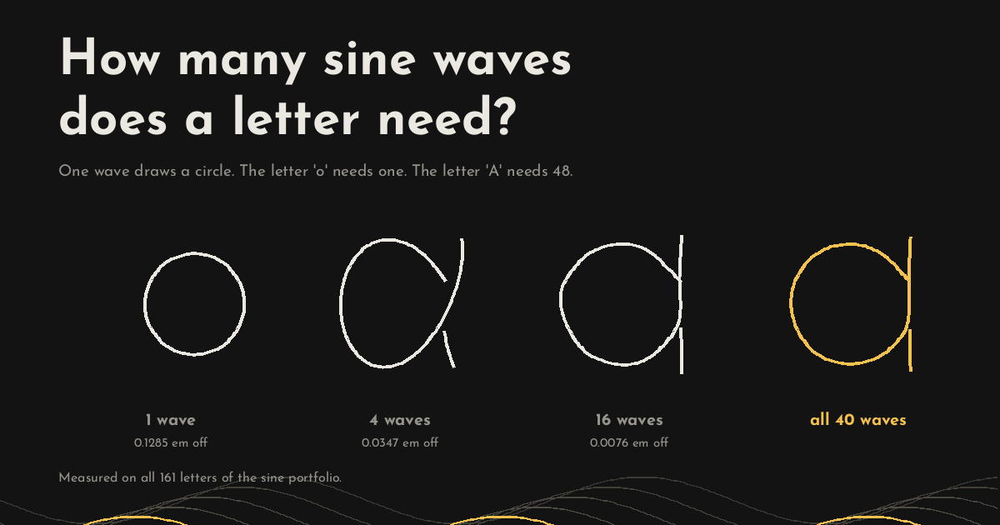
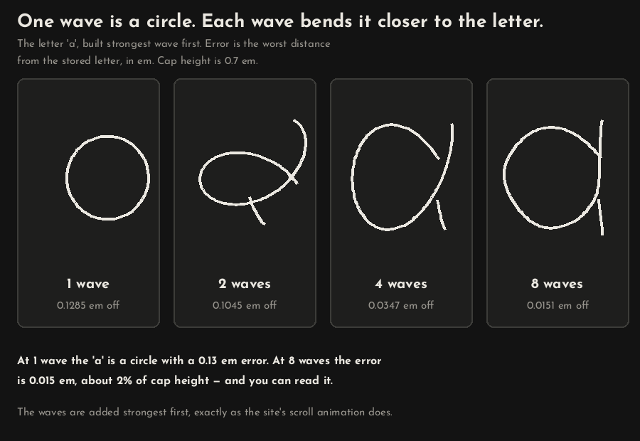
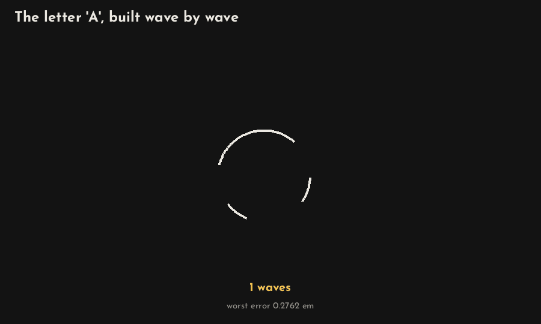
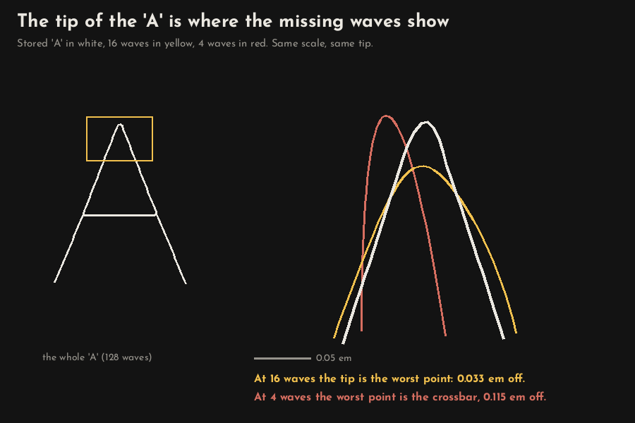
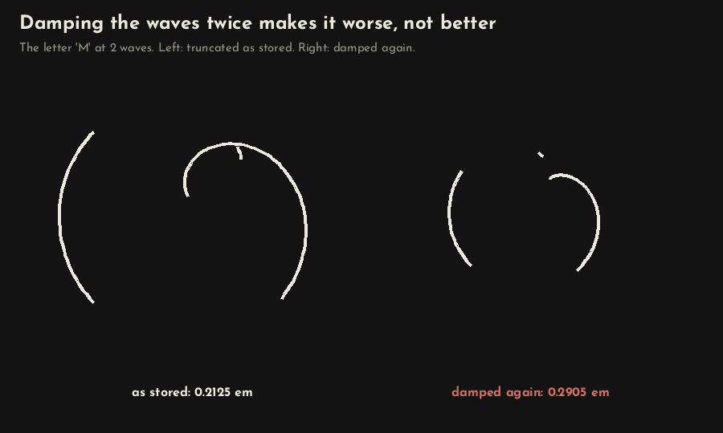

Scroll this site and every letter grows out of a circle. That is not a loading effect pasted on top of the text — it is the text. Each letter is a sum of sine waves, and the scroll animation adds the waves one at a time, strongest first, until the letter is finished. Which means the site runs my experiment for me, hundreds of times a day: one wave is a circle, and at some number of waves it becomes a letter.

I wanted the number. So I took all 161 letters and cut each one down, a few waves at a time — 1, 2, 4, 8, 16, all the way to 128 — and measured how far the cut-down version sits from the real one.

The short answer: it depends on the letter, and the spread is the whole story. The letter 'o' needs one wave. The letter 'A' needs 48. The median letter meets the site's own design tolerance at 16 waves, and the worst letter needs 64. The interesting part is why those numbers are what they are — and what the site pays for the waves it doesn't need.

## What I ran

The data is the site's own glyph file, `data/source/sine-glyphs.json`: 161 letters, 8,993 sine terms in total. Each letter is a list of `[frequency, amplitude, phase]` terms — a complex Fourier series — plus the gaps where the pen only travels. A letter's curve is `x = sum a·cos(2πkt + p)`, `y = sum a·sin(2πkt + p)`, with `t` running 0 to 1.

One clarification: "K waves" means K waves besides the position term — the `k = 0` term, the centre the letter hangs from, which is always kept. So the stored 'A' has 129 terms and 128 waves; the stored 'o' has 13 terms and 12 waves.

The truncation keeps the position plus the first K stored waves. Stored order is strongest first (neighbouring waves swap by up to 0.0013 em after damping), so this is exactly what the scroll animation does: it fades the waves in, strongest first, one at a time. The animation code says so in its own comment: "the position plus the strongest waves, strongest first. One wave is a circle; each added wave bends it closer to the letter."

The error is the worst distance between the cut-down curve and the stored curve, measured the way the designer's own fitting code measures it: the farthest any point of one curve sits from the other, over the visible stretches only (the gaps where the pen travels don't count). I sampled both curves at 1,000 points and used a nearest-point search; I checked that search against the exact point-to-segment distance on the letter 'A' at 8 waves, and both give 0.05363 em, so the fast version is not lying. Units are ems: cap height is 0.7 em, x-height is 0.5 em. And there is a built-in bar to judge against — the designer's tolerance is 0.009 em. When a letter was designed, the designer kept adding waves until the curve sat within 0.009 em of the hand-drawn path, and no further. That is why the stored wave counts differ: 'o' stopped at 12, 'A' kept going to 128. One caveat: the reference is the stored curve, not the hand-drawn path — the stored curve is itself within 0.009 em of the drawing, so a cut-down letter within 0.009 em of the stored curve is within 0.018 em of the original drawing.

:::describe
Four panels showing the lowercase letter 'a' at increasing wave counts. At 1 wave it is a circle, error 0.1285 em. At 2 waves it is a loop with a tail crossing it, error 0.1045 em. At 4 waves it is nearly an 'a', error 0.0347 em. At 8 waves it is a clear 'a', error 0.0151 em. Cap height is 0.7 em for scale.
:::

## The headline: 16 waves for the median letter, 64 for the worst

| Waves kept | Median error | 90th percentile | Worst letter | Within 0.009 em |
| --- | --- | --- | --- | --- |
| 1 | 0.175 em | 0.290 em | 0.371 em | 7 / 161 |
| 2 | 0.107 em | 0.247 em | 0.382 em | 10 / 161 |
| 4 | 0.048 em | 0.161 em | 0.294 em | 32 / 161 |
| 8 | 0.024 em | 0.070 em | 0.170 em | 50 / 161 |
| 12 | 0.012 em | 0.041 em | 0.081 em | 64 / 161 |
| 16 | 0.009 em | 0.028 em | 0.061 em | 85 / 161 |
| 24 | 0.004 em | 0.014 em | 0.029 em | 125 / 161 |
| 32 | 0.002 em | 0.009 em | 0.025 em | 143 / 161 |
| 48 | 0.000 em | 0.004 em | 0.010 em | 160 / 161 |
| 64 | 0.000 em | 0.002 em | 0.005 em | 161 / 161 |

:::describe
A chart with waves kept from 1 to 128 on the horizontal axis and worst error in em, log scale from 0.001 to 0.3, on the vertical axis. Three lines fall from left to right: the median in yellow, the 90th percentile in blue, the worst letter in red. A green horizontal line marks the 0.009 em design tolerance. The median crosses it at 16 waves; the 90th percentile crosses it between 32 and 48 waves; the worst letter crosses it at 64 waves. Zero error plots at the 0.001 floor, since a log scale cannot show 0.
:::

Read the table in two ways, because they answer different questions. The median column answers "how many waves does a typical letter need?" — 16 waves gets the typical letter inside the design tolerance, at 0.0087 em, about 1.2% of cap height. The "within tolerance" column answers "how many letters are actually done at that count?" — at 16 waves only 85 of 161 letters are inside. At 32 waves, 143 of 161 are inside. At 64, all 161. At 8 waves the median letter is 0.024 em off — a small wobble — while the worst is 0.170 em off, a different shape. Any single number for "how many waves a letter needs" is wrong unless it says which letter.

{poster=img/accumulate-poster.png}

*Still frame: the letter 'A' with all 128 waves. The animation builds it in steps from 1 wave to all 128; the site's scroll animation fades the waves in continuously.*

## Smooth letters arrive early; cornered ones do not

The grid shows what the numbers only imply: the wave count a letter needs is decided by its corners.

:::describe
A grid with four rows — 'o' (12 waves stored), 'S' (32), 'A' (128), 'g' (64) — and six columns: 1, 2, 4, 8, 16 waves, and the full stored letter in yellow. Each cell shows the worst error in em. The 'o' row is a circle at every count, error 0.002 at 1 wave. The 'S' row goes from an arc at 1 wave (0.182) through a vertical stroke at 2 waves (0.230) to a clear S by 8 waves (0.014). The 'A' row goes from a broken arc at 1 wave (0.276) to a proper A by 8 waves (0.054). The 'g' row goes from a C-shape at 1 wave (0.175) to a clear 'g' by 8 waves (0.032).
:::

**'o' needs one wave, because 'o' is a wave.** One wave plus the position term traces a circle, and a lowercase 'o' in this typeface is a circle to within 0.002 em — 0.3% of cap height. The digit '0' is nearly as obliging: 0.032 em at 1 wave, 0.009 em at 2. The letter 'c' sits at 0.021 em with one wave. Smooth, round letters are one-wave letters with decoration.

**Straight lines are cheap too.** The capital 'I' is a vertical bar: 0.199 em off at 1 wave — a circle is a terrible 'I' — and 0.018 em at 2 waves. Two waves bend the circle into a bar — a straight line here is three terms, the centre plus two equal waves going opposite ways.

**Corners are expensive.** 'A' stores 128 waves, the maximum the designer allows, and meets the design tolerance at 48 waves — it is 0.005 em off there, 0.011 em at 32. At 8 waves it is 0.054 em off; at 4 waves, 0.115 em. 'M' is nearly the worst: 0.271 em at 4 waves, second only to № at 0.294 em. The digit '2' needs 96 waves stored, and at 8 waves it is still 0.030 em off. The worst letters at almost every count are not letters at all but symbols — the one exception is 2 waves, where the capital N is worst at 0.382 em. The examples: the naira sign ₦ at 0.170 em with 8 waves, the hash # at 0.061 em with 16, the kip ₭ at 0.025 em with 32 — dense little drawings full of straight edges and sharp joins. Smooth curves need few waves; sharp corners need many, because a corner is a place where the curve changes direction all at once and only high-frequency waves can follow it. The stored counts agree: 33 letters stopped at the minimum of 12 waves, 20 went all the way to 128, and the median stopped at 48.

## Adding a wave can make it worse

Look at the 'S' row of the grid again: 1 wave is 0.182 em off, 2 waves is 0.230 em off. Worse. The 'g' does the same thing, 0.175 to 0.201, and so does the '2', 0.222 to 0.237. 'M' gets worse from 2 waves to 4, 0.213 to 0.271. More waves is not monotonically better at these tiny counts.

The mechanism is visible in the pictures. At 1 wave the letter is a circle, and the error is the distance from that circle to the letter. The second wave bends the circle toward the letter, but it bends the whole circle at once: it pulls one side in and pushes the other side out, and the side it pushes can land farther from the true curve than the circle was. The wave is the second-strongest wave of the finished letter, not the best second wave for a two-wave letter. Strongest-first converges — the median error falls at every step — but it is not a path where every step helps every letter. Past 4 waves the wobble shrinks but it does not disappear: 49 of the measured steps from K=4 on still go up. The largest is the cent sign ¢, rising from 0.029 to 0.038 em between 6 and 8 waves — small next to the errors at 1 and 2 waves, but real. If you truncate a Fourier series to two or three terms, check the result — the second term can hurt.

## The tip is where the missing waves show

The worst point of a truncated letter moves as waves are added, and where it sits tells you what the missing waves were doing. For 'A' at 4 waves the worst point is the crossbar — the truncated curve misses the inner corner where the bar meets the leg by 0.115 em. At 16 waves the worst point has moved to the tip, which is rounded and 0.033 em off while the rest of the letter has settled. The tip is the sharpest thing on the letter, so it is the last thing to arrive.

:::describe
On the left, the whole capital 'A' with a yellow rectangle around its tip. On the right, the tip zoomed in: the stored tip in white is sharp; at 16 waves in yellow it is rounded and lower; at 4 waves in red it is narrow and shifted left. A scale bar reads 0.05 em. The caption says at 16 waves the tip is the worst point, 0.033 em off, and at 4 waves the worst point is the crossbar, 0.115 em off.
:::

The rounding at the tip is what truncation does to a sharp corner: cut a Fourier series short and the curve rounds the corner instead of following it, and adding more waves squeezes the rounding tighter to the corner rather than removing it. The famous version of this is the Gibbs phenomenon at a jump discontinuity, where the overshoot is about 9% of the jump — a tip is a kink, not a jump, so the 9% doesn't apply here, but the shape is the same: the error concentrates at the sharpest point and narrows as waves are added. That is why the designer damps the highest waves with a Lanczos sigma factor — each wave's amplitude is multiplied by `sin(x)/x`, which tapers the top wave to almost nothing to keep lines straight. The taper is calibrated to the cutoff it was chosen for. I checked what happens if you apply it again at the new, smaller cutoff: the 90th percentile and the worst letter get worse at every count below 128, and the within-tolerance count falls at every count except one. The exception is 3 waves, where re-damping helps 16 of 161 glyphs — mostly punctuation — and the within-tolerance count ticks up from 15 to 16. The median at 16 waves goes from 0.0087 em to 0.0221 em; the letter 'M' at 8 waves goes from 0.089 em to 0.177 em. Damping twice crushes waves that were mid-range the first time. It is a one-shot calibration, not a smoothing knob you can turn again. (At 128 waves both versions are the stored letter itself, so there is nothing left to damp.)

{poster=img/damping-poster.png}

*Still frame: the letter 'M' at 64 waves, truncated as stored (0.0032 em off) and damped a second time (0.0139 em off). The lesson does not depend on the animation.*

## What the waves cost, and why the site keeps them

There is a price, and it is countable. The site ships 72 of the 161 letters — the ones the home page uses with this post on it — as a 75,988-byte JSON file holding 3,832 terms. Tracing every used letter once, at the point counts the site uses (`M = min(320, 40 + 4·terms)`, traced at M+1 points per letter), is 1,060,092 wave-additions: one 'A' alone is 129 terms at 321 points, 41,409 additions. Cut every letter to 8 waves and the file shrinks to 18,471 bytes, 76% smaller, and the additions fall to 49,896, 95% fewer.

The cost is paid once, not every frame. A finished letter is traced once and cached — the `still` curve — and while forming, the animation draws it with few waves. The wave count is a download-size cost, not a frame-rate cost — and 76 KB is not the thing to optimise.

The other reason is the bar. Cutting to 8 waves would leave 111 of 161 letters outside the 0.009 em tolerance the designer chose — letters that are readable, yes, but measurably not the letters that were drawn. The site keeps 128 waves for 'A' not because you can see the difference between 64 and 128 waves at reading size, but because the designer measured the difference and decided 0.009 em was the line.

## What to try

The measurement is one script and one results file, attached below — `measure-glyphs.py` reads the glyph file from this repo, truncates every letter, and writes `results.json`. Run it and you get the same table.

If you want to see it instead of reading about it, the site already shows it: scroll the home page slowly and watch a letter form. The first frame is a circle. The last frame is the letter. Everything in this post is the frames in between, counted.

## Sources

- The glyph data: [`data/source/sine-glyphs.json`](https://github.com/d-sanoj/sine-portfolio/blob/main/data/source/sine-glyphs.json) — 161 letters, 8,993 terms.
- The trace and the truncation rule: [`src/core/sine/series.js`](https://github.com/d-sanoj/sine-portfolio/blob/main/src/core/sine/series.js) — `trace()`, and `select()`, which keeps the DC term and the K strongest waves with Lanczos sigma damping.
- The animation that adds waves strongest first: [`src/core/animate/morph.js`](https://github.com/d-sanoj/sine-portfolio/blob/main/src/core/animate/morph.js) — `shape()`: "One wave is a circle; each added wave bends it closer to the letter."
- How the designer picks K: [`apps/designer/app/model/glyphFit.js`](https://github.com/d-sanoj/sine-portfolio/blob/main/apps/designer/app/model/glyphFit.js) (`autoK`, fewest waves within tolerance) and [`apps/designer/app/config.js`](https://github.com/d-sanoj/sine-portfolio/blob/main/apps/designer/app/config.js) (`DEFAULT_K = 28`, `TOL = 0.009`, `K_STEPS`).
- The per-letter point counts and the still cache: [`apps/site/app/model/Letter.js`](https://github.com/d-sanoj/sine-portfolio/blob/main/apps/site/app/model/Letter.js).
- The Gibbs phenomenon — overshoot and ringing near sharp corners that narrows rather than vanishing as terms are added: [Wikipedia, Gibbs phenomenon](https://en.wikipedia.org/wiki/Gibbs_phenomenon).
- The Lanczos sigma factor — tapering the highest terms to reduce the ringing: [Wikipedia, Sigma approximation](https://en.wikipedia.org/wiki/Sigma_approximation).
- How the portfolio itself is built: [How I built a portfolio out of sine waves](/blog/how-i-built-a-portfolio-out-of-sine-waves/).

The measurement script ([measure-glyphs.py](measure-glyphs.py)) and the full results ([results.json](results.json)) are attached to this post. The experiment runs on this site's own glyph data, so the script and results ship with the post.
