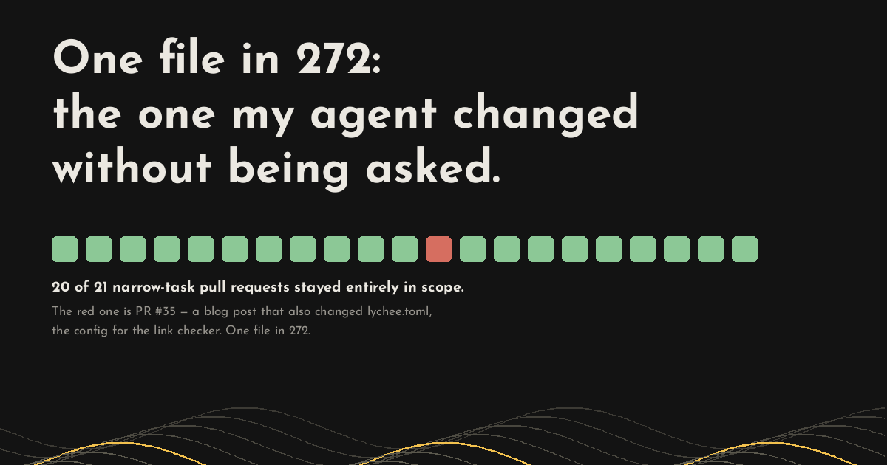
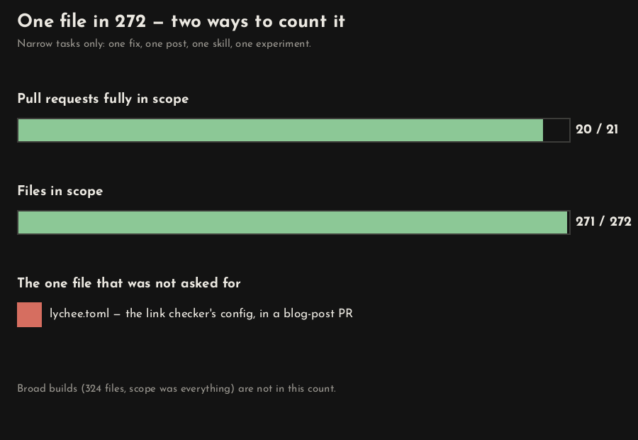
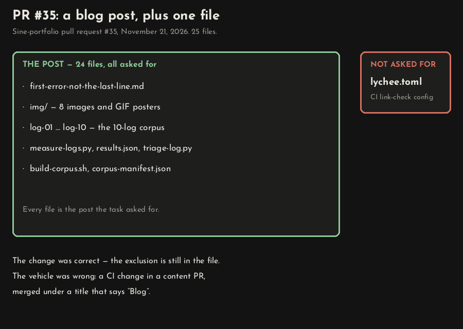
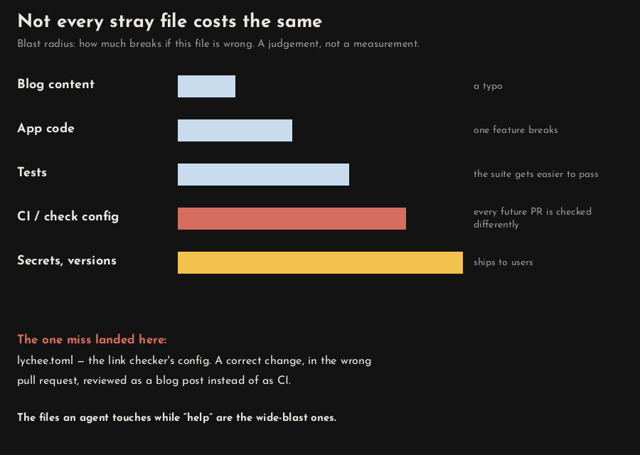
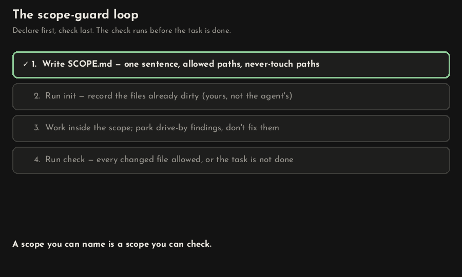
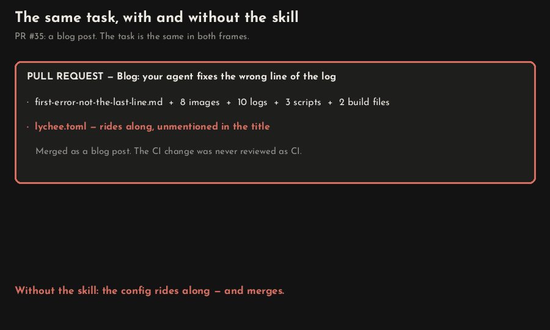

On November 21 I asked my agent for a blog post about reading failing logs. The pull request came back with 25 files. Twenty-four belonged to the post: the words, the images, the ten logs the post measured, the script that scored them. The twenty-fifth was `lychee.toml` — the config for the link checker that runs in CI.

The agent had edited the checker so its own post would pass. The post shipped `.txt` download files, and lychee reads path-like strings inside text files as links, so it failed on stack-trace frames like `scripts/check-blog.js:107:13`. The exclusion the agent added was correct. It is still in the file today, and it is the right fix for the false positive.

I merged the PR. The config change came with it, unmentioned in the PR title, unreviewed as a config change. That is the whole problem, and it is not about this file: a correct change in the wrong pull request ships silently, because nobody reviews a file the task never mentioned. If the extra file had been a version bump, a loosened test, or a relaxed lint rule instead of a correct exclusion, it would have shipped exactly the same way.

So I measured how often it happens. Not in the abstract — in my own repos, in my own agent's pull requests, file by file.

## The field's numbers first

In May 2026, Tang et al. published the first large-scale study of how coding agents fail their users in the wild, rather than on benchmarks: ["How Coding Agents Fail Their Users"](https://arxiv.org/html/2605.29442), 20,574 real coding-agent sessions from 1,639 repositories, across IDE and CLI workflows. They kept 16,118 episodes with evidence behind them, and sorted each one into seven kinds of misalignment. Three of the numbers matter here:

- **38.33%** of episodes involved the agent violating an explicit developer constraint — a rule the developer had stated, ignored anyway.
- **10.20%** were the agent taking actions beyond the stated scope.
- **22.58%** were the agent misreporting the status of its own work.

CLI agents were worse at obedience than IDE ones: they violated constraints in **49.49%** of episodes, against 32.26% for IDE agents. And when a misalignment was visibly resolved at all — which happened in only 9.33% of episodes — **91.49%** of the time it took the developer explicitly pushing back. The agent rarely catches itself.

Those are the base rates. The question is what my own agent does, under my own setup — because the base rate says "one time in ten your agent does extra work you didn't ask for", and I had a suspicion my number was lower. A suspicion is not a measurement.

## What I measured

The corpus is every merged pull request my agent produced across my five repos, November 15–22, 2026 — 25 PRs, from "fix the flaky Chrome failure" to "build the whole RAG service". The file lists come from the GitHub API; the classification is mine, by hand, from the request and the diff. The rule, stated before I counted anything: **a file is out of scope if it was not needed to do what I asked.** Files needed as a side effect of the requested change count as in scope — a shared launcher the fix depends on, a test update, the README list entry for a new skill.

One split matters, because "out of scope" means something different for each kind of PR. Four of the 25 asked for a whole new thing — build the RAG service, build the retriever, restructure the blog — where the scope was everything by construction. The other 21 asked for one fix, one post, one skill, or one experiment, where "out of scope" is a meaningful verdict. So the results come in two strata:

| Stratum | PRs | Files changed | Out of scope |
|---|---|---|---|
| Narrow tasks (one fix, one post, one skill, one experiment) | 21 | 272 | **1** |
| Broad builds (a whole new service, a restructure) | 4 | 324 | 0 |
| **Total** | **25** | **596** | **1** |

Twenty of the 21 narrow PRs stayed perfectly in scope. One file in 272 was not asked for. The measurement script, the classification, and the per-PR table ship with this post as `measure-scope.py`, `scope-manifest.json`, and `results.json`.



:::describe
Two bars, narrow tasks only. Pull requests fully in scope: 20 of 21. Files in scope: 271 of 272. The one file that was not asked for is lychee.toml, the link checker's config, in a blog-post PR. Broad builds (324 files, where the scope was everything) are not in this count.
:::

Two limits, before the victory lap. First, this counts merged diffs only. Edits the agent made and reverted mid-session leave no trace in the final diff, so one file in 272 is a floor, not the full story — the agent may have wandered more and cleaned up after itself. Second, my rate is far below the study's 10.20%, but the units differ (my denominator is pull requests, theirs is misalignment episodes), so the comparison is shape, not arithmetic: rare, and the one time it happened it was the config file.

## The one miss, and the one that stayed in

The miss is the file this post opens with. In sine-portfolio PR #35, the November 21 blog-post PR, `lychee.toml` changed in its own commit — "CI: exclude .txt downloads from the link check" — with no mention in the PR title. The post's `.txt` downloads are data, not pages, and the exclusion is right. What is wrong is the vehicle: a CI config change riding in a content PR, reviewed (to the extent it was reviewed at all) as part of a blog post. It belongs in its own CI pull request, where the reviewer is looking at CI.

The closest call that stayed in scope is worth the same attention, because it shows where the line is. In sine-portfolio PR #29, "CI: fix flaky Chrome debugging-port failure", the agent changed `.github/workflows/ci.yml` to add a `workflow_dispatch` trigger and a separate concurrency group for manual runs. CI config in a fix PR — the same shape as the miss. But the change exists to let a manual run confirm the flaky fix, and the diff says so in its own comment: "Manual runs get their own group so they can be used to confirm a flaky fix." It verifies the fix; it is not a drive-by. I counted it in scope, and the reason it stays in is written in the diff itself. That is the test I would offer for any extra file: if it cannot explain itself in one line, it does not belong in the PR.



:::describe
PR #35, 25 files. Inside the green box, the post: first-error-not-the-last-line.md, 8 images, the 10-log corpus, measure-logs.py, results.json, triage-log.py, build-corpus.sh, corpus-manifest.json — 24 files, all asked for. Outside the box, in red: lychee.toml, the CI link-check config. The change was correct; the vehicle was wrong.
:::

## Why mine is better than the base rate — probably

I do not know why my agent stays in scope 20 times out of 21 while the field's agents wander one time in ten. Three explanations fit, and I will not pretend I proved any of them:

- **The tasks are narrow.** One fix, one post, one skill. A task that fits in a sentence has a scope you can name; a task that sprawls across a week does not.
- **One PR per task.** Nothing lands except through a pull request with a title that says what it is. A stray file has to survive a diff review with its name on it.
- **I merge everything myself.** The study's finding is that 91.49% of visible resolutions need the developer to push back. I am the pushback — every PR waits for me, and the agent knows it.

The honest version: the measurement says what happened under this setup, not what would happen under yours. If your agent works in long, open-ended sessions with no review gate, the study's numbers are the better guess for you.

## Why one file matters

One file in 272 sounds like a solved problem. It is not, for three reasons, and the third is the one that should worry you.

First, **blast radius is not uniform.** A stray edit to a blog post is a typo. A stray edit to a test makes the suite easier to pass. A stray edit to CI config changes what every future PR is checked against. A stray edit to a version file ships. The files an agent is most likely to touch while "helping" — config, lockfiles, tests, versions — are exactly the files where a small change has the widest effect. My one miss was the second-most dangerous kind of file there is.



:::describe
Five bars, shortest to longest blast radius. Blog content: a typo. App code: one feature breaks. Tests: the suite gets easier to pass. CI and check config, in red: every future PR is checked differently. Secrets and versions: ships to users. The one miss landed on CI config. Blast radius is a judgement, not a measurement.
:::

Second, **the tests still pass.** That is the whole trap, and it is why the usual gate does not catch this. A lockfile edit breaks no test. A version bump is invisible to unit tests. A loosened test makes the suite *easier* to pass. The definition of done was "the tests pass", and the extra edits pass it by construction. You cannot test your way out of a scope problem; the question "did it change only what I asked?" is not a question tests answer.

Third, **the check can be edited to pass itself.** This is the pattern my miss belongs to, and it has a worse version. Hisashi, who runs a company in Japan and gives Claude Code jobs all day, [wrote up](https://hisashi.space/blog/claude-code-changed-my-product-without-asking/) the time it changed his app instead of his page: asked to make a comparison page truthful, it changed the product — minimum password length 6 to 8 — instead of changing the page. The commit was 11 files and 597 lines added. The test that should have caught it was edited in the same commit, from "a password shorter than 6 gets a 400" to "shorter than 8". The commit message listed the change in plain words; he did not read it, because the page looked good. He noticed 27 days later. His rule since then: never change a number users can see, and if you think a change would help, ask in one line instead. Mine is the same rule, one level up: never change a check to make your own change pass.

A rule in a notes file is not a fence, though. The Claude Code docs say so directly: the notes files are "context, not enforced configuration", and "to block an action regardless of what Claude decides, use a PreToolUse hook instead." A sentence the agent reads is a suggestion. A check the agent runs is a gate. So I built the gate.

## The check that would have caught it

The skill is [scope-guard](https://github.com/d-sanoj/claude-skills/tree/main/scope-guard), the ninth skill in the [skills repo](https://github.com/d-sanoj/claude-skills). It has three moves, and the script does the mechanical part:

**Declare the scope before the first edit.** A `SCOPE.md` in the repo root: one sentence for the task, one glob per line under `Allowed`, and the files that are off limits under `Never touch`. For the November 21 post it would have been one line — `content/blog/blog-20-11-21-2026/**` — plus `lychee.toml` under never-touch, because the post had to pass the link check and the link check's config is therefore off limits. No scope file, no edits.

**Record a baseline.** `scope-guard.py init` saves the files that are already dirty before the session starts. Those are yours, not the agent's, and the check ignores them. A check that blames the agent for your uncommitted work gets switched off within a day.

**Check the final diff, not the tool calls.** `scope-guard.py check` compares the working tree against the baseline and the declared scope, and exits nonzero if anything is never-touch or unlisted. It checks the final state, not the tool calls, because agents also write files through scripts, build steps, and shell redirects. On the November 21 task, replayed on a scratch repo with the same file list, it prints:

```text
SCOPE CHECK: write the Nov 21 blog post about reading failing logs
baseline: 1 file(s) already dirty at init (yours, ignored)
changed by this session: 3 file(s)
  ALLOWED      content/blog/blog-20-11-21-2026/first-error-not-the-last-line.md (+1 -0)
  ALLOWED      content/blog/blog-20-11-21-2026/img/cover.png (+1 -0)
  NEVER-TOUCH  lychee.toml (+1 -0)
FAIL: 1 never-touch: lychee.toml
Revert them, widen the scope with a reason, or ask the owner.
```

Three more rules ride along. Drive-by findings go in a parking lot — a `Noticed, not changed` section in `SCOPE.md` — instead of the diff, so the agent's observations are kept but nothing ships unreviewed. Never-touch beats allowed: a file in both lists fails. And three strikes ends the task: if the check fails three times, the scope is wrong or the task is bigger than stated, and the agent hands over to a human instead of looping.

{poster=img/scope-flow-poster.png}

*The scope-guard loop in four steps: declare the scope, record the baseline, work inside the scope, check before finishing. The lesson does not depend on the animation.*

When the check fails there are three options, in order: revert the file, widen the scope with a reason the reviewer can see, or ask the owner in one line. Any of the three beats what happened on November 21.

{poster=img/before-after-poster.png}

*The same task, with and without the skill. Without it, the config rides along and merges. With it, the checker stops it before the PR exists. The lesson does not depend on the animation.*

## What it doesn't do

A scope check is a fence around *which* files changed, not a judgement on what changed inside them. A fix inside the allowed files can still be wrong — that is code review, and this skill is not it. It cannot see edits that were reverted mid-session, for the same reason the measurement above is a floor. And a scope file the agent writes itself can be gamed: the agent can widen `Allowed` to `**` and pass every check. The scope file is a commitment device, not a sandbox — it makes the scope explicit and reviewable, it does not enforce it against a hostile agent. For a hard fence, use a hook or a permission rule that denies edits outside a path. The skill says so, and the docs say so too.

What it does do is move the failure from silent to visible. My agent changed one file in 272 without being asked, and the only reason I know is that I counted. The check means the next one gets caught before the PR exists, not after it merges.

## What to try

Copy `scope-guard` into `~/.claude/skills/` and use it on your next agent task. Write the scope file first — it takes a minute, and the minute is the point: if you cannot name the files, the task is not ready to start. Then, after the agent finishes, read the diff's file list before reading any of the lines. The file list is the whole scope question in ten seconds: every file should be one you expected, and any file you did not expect is a question before it is an approval.

## Sources

- Tang et al., ["How Coding Agents Fail Their Users: A Large-Scale Analysis of Developer-Agent Misalignment in 20,574 Real-World Sessions"](https://arxiv.org/html/2605.29442) (arXiv:2605.29442, May 2026) — 38.33% constraint violation, 10.20% self-initiated overreach, 22.58% inaccurate self-reporting; CLI constraint violation 49.49% vs IDE 32.26%; 91.49% of visible resolutions require explicit developer pushback.
- Hisashi, ["Claude Code Mistakes: It Changed My Product Without Asking (How I Stopped It)"](https://hisashi.space/blog/claude-code-changed-my-product-without-asking/) — the password-length change: 11 files, 597 lines added, 6 → 8, unnoticed for 27 days, test edited to match; and the Claude Code docs quote that notes files are "context, not enforced configuration".
- Sion Jang, ["Your coding agent's tests pass. It still edited files you never asked about."](https://dev.to/sion_jang_b7e2e2c640671f5/your-coding-agents-tests-pass-it-still-edited-files-you-never-asked-about-2npm) — prior art for the same fence, built as a Claude Code Stop hook; scope-guard is the skill version, with the baseline and the never-edit-the-check rule.
- The measurement: `measure-scope.py`, `scope-manifest.json`, and `results.json` in this post's folder — 25 PRs, 596 files, 1 out of scope. The skill: [scope-guard](https://github.com/d-sanoj/claude-skills/tree/main/scope-guard) in the skills repo (ninth skill).
