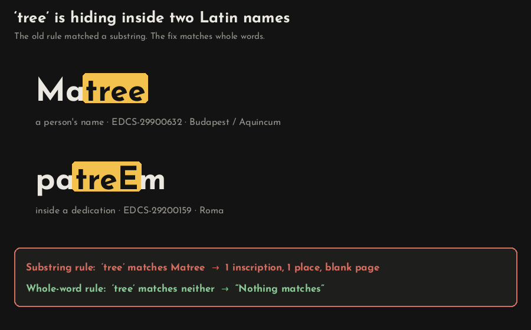
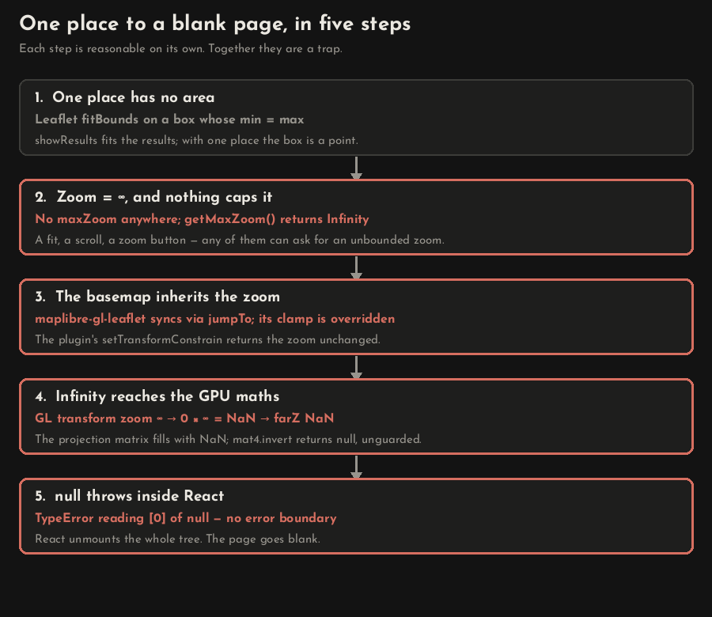
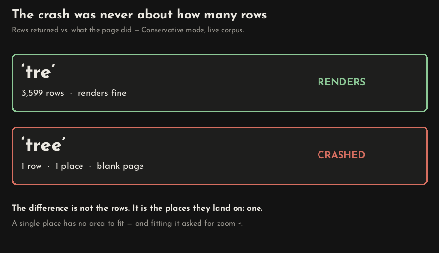
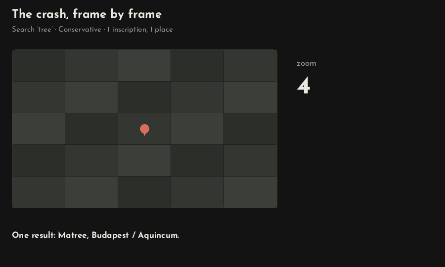
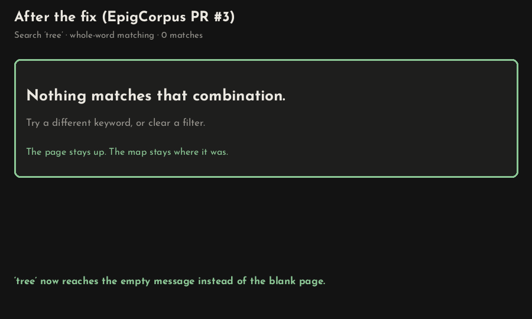

On Sunday, Chris Nussbaum emailed me about EpigCorpus — the search app for Roman inscriptions I run at [epigcorpus.sanoj.dev](https://epigcorpus.sanoj.dev). He had found my site through Reddit, searched for `tree` in Conservative mode, and the page went blank. Not an error message, not a failed search. The whole app vanished, and reloading re-triggered it.

That is the worst kind of bug report to get: precise, reproducible, and impossible to explain from the search side. A search that returns nothing shows "Nothing matches that combination" and carries on. A search that returns too much renders a table and moves on. So what does `tree` do that no other word does?

## What the symptoms ruled out

I reproduced it live four times, in Conservative and in Raw, before touching any code. The symptoms were narrow in a useful way:

- Only `tree` did it. Other searches worked, including searches that return far more rows.
- Reloading re-triggered it, every time. It was not a flaky render.
- The page blanked about five seconds after load — right when the results arrived, not while the page was loading.

Three obvious suspects died quickly. It was not missing data: the record `tree` matched is ordinary in every field. It was not zero results: a nonsense query like `zzzzqq` fails gracefully with the "Nothing matches" message. And it was not result volume: `tre` matches 3,599 rows in Conservative mode and renders fine. One row crashed the page; three thousand rows did not.

That inversion is the whole story. The crash had nothing to do with how *many* results came back. It had to do with how many *places* they landed on.

## The match: a name, not a tree

EpigCorpus matches a keyword as a case-insensitive substring — or it did until Monday. Search the corpus of 588,509 inscriptions for the letters `tree` and here is what you get, per mode, counted with the app's own search code:

| Mode | Old substring matches for `tree` | What they are |
|---|---|---|
| Raw | 1 | `Matree[3]` |
| Conservative | 1 | `Matree` |
| Interpretive | 2 | `Matree`, and `patreEm` |

`Matree` is a person's name, on one inscription: EDCS-29900632, found at Budapest / Aquincum, in Pannonia inferior. In Interpretive mode there is a second hit, `patreEm` — a word in a long dedication from Rome, EDCS-29200159 — because the letters t-r-e-e hide inside it too. There is no tree anywhere in this story. There is a four-letter substring sitting inside two Latin names.

One inscription, one place. That is the degenerate input the map could not handle.

:::describe
Two Latin names with the letters t-r-e-e highlighted inside them: Matree, and patreEm inside a longer inscription. Under the old substring rule, "tree" matched Matree in Raw and Conservative modes, and patreEm as well in Interpretive mode. Under the whole-word rule it matches neither, because the letters sit inside larger words.
:::

## The chain: from one place to a blank page

The search engine was clean. The bug was downstream, in what the app did with the result — and it took five steps, across two mapping libraries, to blank the page. Each step is reasonable on its own. Together they are a trap.

**Step 1: one place has no area.** When results arrive, the app fits the map to them. The code in `frontend/src/features/map/epigMap.ts` took the minimum and maximum latitude and longitude of the result places and called Leaflet's `fitBounds` on that box. With one place, the minimum and the maximum are the same point, so the box has zero area. Fitting a zero-area box means dividing by zero, and Leaflet's answer is a zoom of Infinity. The code said so itself, in the comment the fix later added: "fitBounds divides by a zero-size bounds and asks for an infinite zoom."

**Step 2: nothing capped the zoom.** The Leaflet map was created with no `maxZoom`. No layer set one either, so Leaflet's `getMaxZoom()` returned Infinity — there was no ceiling anywhere for that unbounded zoom to hit. A scroll, a zoom button, a fit: any of them could ask for a zoom the basemap cannot render.

**Step 3: the basemap inherited the impossible zoom.** The basemap is a MapLibre GL vector map (OpenFreeMap's Positron style), drawn inside the Leaflet map by the `maplibre-gl-leaflet` plugin, which syncs the two maps' views. When Leaflet's zoom went to Infinity, the plugin passed it to MapLibre with `jumpTo`. Worse, the plugin overrides MapLibre's `setTransformConstrain` to return the zoom unchanged — which disables the clamp MapLibre would normally apply. The one safety net in the chain was switched off by the glue code between the libraries.

**Step 4: Infinity reached the GPU maths.** Inside MapLibre, the GL transform's zoom became Infinity. The world size and the pixels-per-metre became Infinity. Then the elevation term multiplied zero by Infinity, which in floating point is NaN. The far plane distance, `farZ`, became NaN, the view-projection matrix filled with NaN, and `mat4.invert` — called without a guard — returned null.

**Step 5: null crashed React.** The next line read element `[0]` of that null matrix and threw `TypeError: Cannot read properties of null (reading '0')`. The throw happened inside a React effect, and the app has no error boundary, so React unmounted the whole tree. The page went blank — not because the search failed, but because the map's render loop threw while React was holding the page.

The console error was the only witness. Nothing in the search path logged anything, because nothing in the search path was wrong.

:::describe
The failure chain in five steps. One place gives a zero-area bounds, Leaflet's fitBounds computes zoom Infinity, the Leaflet-MapLibre plugin syncs that zoom into the basemap without clamping it, the GL transform fills with NaN and its matrix inversion returns null, and reading element zero of null throws a TypeError inside a React effect with no error boundary, unmounting the whole page.
:::

## Why it took a day to find

Three things made this bug hard to see, and all three are worth knowing the next time a page blanks for no apparent reason.

First, **the crash needed the basemap loaded.** Without the GL map, there is no sync, no Infinity zoom, no crash. My first local run rendered `tree` fine — "1 inscription · 1 place" — because the basemap had not finished loading when the results arrived. The crash only appeared once local map loading mimicked the live site. A bug that depends on a race between data and a lazy-loaded map will reproduce on the live site and not on your machine, until you make your machine load the map the way the site does.

Second, **the failing code was not the code I wrote for search.** The search, the filtering, the place aggregation — all clean, all tested. The bug lived in the seam between Leaflet and MapLibre, in a plugin's override and a missing option. When two libraries share state, the seam is where the invariants die: Leaflet assumes a zoom is finite, MapLibre assumes its clamp is active, and the plugin quietly breaks the second assumption while the first one is being violated.

Third, **the page gave no partial failure.** A blank page with no error boundary looks identical for a hundred different causes. The only reason this one got found the same day is that the console error survived — `TypeError: Cannot read properties of null (reading '0')` — and it pointed at the matrix code, not the search code. Without it, I would have spent the day auditing the search engine, which was innocent.

## The fix: three lines of defence

The fix, merged Monday as [EpigCorpus PR #3](https://github.com/d-sanoj/EpigCorpus/pull/3), has three parts, and the point of having three is that each one would have stopped the crash on its own:

1. **Whole-word matching.** The keyword now matches whole words only, in the server and in the static site's search worker — `tree` matches `tree`, not `Matree`, `trees`, or `tree2`. A Greek letter next to the term still counts as part of a word; a separator like `·` does not. This fixes the search semantics, which were the real user-facing bug: nobody searching for `tree` wants a person named Matree.
2. **A single place is centred, not fitted.** A search that lands on one place now centres on it at a fixed zoom of 10 instead of fitting its bounds. One place has no area, so there is nothing to fit.
3. **The map has a maxZoom of 18.** No zoom path — a fit, a scroll, a zoom button — can ask the basemap for an unbounded zoom again.

I verified the fix against the live corpus with the app's real search code, before and after. The script ships with this post as `verify-tree.py`, with its output in `results.json`:

| Query | Before (substring) | After (whole-word) | Renders? |
|---|---|---|---|
| `tree`, Raw | 1 row, 1 place | 0 rows | "Nothing matches" |
| `tree`, Conservative | 1 row, 1 place | 0 rows | "Nothing matches" |
| `tree`, Interpretive | 2 rows, 2 places | 0 rows | "Nothing matches" |
| `TREE`, all modes | — | 0 rows | "Nothing matches" |
| `matree` | 1 row, 1 place | 1 row, 1 place | Yes |
| `popidium` | 154 rows, 1 place | 154 rows, 1 place | Yes |
| `viator` | 379 rows, 213 places | 379 rows, 213 places | Yes |
| `vixit` | 24,724 rows, 2,092 places | 24,724 rows, 2,092 places | Yes |

The last two rows are the point of the fix's second and third parts: `popidium` still lands on one place — 154 inscriptions, one dot on the map — and now renders, because a single place is centred instead of fitted. And `vixit`, at 24,724 inscriptions across 2,092 places, renders too, because volume was never the problem. One row used to crash the page; twenty-four thousand do not.

:::describe
Two panels. Searching "tre" returns 3,599 rows and renders fine. Searching "tree" returns 1 row and used to crash the page. The crash was never about how many rows came back; it was about how many places they landed on — one.
:::

{poster=img/crash-sequence-poster.png}

*The crash in six frames: one result, a zero-area fit, the zoom climbing past every sane value to Infinity, the tiles dissolving, the page blank. The lesson does not depend on the animation.*

{poster=img/fixed-sequence-poster.png}

*The same searches after the fix: "tree" reaches the empty message, and "matree" centres on the one place at zoom 10. The lesson does not depend on the animation.*

## The general lesson

This bug has a shape I expect to meet again, and it is worth naming: **a degenerate input at a seam between two systems.** One place is a degenerate input for a function that fits a box. Infinity is a legal number in JavaScript right up until it reaches the GPU, where it becomes NaN and then null and then a crash. Neither library is at fault — Leaflet documents `fitBounds`, MapLibre documents its clamp, and the plugin that joined them disabled the clamp and passed the zoom through. The fault is in the assumption each side made about the other, and assumptions at seams do not get tested, because each library's tests cover its own side.

Two habits would have caught it earlier, and both are cheap.

**Test the one-result case, not just the many-result case.** Every search demo shows a query with dozens of results. The dangerous queries are the ones with exactly one: one row, one place, one file, one pixel. A single point has no area, a single row has no variance, a single item has no ordering — and every function that divides by a spread, fits a bounds, or sorts a pair will find out. If you test one shape of result, test the shape with one of everything.

**Cap what you pass across a seam.** If a number crosses from one library into another, clamp it on your side before it crosses. The map now has `maxZoom: 18` — a one-line ceiling that would have stopped this crash even if the single-place fit had stayed. The same habit applies anywhere a value leaves your code for a library's: a zoom, a timeout, a retry count, a buffer size. The library will accept Infinity politely and fail somewhere you cannot see.

And one more, for the search side: **substring matching is a user-interface decision, not a default.** It felt generous — match inside words, catch more — and it caught a name nobody wanted. Whole-word matching is the behaviour a reader expects from a search box, and the substring version was only ever one accidental name away from a blank page. The generous default was the bug; the strict default is the fix.

## What to try

If you run a Leaflet map with a MapLibre basemap, check two things today: that your map sets `maxZoom`, and that every `fitBounds` call has a single-point path that centres instead of fitting. Search your codebase for `fitBounds` and ask what happens when the bounds have zero area. Then try your own app's search with a query that returns exactly one result in exactly one place — a rare name, a unique code — and watch what the map does. If it blanks, you have the same bug, and the fix is three lines: match whole words, centre single places, cap the zoom.

The reader who found this one did the project a favour. A bug that blanks the page for a four-letter word is a bug that blanks it for every rare name in the corpus — and a corpus of 588,509 inscriptions is mostly rare names.

## Sources

- The report: Chris Nussbaum emailed on 2026-11-22 after finding sanoj.dev via Reddit — searching `tree` in Conservative mode blanked the live site; reproduced live four times in Conservative and Raw, reload re-triggered it.
- The fix: [EpigCorpus PR #3](https://github.com/d-sanoj/EpigCorpus/pull/3), "Search whole words, not substrings; don't blank the page on one place" — merged 2026-11-23. Whole-word search in `backend/src/epigcorpus/core/search.py` and the static worker `frontend/src/api/static/wordSearch.ts`; single-place centring at zoom 10 and `maxZoom: 18` in `frontend/src/features/map/epigMap.ts`.
- The measurement: `verify-tree.py` and `results.json` in this post's folder — run against the live corpus with the app's real search code. 588,509 records; `tree` matched 1 row in Raw and Conservative, 2 in Interpretive, before the fix, and 0 in all modes after it. The same check also lives in the EpigCorpus repo as [research/scripts/tree_crash_verification.py](https://github.com/d-sanoj/EpigCorpus/tree/research/tree-crash-verification/research/scripts/tree_crash_verification.py) ([PR #4](https://github.com/d-sanoj/EpigCorpus/pull/4)).
- [Leaflet's `fitBounds` documentation](https://leafletjs.com/reference.html#map-fitbounds) and [maplibre-gl-leaflet](https://github.com/maplibre/maplibre-gl-leaflet), the plugin that syncs the Leaflet map with the MapLibre basemap.
- The live site: [epigcorpus.sanoj.dev](https://epigcorpus.sanoj.dev) — `tree` now shows "Nothing matches that combination" in all three modes.
