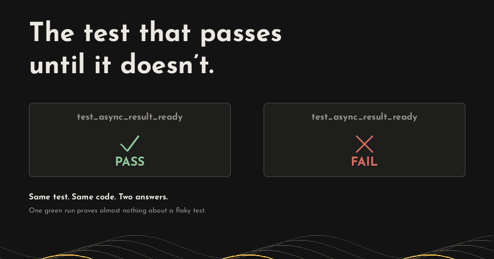
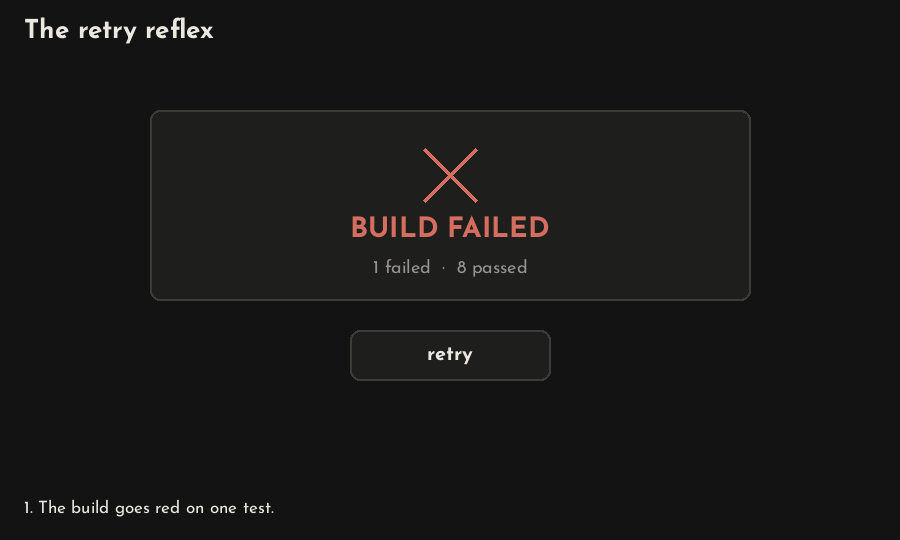
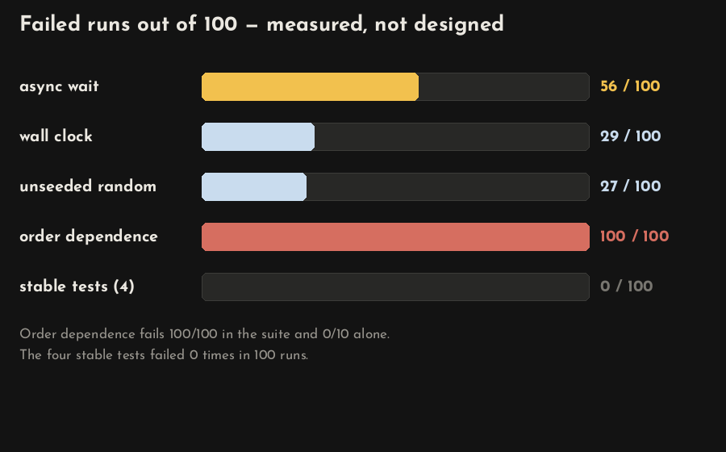
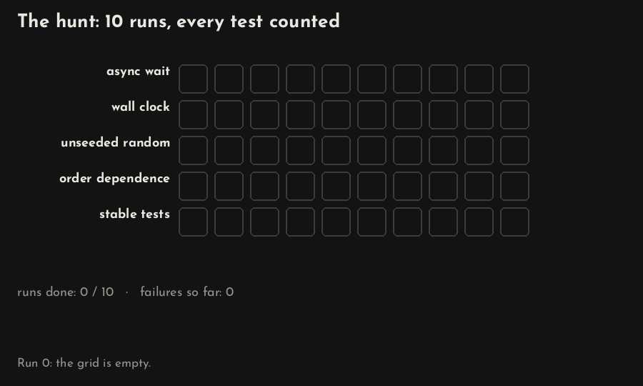

Thursday, 16:40. The build goes red on an integration test. Nobody opens the stack trace. Someone clicks retry, the second run comes back green, the PR merges, and the ticket closes without a comment.

The engineer had no evidence the failure was real, the rerun costs a fraction of a cent, and an investigation costs an afternoon. Do it two hundred times over a quarter and every instance is still individually defensible. It is also, exactly, how a real defect gets waved through: the retry button cannot tell a test that is lying from a test that is right.

I have done the retry-reflex version of this myself. So this week I stopped arguing about it in the abstract and measured it instead: I built a small test suite with four deliberately flaky tests, ran it 100 times, and counted what a single run actually proves. Then I built a skill — [flake-hunt](https://github.com/d-sanoj/claude-skills/tree/skill/flake-hunt/flake-hunt), the tenth in my skills repo — that does the honest version of the job: run the suite N times, name every test that changed its answer, and quarantine what it finds.

{poster=img/retry-reflex-poster.png}

*The retry reflex in four frames: red, retry, green, merged — and the bug that rode through underneath. The lesson does not depend on the animation.*

## What a flaky test is, and how big the problem is

Google's working definition, from John Micco's 2016 post on the Google Testing Blog, is the one I use: a flaky test is a test that "exhibits both a passing and a failing result with the same code". Nothing changed — not the code, not the test, not the config — and the answer changed anyway. That is the whole definition, and it is also the whole problem: a test that can answer either way on the same code cannot tell you whether your change broke something, because its red means nothing and its green means nothing either.

The scale is not a corner case. At Google, about 1.5% of all test runs reported a flaky result, almost 16% of tests had some level of flakiness, and about 84% of the pass-to-fail transitions in post-submit testing involved a flaky test — most of the time a test went from green to red, the code was not the reason. Google's own test system saw 1.6 million test failures a day on average, and 73,000 of them — 4.56% — were caused by flaky tests.

The causes are a short list, and they have been a short list for a decade. Luo, Hariri, Eloussi and Marinov studied 201 commits that fixed flaky tests across 51 Apache projects in 2014, classified 161 of them, and found three causes behind 77% of the fixes: async wait 45%, concurrency 20%, test order dependency 12%. Martin Fowler, writing in 2011, named the same families from the other side: lack of isolation, asynchronous behaviour, remote services, time, and resource leaks. And the study's finding nobody repeats is the one that matters most for prevention: 78% of the flaky tests were flaky from the revision that introduced them. They are usually born, not acquired — which means the moment to catch them is the moment the test is written, not the third Thursday it ruins.

## The fixture: four flakes, four causes

To measure what a single run proves, I needed a suite where I knew the truth in advance. The fixture lives in the skill repo at `flake-hunt/examples/fixture/`: nine tests, four stable, four flaky, and one test whose only job is to mutate shared state so the order-dependent test has something to trip on. Each flake is one classic cause, with a designed failure rate:

- **Wall clock** — `test_expiry_uses_wall_clock` asserts on `time.time() % 10`, and fails when the wall clock is in the first 3 seconds of a 10-second window. Designed to fail about 30% of runs. The real version is a test that checks "expires at end of day" or formats a date near midnight.
- **Unseeded random** — `test_random_sample_covers_all` draws `random.random()` with no seed and fails when the draw is under 0.25. Designed to fail about 25% of runs. The real version is any test that samples data without a seed.
- **Async wait** — `test_async_result_ready` starts work that finishes after a delay drawn uniformly from 0 to 0.1 seconds, sleeps a fixed 0.05 seconds, then reads the result. Designed to fail about 50% of runs. The real version is any `sleep(N); assert ready` pattern.
- **Order dependence** — `test_visit_count_starts_at_zero` asserts a module-level counter is zero, but `test_records_a_visit` runs first (definition order) and increments it. It fails in the suite and passes alone. The real version is any test that depends on another test's leftovers.

The four stable tests are the control group: pure functions, no clock, no randomness, no shared state. If the hunt flags one of them, the hunt is broken.

The measurement script, `measure-flakes.py`, runs the whole suite 100 times and counts per-test outcomes. It also runs each flaky test alone 10 times, and the stable tests alone 50 times as a control. The script and the full results (`flake-rates.json`) ship with this post.

## One hundred runs: what a single run proves

Here is what 100 runs produced:

| Test | Cause | Failed / 100 runs |
|---|---|---|
| test_async_result_ready | async wait | 56 |
| test_expiry_uses_wall_clock | wall clock | 29 |
| test_random_sample_covers_all | unseeded random | 27 |
| test_visit_count_starts_at_zero | order / shared state | 100 |
| 4 stable tests | — | 0 |

The measured rates landed close to the designed ones — 56 against a designed 50, 29 against 30, 27 against 25. A flake's rate is a property you measure, not a number you assume; sampling variation is real, and the design column is what the code aims at while the measured column is what 100 runs actually produced.

Now the run that matters: the first of the 100. That is the run the retry reflex trusts — one run, one verdict. It caught 2 of the 4 flakes (the async test and the order test failed) and missed the other two entirely: the wall-clock test and the random test both passed. A single run catches a 29%-flake exactly 29% of the time, so "it passed" is nearly no evidence at all — and the suite looked, on that run, like it had two failures to investigate and seven healthy tests, when in fact four of the nine were unreliable.

The isolation runs tell the second half of the story. Each flaky test alone, 10 times: the async test failed 7, the random test 2, the order test 0 — it passed alone every time, which is the order-dependence signature — and the wall-clock test 0. That last one deserves a pause. The wall-clock test fails 29 times in 100 suite runs and passed all 10 alone-runs, by luck: a 29% flake passes 10 in a row about 3% of the time. It happened. A classifier that trusted "passes alone" would have called it order-dependent, which is wrong, and this is why the skill's classifier treats "passes alone" as a leading hypothesis, not a verdict, when the source also hints at a low-rate flake — it reports the source hints next to the alone-run count, and the wall-clock test's source contains `time.time(`, the hint that separates a low-rate time flake from shared state.

The control groups stayed clean, which is what makes the method usable rather than merely alarming. The four stable tests failed 0 times in 100 suite runs and 0 times in 200 executions of a stable-only control, and 12 real tests from my local-rag project (`test_bm25.py` and `test_rrf.py`) ran 20 times each — 240 executions, 0 failures. The method does not cry wolf: it flags tests that change their answer, and stable tests do not change their answer.



:::describe
Four horizontal bars showing the measured failure rate of each flaky test in the fixture over 100 runs: async wait 56 out of 100, wall clock 29 out of 100, unseeded random 27 out of 100, and order dependence 100 out of 100 in the full suite (but 0 out of 10 alone). A fifth bar for the four stable tests is flat at zero.
:::

## The detection math: why ten runs, and why ten is not enough

For a test that fails with probability p, the chance that N runs catch it is 1 − (1 − p)^N. That one formula is the whole argument for hunting instead of retrying:

| Fail rate | 1 run | 5 runs | 10 runs | 20 runs | 50 runs |
|---|---|---|---|---|---|
| 1% | 1% | 5% | 10% | 18% | 40% |
| 5% | 5% | 23% | 40% | 64% | 92% |
| 10% | 10% | 41% | 65% | 88% | 99% |
| 25% | 25% | 76% | 94% | 100% | 100% |

A 10% flake — one failure in ten runs — passes a single run 90% of the time, and a 10-run hunt still misses it a third of the time. A 1% flake is essentially invisible to any hunt you can afford: 10 runs catch it 10% of the time, 50 runs catch it 40% of the time. Ten runs is the skill's default because it is cheap, not because it is enough. For a suite you are about to trust with a release, run 20.

This is also why Google's own procedure is a rerun count, not a single retry: a failing test at Google is rerun 10 times against the same code version, and if it passes in any of those 10 reruns it is labelled flaky. Note the direction — the reruns are the *diagnosis*, applied to a test that already failed, not a way to turn a red build green. A rerun that passes is evidence about the test, not a fix for it. The moment you treat it as a fix, you have stopped testing and started gambling with a known probability.


:::describe
Four curves showing the probability that N repeated runs catch a flaky test, for failure rates of 25%, 10%, 5%, and 1%. The 25% curve reaches 94% by 10 runs; the 10% curve reaches 65% at 10 runs and 88% at 20; the 5% curve needs 50 runs to reach 92%; the 1% curve is still only at 40% after 50 runs.
:::

## The skill: hunt, isolate, quarantine, fix

flake-hunt is a procedure with a script doing the mechanical part. The procedure, in full, is in the skill's `SKILL.md`; the short version is three commands.

**Hunt.** Run the suite 10 times and name every test that changed its answer. From the fixture directory, so the paths are the ones the skill actually ran on:

```bash
cd examples/fixture
python3 ../../scripts/flake-hunt.py hunt . --runs 10
```

On the fixture, the hunt found all four suspects in 10 runs. It writes a report (`flake-report.md` and `.json`) with the per-test counts, and exits 1 when something was found, so CI can gate on it. A test that fails every run is not flaky by the definition — it never passes — but the hunt still lists it, because a test that fails 10/10 in the suite and 0/10 alone is the order-dependence signature, and that is exactly what the fixture's order test does.

{poster=img/hunt-grid-poster.png}

*The hunt in six frames: ten runs fill the grid, and four rows light up red while the stable rows stay green. The lesson does not depend on the animation.*

**Isolate.** Run each suspect alone, to separate the two families:

```bash
python3 ../../scripts/flake-hunt.py isolate tests/test_flaky.py::test_async_result_ready --runs 5
```

A test that fails alone has its non-determinism inside itself: the clock, an unseeded draw, a sleep that ends before the work does. A test that passes alone every time but fails in the suite gets its non-determinism from its neighbours. Run it alone at least 5 times; 10 is better, because a low-rate flake passes a short alone-run by luck — the fixture's wall-clock test did exactly that.

**Quarantine, then fix by cause.** A confirmed flaky test leaves the merge-blocking suite the same day it is found, into a quarantined suite that still runs and still reports, with a ticket, an owner, and a deadline. Fowler's rule from 2011, unchanged since: "Place any non-deterministic test in a quarantined area. (But fix quarantined tests quickly.)" Cap the quarantine — eight tests is the example Fowler gives — and fix them within a week, or it becomes a second suite nobody reads, and a test in quarantine no longer guards anything.

The fix depends on the classification, and the wrong fix is worse than no fix because it looks like a fix. Luo et al.'s Table 4 is blunt about the most common mistake: of 20 async-wait fixes that added or changed a `sleep`, zero removed the flakiness; of the 42 that used a `waitFor`, 23 removed it entirely. Lengthening a sleep from 0.05 seconds to 0.5 seconds does not fix the flake, it just makes it rarer — and rarer is harder to catch next time.

| Classification | Fix | Never |
|---|---|---|
| Async wait | wait for the condition (poll until ready, or a callback) | lengthen the sleep |
| Wall clock | inject the clock; test fixed dates on purpose | assert on `now()` |
| Unseeded random | seed it and log the seed, so the failing draw reproduces | delete the random case |
| Order / shared state | fresh fixture per test; every test creates its own data | run tests in a fixed order and call it done |
| Concurrency | fix the race — in the test or, if it is real, in the code | add a sleep to "let it settle" |
| Remote service | use a test double you control | retry the network and hope |

One row of that table needs a warning attached. "Fix the test, not the code" is the default, because most flakes are bugs in the test — but a flaky test can also be the only witness to a real race in the product. In Luo et al.'s study, 24% of flaky-test fixes changed the code under test, and 94% of those fixed a real bug in it. The paper's own implication is explicit: flaky tests "should not simply be removed or disabled because they can help uncover bugs in the CUT". Read the failure before deciding which side is wrong. A flake you "fix" by deleting the test is a bug report you threw away.


:::describe
Two panels comparing the two responses to a red build. Left, the retry reflex: a red X with "1 test failed", an arrow down to a "click retry" button, then a green check with "green — merged". Right, the hunt: a ten-run grid in which four rows light up red — async 3 of 10, wall clock 6 of 10, random 3 of 10, order 10 of 10 — followed by three boxes: "4 suspects named", "quarantined + ticket", "fixed by cause".
:::

## What a clean hunt does not prove

A hunt that finds nothing is good news with a precise limit: it means no flake above the rate your run count can see. Ten runs see a 25% flake, barely see a 5% one, and do not see a 1% one. Say which rate your hunt could see, and do not upgrade "nothing found in 10 runs" into "the suite has no flakes".

The skill has the same limit built into its own evidence. The wall-clock test's 0-for-10 alone-runs is a 3%-likely event that happened on camera, and the classifier reports it as a leading hypothesis with the source hint beside it, not as a verdict. A tool that is certain about uncertain evidence is worse than one that says it does not know — and a test suite is exactly the place where false certainty costs the most, because it is the thing you consult when you want to know whether your code is right.

So the rule I am keeping is a small one, and it fits on a sticky note: **a test that failed once is a suspect until N runs say otherwise, and a rerun that passes is evidence, not a repair.** The next time a build goes red at 16:40, run the hunt. It costs ten runs of a fast suite — seconds — and it is the difference between knowing the test is lying and hoping it is.

## What to try

Install the skill, then run it on the fixture suite — the same commands I ran for this post:

```bash
cp -r flake-hunt ~/.claude/skills/
cd ~/.claude/skills/flake-hunt/examples/fixture
python3 ../../scripts/flake-hunt.py hunt . --runs 10
```

Both the hunt and the measurement need pytest installed for the Python you run them with (`pip install pytest` first, if yours does not have it). To replay my measurement, clone the skill repo and run the fixture — the measurement script and the 100-run results ship with this post as `measure-flakes.py` and `flake-rates.json`:

```bash
python3 measure-flakes.py --runs 100 --fixture /path/to/flake-hunt/examples/fixture
```

Start with the tests that have already embarrassed you once. If a test has ever failed and passed on retry, it is already a suspect; the hunt just makes the suspicion a number.

## Sources

- John Micco, ["Flaky Tests at Google and How We Mitigate Them"](https://testing.googleblog.com/2016/05/flaky-tests-at-google-and-how-we.html), Google Testing Blog, 27 May 2016. The definition ("a test that exhibits both a passing and a failing result with the same code"), the 1.5% of runs / ~16% of tests / 84% of pass-to-fail transitions figures, and the quarantine tooling.
- Qingzhou Luo, Farah Hariri, Lamyaa Eloussi, Darko Marinov, ["An Empirical Analysis of Flaky Tests"](https://huang.isis.vanderbilt.edu/cs8395/paper/flakytest.pdf), FSE 2014. 201 commits across 51 Apache projects, 161 classified: async wait 74 (45%), concurrency 32 (20%), test order dependency 19 (12%); 78% flaky from the first revision; Table 4 fix effectiveness (sleep 0 of 20 removed the flakiness, waitFor 23 of 42); 24% of fixes changed the code under test, 94% of those fixing a real bug; Google TAP figures (1.6M failures/day, 73K / 4.56% flaky); Google's 10-rerun labelling policy.
- Martin Fowler, ["Eradicating Non-Determinism in Tests"](https://martinfowler.com/articles/nonDeterminism.html), 14 April 2011. The quarantine rule ("Place any non-deterministic test in a quarantined area. (But fix quarantined tests quickly.)"), the numeric cap, and the cause families: lack of isolation, asynchronous behaviour, remote services, time, resource leaks.
- The fixture, the measurement script, and the 100-run results: [flake-hunt](https://github.com/d-sanoj/claude-skills/tree/skill/flake-hunt/flake-hunt) in `d-sanoj/claude-skills` (skill, fixture, and tests); `measure-flakes.py` and `flake-rates.json` ship with this post. Measured 2026-11-25: async 56/100, wall clock 29/100, random 27/100, order 100/100 in suite and 0/10 alone; stable tests 0/100 (control 0/200); local-rag `test_bm25.py` + `test_rrf.py`, 12 tests × 20 runs, 0 failures in 240 executions.
