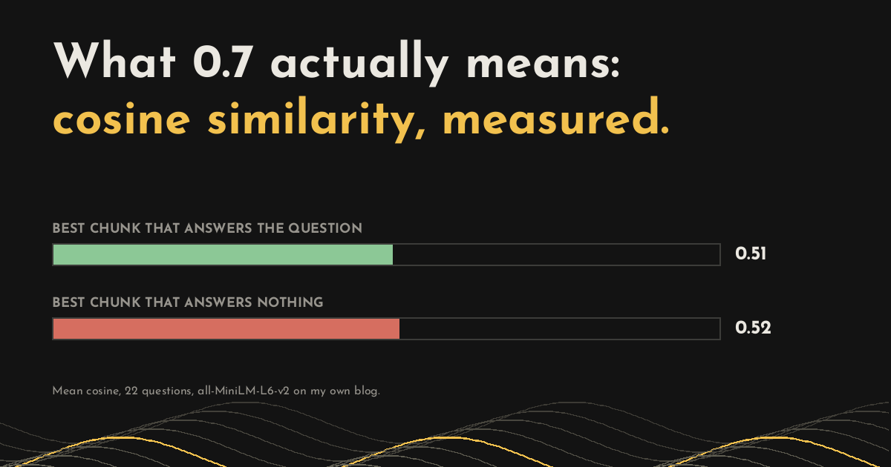
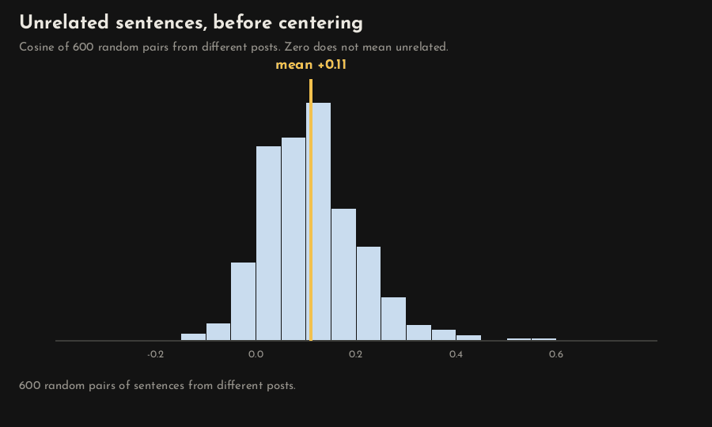

Six days ago I left a loose thread in the embeddings post. A question about what happens inside a model reading a million tokens was topped, at cosine 0.690, by a chunk from the ERNIE news intro — a paragraph that answers nothing. The chunk that actually explains the answer sat at rank 9. I wrote it up as the magnet-chunk problem and moved on. But the number itself kept bothering me. 0.690 of what? Cosine similarity runs from −1 to 1, so 0.69 sounds like 69% similar, which sounds like a lot. Is it? What does 0.5 mean? What does 0.9 mean? Everybody who builds retrieval treats these numbers like a ruler with honest markings. I had never checked whether the markings mean anything, so this week I measured them — on the same model, the same corpus, the same questions as the November 20 embeddings run.

The short version: the ruler's markings are not honest. Two sentences about completely different things score 0.11 on average, not 0. Two sentences that say the same thing in different words score 0.67 to 0.91. And at retrieval time, the best chunk that answers the question scores 0.51 on average — while the best chunk that answers nothing scores 0.52. No threshold separates right from wrong, because at the top of the ranking the two distributions sit on top of each other. The number is real, the ordering is mostly real, and the absolute value means almost nothing without a baseline measured on your own data.

## What I ran

The model is the same one as the last post, `sentence-transformers/all-MiniLM-L6-v2`: 384 dimensions, 22.7 million parameters, trained with a contrastive objective on more than 1.17 billion sentence pairs, inputs longer than 256 word pieces truncated. The corpus is the same 16 blog posts, which split into 1,749 sentences (6 to 40 words each) and 229 non-overlapping 200-word chunks. The questions are the same 22 golden questions, each labeled with the post that answers it and the terms the answering passage must contain. The script and the full results are in the [retriever repo](https://github.com/d-sanoj/retriever-doc-answer/tree/main/data/anisotropy).

One difference from the last post to keep straight: the November 20 run used overlapping chunks (40 words of overlap), which gave 281 chunks; this run uses non-overlapping 200-word windows, which gives 229. The ranks below are from this run's chunking, so the 17-of-22 in the top five here is not directly comparable to the 18-of-22 there. Everything compared inside this post — gold against non-gold, before centering against after — uses the same chunking on both sides, so those comparisons are apples to apples.

Three measurements. First, sentence pairs: 600 random pairs of sentences from different posts (different topics, as unrelated as my blog gets), 600 pairs from the same post, five paraphrases I wrote myself, and 20 near-duplicates (the same sentence with casing and punctuation changed). Second, the geometry: the average of all the vectors — the direction every embedding shares. Third, retrieval: for each of the 22 questions, the best chunk that answers it under the strict rule (right post, at least two answer terms) against the best chunk that does not.

## The scale, calibrated

Here is what the numbers mean on this model, on this corpus. Read it as a conversion table, because that is what it is — the mapping from a cosine score to a plain-English relationship, measured rather than assumed:

| Relationship | Mean cosine | Range |
| --- | --- | --- |
| Same sentence, casing/punctuation changed | 0.98 | 0.96–1.00 |
| Paraphrase (same sentence, different words) | 0.75 | 0.67–0.91 (5 hand-written pairs) |
| Two sentences from the same post | 0.20 | 90% below 0.40 |
| Two sentences from different posts | 0.11 | 90% below 0.24 |
| A question against an average chunk | 0.14 | 90% below 0.30 |

:::describe
A horizontal scale from 0 to 1. Near-duplicate sentences sit at 0.98. Hand-written paraphrases span 0.67 to 0.91. Two sentences from the same blog post average 0.20; two sentences from different posts average 0.11; a question against an average chunk averages 0.14. A shaded band from 0.29 to 0.72 covers the range where both the best answering chunk and the best non-answering chunk fall.
:::

Two things in that table should change how you read a cosine score. First, the floor is not zero. Two sentences about nothing in common — one about flaky tests, one about sine-wave letters — still score 0.11 on average, and one in ten scores above 0.24. The scale does not start at "unrelated"; unrelated lives at 0.11, and everything above that is a small increment on top of a shared baseline. A score of 0.3 is not "30% similar"; it is 0.19 above the unrelated floor — and 3.3% of genuinely unrelated pairs score above 0.3. Only 1% score above 0.38, the 99th percentile.

Second, the gap between "same post" and "different post" is small: 0.20 against 0.11. Sentences from the same post — the same author, the same argument, often the same paragraph — are barely more similar to each other than sentences from posts on different topics. Cosine similarity, on this model, is a weak signal at the sentence level. It separates near-duplicates from everything else cleanly (0.98, and the lowest near-duplicate in my sample is 0.96, above the highest paraphrase at 0.91), and it separates paraphrases from unrelated pairs cleanly (the lowest paraphrase is 0.67; the highest unrelated pair is 0.56). But between "same topic" and "different topic" there is no clean line — the distributions overlap almost completely.

## Why the floor is not zero: every vector points the same way, a little

The floor has a mechanism, and it is measurable. Take all 1,749 sentence vectors and average them. If the vectors pointed in all directions equally, the average would be near zero — the directions would cancel. It is not near zero. The mean vector has length 0.34, while each individual vector has length 1.0 — I checked: all 1,749 sentence vectors and all 229 chunk vectors have length exactly 1.0. A third of every sentence vector points in one shared direction.

That number predicts the floor. If every vector is a shared component plus its own distinctive component, then two random vectors agree on the shared part and disagree on the rest, so their expected cosine is the shared part squared: 0.34² = 0.116. I measured the mean cosine of 600 pairs of sentences from different posts at 0.11. The prediction and the measurement agree to within 0.006. The "everything is a bit similar" floor is not noise in my sample. It is the shared direction, squared.

For 200-word chunks the shared direction is stronger: the mean chunk vector has length 0.49, so nearly half of every chunk's vector points the same way, and the squared prediction is 0.24. Longer texts average toward the mean — a chunk contains many sentences, and their distinctive directions partly cancel, leaving the shared part proportionally larger. That is also why the background level of a question against all chunks is 0.14 rather than 0.11: the question is short, the chunks are long, and the long side carries more of the shared direction.

This is not a new observation. Mu, Bhat, and Viswanath showed in 2018 that word vectors share a large common vector — "with norm up to a half of the average norm of word vector" — and that removing it makes the representations better on word-similarity benchmarks. Their fix, all-but-the-top, starts by subtracting the mean vector, then projects the vectors away from the top dominating directions. Ethayarajh showed in 2019 that contextual word representations are anisotropic in every layer of ELMo, BERT, and GPT-2 — so anisotropic that in GPT-2's last layer, two random words are on average almost perfectly similar. One scope note: those papers studied word vectors — Mu static ones like word2vec and GloVe, Ethayarajh and Timkey raw contextual word embeddings — and I am applying their geometry by analogy to sentence embeddings, which is a transfer, not a given. The sentence model I use is far milder than raw GPT-2 word vectors — 0.11 against nearly 1.0 — but the same geometry is still there: a shared direction, a nonzero floor, and a scale that does not start at zero.

One difference from the classic papers is worth stating, because it cuts against a tempting simplification. Timkey and van Schijndel showed in 2021 that in BERT, GPT-2, RoBERTa, and XLNet, cosine similarity is dominated by one to five "rogue dimensions" — a handful of coordinates with large means and variances. For MiniLM sentence vectors, the shared direction is diffuse: the single largest dimension of the mean vector holds only 2.6% of its energy, the top five hold 11%. There is no one dimension to delete. The shared component is spread across the space, which is why subtracting the whole mean vector — not pruning a dimension — is the fix that works here.

:::describe
Two panels. In the first, two vectors from the same origin each decompose into a shared arrow pointing in a common direction and a shorter distinctive arrow pointing its own way; the angle between the full vectors is small because the shared arrows dominate. In the second panel, the shared arrow is subtracted from both, and the angle between the remaining distinctive parts opens up.
:::

## The retrieval test: the best wrong chunk beats the best right one

Sentence pairs are the calibration. Retrieval is where the number does its damage. For each of the 22 questions I took the best chunk that answers it (strict rule: right post, at least two answer terms) and the best chunk that does not, and compared their cosines:

- Best answering chunk: mean 0.51, median 0.51, range 0.33–0.72.
- Best non-answering chunk: mean 0.52, median 0.54, range 0.29–0.70.

The best chunk that answers nothing scores higher, on average, than the best chunk that answers the question. Head to head, the answering chunk outscores the best wrong chunk in only 10 of 22 questions. The mean gap is −0.009 — essentially zero, with the sign pointing the wrong way.

:::describe
Two rows of 22 dots on a 0-to-1 axis. Green dots mark each question's best answering chunk; red dots mark each question's best non-answering chunk. Green spans 0.33 to 0.72, red spans 0.29 to 0.70, and the two rows interleave across the whole span — no vertical line separates them.
:::

Now try to fix it with a threshold, the way half the retrieval tutorials tell you to. Cut at 0.5 — keep everything above, drop everything below:

- 12 of the 22 answering chunks pass. 10 are dropped.
- 13 of the 22 wrong chunks pass. They are kept.

Cut at 0.7 instead, the "high confidence" setting:

- 1 of the 22 answering chunks passes. 21 are dropped.
- 0 of the 22 wrong chunks pass.

There is no threshold that keeps the answers and drops the wrong chunks, because the two distributions are the same distribution with different labels. Watch the sweep:

{poster=img/threshold-poster.png}

*Still frame: the threshold at 0.5 — 12 answering chunks and 13 non-answering chunks pass. The lesson does not depend on the animation.*

Why is the best wrong chunk so strong? The same reason as the magnet chunk in the last post: a chunk that summarizes a whole post — an intro, a section opener — is a little similar to every question about that post's topic, and "a little similar to everything in the topic" beats "very similar to one passage" when the question is short. The ERNIE intro at 0.6905 is the extreme case, but the average case is the same shape: the best wrong chunk for a question averages 0.52 against a background of 0.14, which means it is not a random chunk — it is the most generic chunk in the topic's neighborhood. Generic chunks are the ones cosine similarity likes. Specific chunks are the ones that answer questions.

This is also why the sentence-level calibration does not transfer. At the sentence level, paraphrases (0.67–0.91) separate cleanly from unrelated pairs (max 0.56). At the chunk level, the answering chunk (0.33–0.72) and the best wrong chunk (0.29–0.70) do not separate at all. The reason is length: a 200-word chunk contains many ideas, so its vector is an average over them, and averages of different things in the same topic look alike. The chunk that answers the question is specific; the chunk that tops the list is generic; cosine rewards the generic one.

## The fix: subtract the mean, then stop trusting the number

The honest fix for the scale borrows the first step of Mu and Viswanath's all-but-the-top: subtract the corpus mean vector from every embedding, then renormalize. I did it — same vectors, same pairs, one subtraction:

| Pairs | Before centering | After centering |
| --- | --- | --- |
| Unrelated sentences | 0.11 | −0.01 |
| Same-post sentences | 0.20 | 0.09 |

{poster=img/centering-poster.png}

*Still frame: after centering, the unrelated-pair distribution is centred at −0.01. The lesson does not depend on the animation.*

After centering, zero means "unrelated" — the scale finally says what it looks like it says. But notice what centering does not do: the separation between same-post and different-post pairs barely changes, from 0.09 before (0.20 − 0.11) to 0.10 after (0.09 − (−0.01)). Centering fixes the scale, not the ranking. It makes the numbers honest; it does not make the wrong chunk score lower than the right one. If you center and then threshold at 0.3 expecting clean separation, you will be disappointed in exactly the same way, one honest decimal place lower.

So what do you do with a number that ranks well and measures badly? Four things, all of which follow from the measurements above rather than from taste:

1. **Rank, don't threshold.** The ranking is the part that works — the answering chunk is in the top five for 17 of 22 questions in this run. The absolute score is the part that doesn't. A cutoff at 0.5 or 0.7 discards answers and keeps wrong chunks in nearly equal numbers. If your pipeline drops results below a cosine threshold, you are not filtering for quality; you are sampling from the overlap.
2. **Calibrate on your own corpus.** The floor is a property of your model and your texts, not a universal constant. Measure the unrelated-pair distribution the way I did — sample pairs from different documents, take the mean — and report scores relative to it. A 0.5 means something different on a corpus of legal contracts than on a corpus of tweets, and the only way to know what it means on yours is to measure it.
3. **Center the vectors.** Subtracting the corpus mean costs one vector and one pass, and it makes zero mean "unrelated." It will not fix your ranking, and anyone who tells you it will is selling something. But it stops the scale from lying about its zero, which matters the moment a human reads a score and decides what it means.
4. **Keep the exact-match ranker for the things embeddings discard.** This is the same conclusion as the last post, and it survives because the failure is structural, not a tuning problem. Names, version numbers, error strings, code identifiers — embeddings wash them out into the generic direction, and BM25 catches them instantly. The two rankers fail differently, which is the only reason to have two.

## What this doesn't prove

One model, one corpus, 22 questions. MiniLM is a small, contrastively trained sentence model; a larger model, a different training objective, or a different domain could have a different floor — the classic anisotropy papers found far worse in raw BERT and GPT-2 word vectors, so if anything my numbers are the mild case. The corpus is sixteen posts by one author on distinct topics, with no near-duplicates to confuse the ranking, and the questions are mine, written by the person who wrote the posts. The five paraphrases are hand-written by me, and five is a small sample — they establish the paraphrase range on this model, not a law. The chunking matters: non-overlapping 200-word windows here, overlapping windows in the last post, and the ranks move when the chunking moves. The centering result is about subtracting the mean of this corpus; a mean computed on a different corpus would shift the numbers slightly. None of that changes the shape of the finding — the floor, the overlap, and the threshold result are all large compared to the noise — but it bounds the claim: this is what 0.7 means for this model on this corpus, and the method, not the constants, is the part to reuse.

## Sources

- All numbers are from `measure-cosine.py`, run on this blog's sixteen posts on 2026-11-26 (1,749 sentences; 229 non-overlapping 200-word chunks; 22 golden questions; all-MiniLM-L6-v2). Full script, questions, and results: [retriever-doc-answer, data/anisotropy](https://github.com/d-sanoj/retriever-doc-answer/tree/main/data/anisotropy).
- Sentence Transformers, [all-MiniLM-L6-v2 model card](https://huggingface.co/sentence-transformers/all-MiniLM-L6-v2) — 384-dimensional vectors, fine-tuned on 1,170,060,424 sentence pairs, inputs longer than 256 word pieces truncated.
- Mu, Bhat, and Viswanath, ["All-but-the-Top: Simple and Effective Postprocessing for Word Representations"](https://arxiv.org/abs/1702.01417) (ICLR 2018) — word vectors share a common vector with norm up to half the average norm; removing the mean and the top directions improves word-similarity benchmarks.
- Ethayarajh, ["How Contextual are Contextualized Word Representations?"](https://ar5iv.labs.arxiv.org/html/1909.00512) (EMNLP 2019) — contextual representations are anisotropic in every layer of ELMo, BERT, and GPT-2; in GPT-2's last layer two random words are on average almost perfectly similar.
- Timkey and van Schijndel, ["All Bark and No Bite: Rogue Dimensions in Transformer Language Models Obscure Representational Quality"](https://ar5iv.labs.arxiv.org/html/2109.04404) (EMNLP 2021) — 1–5 rogue dimensions dominate cosine similarity in BERT, GPT-2, RoBERTa, and XLNet, and standardization corrects for them.
- My earlier posts: [Why embeddings make search work](/blog/why-embeddings-make-search-work/), [Embeddings beat BM25 on my blog, 82% to 73% — and the hybrid lost](/blog/embeddings-vs-bm25-measured/).
