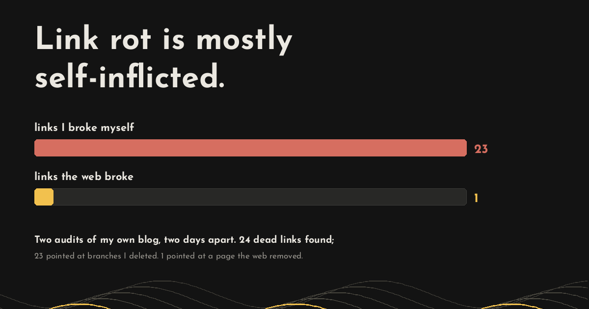
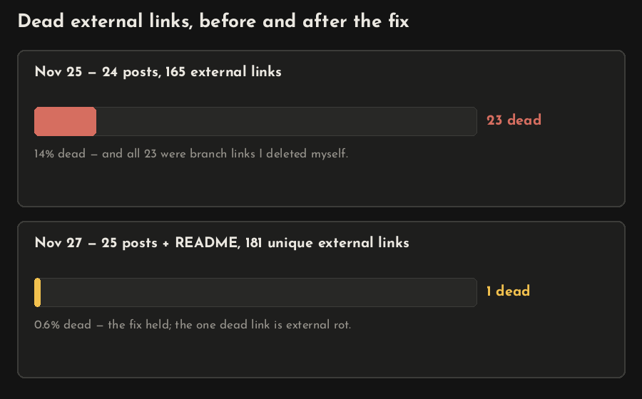
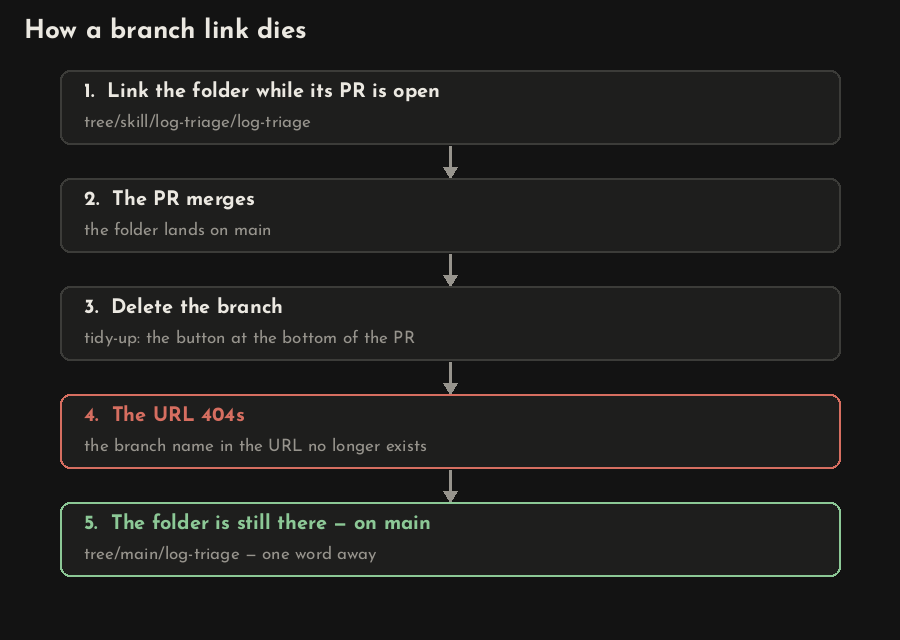
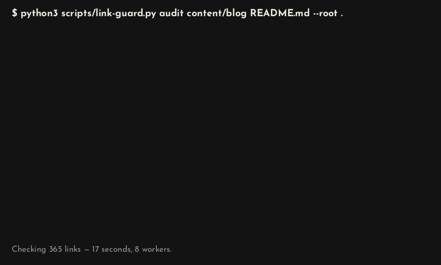
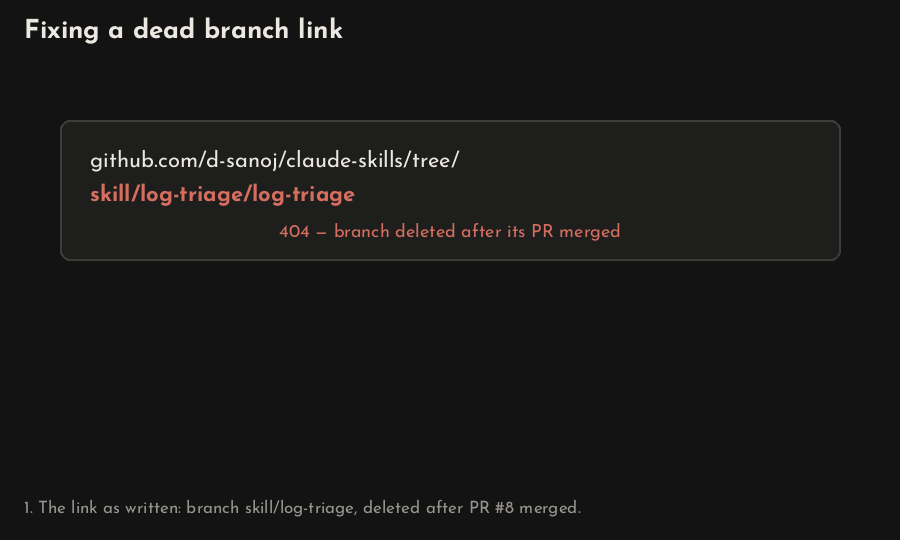

On Wednesday I clicked a link in one of my own posts and got a 404. Not a reader reporting it, not a monitoring alert — me, reading my own blog. I checked all of them. Twenty-four posts, 165 external links, 23 dead. Fourteen percent of everything I had linked to was gone, and the posts were just over three weeks old.

The part that stung was the cause. The web had not rotted my links. I had. Every one of the 23 pointed at a GitHub branch I had deleted after merging its pull request. The link was alive when I wrote the post and dead the day the branch went away — which, in my workflow, is usually the day the post goes up, because I link to the thing while its PR is still open and delete the branch when it merges. I was publishing dead links on the same day I published the post.

So I measured it properly, and built the checker I should have had from the start. This post is the measurement; the checker is the eleventh skill in the [skills repo](https://github.com/d-sanoj/claude-skills/tree/skill/link-guard), called link-guard.

## The two audits

The first audit was Wednesday, November 25: all 24 posts on the site at the time, 165 external links. Twenty-three were dead. The breakdown tells the whole story:

| What the dead links pointed at | Dead links |
| --- | --- |
| Skill folders on their PR branches (`tree/skill/<name>/…`) | 21 occurrences, 9 skills, 10 posts |
| An experiment folder on its PR branch | 2 |
| **Total** | **23** |

Zero of the 23 were links to other people's sites. Every dead link was mine, pointing at my own repos, at branches I had deleted. I fixed all 23 the same day — repointed each one at `main` — in [blog PR #40](https://github.com/d-sanoj/sine-portfolio/pull/40), and made a rule for myself: link repos at `main` only, never at a branch. Two more links were repointed in the same PR before they could die: the flake-hunt skill, linked at its branch in that morning's post. Its branch was still alive — it still is, because I haven't deleted it yet — but every other skill branch had been deleted after merging, so the fix went in pre-emptively. The PR repointed 25 links in total: 23 dead, 2 pre-emptive.

The second audit is today, Friday, November 27. Same checker, now a real script instead of a one-off: 25 posts plus the README, 365 links in total. Here is what it found:

| | Count |
| --- | --- |
| Links checked (all files) | 365 |
| External link occurrences | 186 (181 unique) |
| Relative links (images, site pages) | 179 — all fine |
| Alive (HTTP 200) | 358 |
| Bot walls (403/429 — the site blocks scripts, serves browsers) | 6 |
| Dead | 1 |
| GitHub `tree/`/`blob/` links pointing at a branch other than `main` | 0 of 23 |

Counting note: the November 25 audit counted raw occurrences (23 dead branch links across the posts); the November 27 audit counts each (URL, file) pair once — 23 GitHub file links, 34 raw mentions, all on `main`. Either way, no branch link remains.

The fix held. Not one branch link remains, two days after repointing 23 dead links (plus the 2 pre-emptive ones). The one dead link is the interesting one, and I will come back to it. The whole audit took 17 seconds.



:::describe
Two stacked panels. The top panel, November 25, shows a red bar filling 14% of its track, labelled "23 dead", with the caption "14% dead — and all 23 were branch links I deleted myself." The bottom panel, November 27, shows a hair-thin yellow sliver at the left of its track, labelled "1 dead", with the caption "0.6% dead — the fix held; the one dead link is external rot."
:::

I ran the same checker over the skills repo as a second corpus: 42 Markdown files, 30 external links (23 unique), zero dead. The audit also printed 2 BROKEN lines — `LICENSE` and `runtime/OFL.txt` in the motion-reel folder — but those are artifacts of auditing a partial download: I fetched only the `.md` files, so two real files looked missing. Both exist in the repo. The only non-200 external link there is the same apiiro article that shows up as a bot wall on the blog. Two corpora, 185 unique external links between them, one dead. My blog's links are in good shape *now*. The question is why they were ever in bad shape, and how fast they get there again.

## How a branch link dies

A link to a file on a branch looks permanent. It has the same shape as any other GitHub URL, it works when you test it, and nothing about it says "this expires." What expires is the branch. GitHub lets anyone with write access delete the head branch of a merged pull request — there is a Delete branch button at the bottom of the merged PR, and a repository setting to do it automatically — and once the branch is gone, every URL containing its name 404s. The files are not gone; they are on `main`, one path segment away. The link is dead anyway, because the URL names the branch, not the content.

The timing is what makes this a trap rather than ordinary decay. A normal link rots slowly: the page moves, the site redesigns, the domain lapses. A branch link rots *instantly*, at the moment of deletion, and the deletion is the normal, tidy, recommended end of the workflow that created the link. The worse your hygiene — the more promptly you delete merged branches — the faster your links die. I delete branches the day PRs merge, so my links had a life expectancy of about a day, measured from the merge, and I was writing them into posts that are supposed to last.



:::describe
A vertical flow of five boxes with arrows between them. 1. Link the folder while its PR is open — tree/skill/log-triage/log-triage. 2. The PR merges — the folder lands on main. 3. Delete the branch — tidy-up: the button at the bottom of the PR. 4. The URL 404s, in red — the branch name in the URL no longer exists. 5. The folder is still there — on main, in green — tree/main/log-triage, one word away.
:::

There is a subtlety I got wrong at first, and it matters. I assumed branches die *at* the merge. They don't. They die when someone deletes them, which in my flow is usually right after the merge but not always. Nine of my ten skill branches are gone. The tenth, `skill/flake-hunt`, is still there — its PR merged on Wednesday and I haven't deleted the branch yet. The November 26 blog branch is still there too. So a branch link is not dead on a schedule you can predict. It is alive until it isn't, and the only way to know which state it is in is to check. That is the whole argument for the checker: the failure mode is silent, the timing is irregular, and the fix is a one-word change (`skill/log-triage` → `main`) once you know.

## The one link the web broke

The single dead external link is in the Sources of the November 11 post about the Opus 5.5 nerf scare. It is an AICoder article summarizing an X discussion — "Is Opus 5.5 Nerfed?" — cited for the 1,400-session analysis in that post. I published it on November 11. By November 27 it 404s. Sixteen days.

I confirmed it three ways, because a 404 from one script is not proof: `curl` gets 404, the checker's GET gets 404, and a browser fetch gets 404 — while the site's homepage answers 200 to the same clients. The article is gone, not hiding. It was a news-aggregator page about a two-week-old argument, and aggregator pages about arguments are among the most disposable things on the web. The citation it carried is dead too, which is the part that actually costs something: the post still says the analysis exists, and the evidence for it is a 404. That citation needs a replacement source — the underlying discussion, not the aggregator — and that is a fix for a separate small PR, not this one.

Sixteen days is fast, but it is the normal speed of the web, not an anomaly. The background rate, measured by people who study this for a living, is much worse than my blog's 1-in-181. Pew Research Center checked pages sampled from Common Crawl and found 38% of webpages from 2013 were gone a decade later, and a quarter of all pages from 2013–2023. On live pages, 23% of news pages and 21% of government pages contain at least one broken link, and 54% of Wikipedia pages have a broken link in their References. Zittrain, Albert and Lessig, in the 2014 Harvard study that gave the field its numbers, found that more than 70% of URLs in three Harvard law journals and 50% of URLs in US Supreme Court opinions no longer produce the information originally cited. Ahrefs, crawling since 2013, found at least 66.5% of links to the 2,062,173 websites it sampled have rotted.

My numbers look nothing like those, and the difference is instructive: my links are three weeks old, and most of them point at GitHub, arXiv, and documentation — the most stable addresses on the web. Link rot is a function of time and of what you link to. A blog that is a month old, linking mostly to repos and papers, should have almost no external rot. Mine had 1 in 181. A blog that is five years old, linking mostly to news and aggregators, should expect something closer to Pew's numbers. The rate is not a property of links in general; it is a property of *your* links, and the only way to know yours is to measure them.

## Why a naive checker cries wolf

The obvious tool — fetch every link, flag anything that isn't a 200 — would have reported 29 dead links on my blog. I ran exactly that, HEAD requests only, no special cases, and saved the output: 29 flagged, 28 of them false alarms. Ten were links to pages on my own site (`/blog/<slug>/`, `/boring/`) that it read as missing files. Nine were Hacker News links that refuse HEAD requests. Five were 403s and two were 429s from sites that block scripts. One was the stargazers page that 404s to scripts. One was a YouTube link that answered HEAD with 204. A checker that cries wolf twenty-eight times per run gets ignored, and an ignored checker catches nothing — which is how 23 real dead links sat there unnoticed. The interesting engineering in link-guard is not the fetching; it is the classification. Every verdict the script can return exists because a real link on this blog taught it to:

- **OK (200).** The link works. 358 of 365.
- **REDIRECT.** Redirects are followed silently, so a redirect to a live page reports OK — the verdict is listed for completeness and never fires in the current version.
- **BOT-WALL (403/429).** The site answers scripts with "forbidden" or "slow down" but serves browsers fine. Six links in the final audit — seven in an earlier run the same morning, because a YouTube watch link answered 200 on one run and 429 on the next. Some hosts drop the first connection entirely and answer 403 when the script retries after a pause — which is why a transport failure is retried once, and only called UNKNOWN if it still fails. These are not dead; they are unverifiable by script, and the script says so instead of guessing.
- **UNKNOWN.** The host never answered at all — DNS failure, timeout, connection reset after a retry. Inconclusive, not dead; reported, does not fail the run. A server error (5xx) lands here too: a 503 says the server is struggling right now, not that the page is gone — GitHub answered 503 for eleven of my links during one run, and 200 for all of them minutes later.
- **BROKEN.** The server answered and said no: a 404, a missing file on disk, a missing `#anchor`, or a GitHub branch that is gone. One link today.

Three of those verdicts come with a story worth knowing if you ever write your own checker:


:::describe
A table with three columns — verdict, meaning, fails run? — and five rows. OK, green: 200, file exists, anchor exists; no. REDIRECT, blue: redirects to a live page; no. BOT-WALL, yellow: 403 / 429, or 404 to scripts — serves browsers; no. UNKNOWN, grey: host never answered — inconclusive; no. BROKEN, red: 404, missing file, missing anchor, branch gone; YES. Below the table: "Only BROKEN fails the run. A run that fails on things you cannot fix trains you to ignore it."
:::

**Hacker News answers HEAD with 405.** My first version fetched every link with HEAD, and nine HN links came back "dead." They are not dead — HN simply refuses HEAD requests. The fix is to retry with GET when HEAD is refused, which the script now does for 400, 401, 403 and 405. A checker that only uses HEAD will mislabel every HN link on the internet.

**YouTube's HEAD answers vary.** One watch link returned 204 to HEAD in the naive run and 200 when I re-checked with `curl` minutes later; GET is rate-limited intermittently (429 on one run, 200 on the next). The script retries with GET when HEAD comes back 204, and treats 429 as a bot wall, not a death.

**GitHub's own list pages 404 to scripts.** The README links to the repo's stargazers page, which answers 404 to `curl` — and to the same request for `torvalds/linux`, so it is not about my repo. The page exists and serves in a browser; GitHub's list pages are JavaScript-rendered and answer 404 to plain HTTP clients. The script special-cases `/stargazers`, `/watchers`, `/forks` and `/network/members` as bot walls. I verified the torvalds case by hand before adding the rule, because a special case you add to make a red light go away is exactly how a checker stops checking.

There is one more classification the script gets wrong on purpose, and I want to be plain about it: it cannot tell you whether a link still points at what you *meant*. A page can return 200 with entirely different content than the day you linked it — Zittrain's study calls that reference rot, and it is the larger problem: of the Supreme Court links that still loaded, only 76% still led to the material cited. A status checker catches link rot. Content drift needs a human, or an archive.

## What link-guard does

The skill is one Python file, standard library only, no packages, no model calls. It walks the Markdown files you point it at, pulls out every link — inline, reference-style, bare URLs, images, HTML `href`/`src` — while skipping frontmatter, fenced code blocks and inline code, because a URL in a code sample is not a link and counting it would be another kind of false positive. Then it checks each unique (URL, file) pair once and prints a verdict. The output below is the first two flagged lines of the real run — the run lists all six bot walls:

```bash
python3 scripts/link-guard.py audit content/blog README.md --root .
```

```text
BROKEN    content/blog/blog-10-11-11-2026/is-opus-5-5-nerfed.md:152  https://aicoder.com/news/news-20261107-x-discussion-opus-5-5-nerf-debate-1400-claude-code-sessions-theo-reasoning-summarizer
          HTTP 404
BOT-WALL  content/blog/blog-8-11-09-2026/claude-code-dont-ask-again-leak.md:6  https://apiiro.com/blog/coding-agents-leaking-secrets-github-dont-ask-again
          403 -- site blocks scripts; verify in a browser

files: 26  links: 365  BOT-WALL: 6  BROKEN: 1  OK: 358
```

{poster=img/audit-run-poster.png}

*The audit in five frames: one broken link, three of the six bot walls, and the summary line. Condensed — the real output prints each link on two lines with its full URL, and the numbers are in the text either way.*

Exit code 1 when anything is BROKEN, 0 otherwise. Bot walls, redirects and unknowns don't fail the run, because a run that fails on things you can't fix trains you to ignore it.

The checks, per link:

- **Relative links** (`img/cover.png`, `../other.md`) resolve against the file that contains them, on disk. A `#fragment` is checked against the headings in the target file, GitHub-style.
- **Site links** (`/blog/<slug>/`, `/boring/`) resolve against the repo layout: a post slug is live when some post folder holds that slug's Markdown file.
- **GitHub branch links** get the careful treatment. Branch names contain slashes, so the branch can't be split from the path by eye — `tree/skill/log-triage/log-triage` is branch `skill/log-triage`, path `/log-triage`. The script asks the GitHub API for the repo's live branches; if the branch is alive but the path is wrong, it says so. If the branch is gone, it finds the longest trailing path that still exists on `main` and prints the repoint. The API call is one request per repo, cached, and if the API is unreachable the script falls back to the repoint heuristic and says so.
- **External links** get HEAD, then GET when HEAD is refused, then one retry after a pause when the connection drops. A transport failure after retry is UNKNOWN, not BROKEN.

{poster=img/repoint-poster.png}

*The repoint in four frames: 404, strike the branch, write main, 200. The fix is one word.*

The fixture in the skill folder demonstrates all of it in six links — a good file, a missing file, a missing anchor, a genuinely deleted branch (`skill/log-triage`, deleted after its PR merged; the same folder is alive on `main`), a live page, and a URL inside a code block that is not a link. Running the audit on the fixture prints three BROKEN lines with the repoint included. The skill's tests are 23 checks, mostly offline; the one live test checks the real deleted branch and skips gracefully without a network.

## What to try

If you write anything with links in it — docs, a blog, a README that people actually read — run a checker like this after every merge, not once a quarter. The cost is 17 seconds for 365 links. The failure it catches is silent: nobody tells you your links died, your readers just leave. Two rules cover nearly all of it:

1. **Link repos at `main` only, never at a branch.** A branch is a work-in-progress address. The moment you treat it as a permanent address, you have set a timer you can't see. If you must link something that only exists on a branch, link it the day the branch merges — or better, don't link it until then.
2. **Check after every merge, in CI if you can.** Rot from deletion is instant, so a quarterly audit finds three months of dead links at once. A check on every push finds one, while you still remember writing it.

And when the checker flags a bot wall, verify it once in a browser and move on — don't "fix" it by deleting a live link, and don't teach the checker to ignore a whole host because one of its pages annoyed you. The 403s on my blog are all live pages. The one 404 is the only one that mattered, and it was a citation, not a decoration. That is the ratio to remember: out of 365 links, 358 fine, 6 unverifiable, 1 dead. The dead one was the only one carrying evidence for a claim. Links rot from the outside in — the aggregator goes first, the repo lasts — and the ones you can least afford to lose are the ones that look the least permanent.

# Sources

- Pew Research Center, ["When Online Content Disappears"](https://www.pewresearch.org/wp-content/uploads/sites/20/2024/05/pl_2024.05.17_link-rot_report.pdf) (May 17, 2024) — 38% of webpages from 2013 gone a decade later; 25% of pages from 2013–2023 gone; 23% of news pages and 21% of government pages contain at least one broken link; 54% of Wikipedia pages have a broken link in References.
- Jonathan Zittrain, Kendra Albert and Lawrence Lessig, ["Perma: Scoping and Addressing the Problem of Link and Reference Rot in Legal Citations"](https://ia600100.us.archive.org/16/items/permascopingandaddressingtheproblemoflinkandreferencerotinlegaldocuments/SSRN-id2329161.pdf), Harvard Law Review Forum, vol. 127 (2014) — more than 70% of URLs in three Harvard law journals and 50% of URLs in US Supreme Court opinions no longer produce the information originally cited; of the Supreme Court links that still loaded, 76% still led to the cited material.
- Ahrefs, ["At Least 66.5% of Links to Sites in the Last 9 Years Are Dead"](https://ahrefs.com/blog/link-rot-study/) — at least 66.5% of links to the 2,062,173 sampled websites rotted since January 2013, with another 6.45% returning temporary errors.
- GitHub Docs, ["Deleting and restoring branches in a pull request"](https://docs.github.com/en/enterprise-server@3.11/repositories/configuring-branches-and-merges-in-your-repository/managing-branches-in-your-repository/deleting-and-restoring-branches-in-a-pull-request) — branches associated with merged pull requests can be deleted; the Delete branch button appears at the bottom of the merged PR.
- The measurement in this post: [link-guard](https://github.com/d-sanoj/claude-skills/tree/skill/link-guard) (`scripts/link-guard.py`), run November 27, 2026 over 25 posts plus the README (365 links) and over the skills repo (42 files, 30 external links). The November 25 audit — 24 posts, 165 external links, 23 dead (plus 2 repointed pre-emptively) — was fixed in [blog PR #40](https://github.com/d-sanoj/sine-portfolio/pull/40). The skill links in this post point at the pull-request branch until the skill PR merges; they will be repointed at `main` after that.
