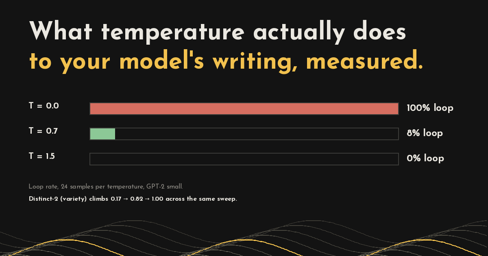
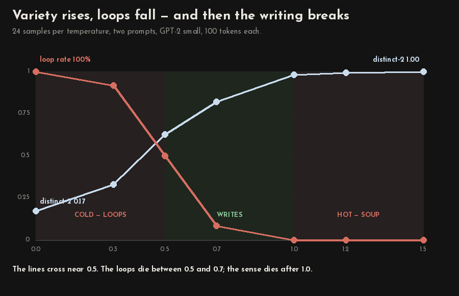
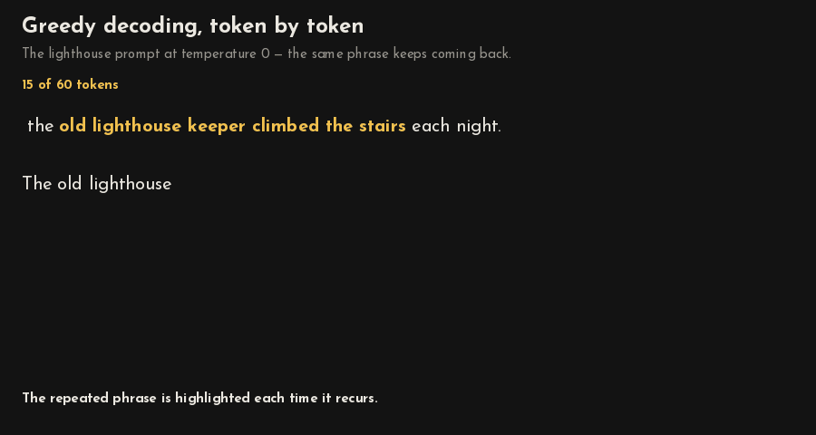
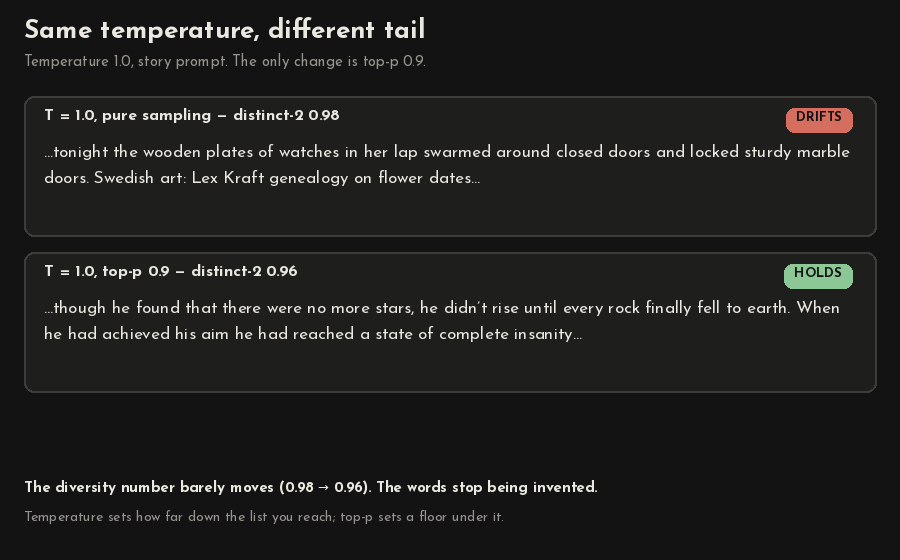

Temperature is the most-twiddled, least-understood knob on a language model. Every API and chat UI exposes it, every tutorial tells you 0.7 is "balanced" and 0 is "deterministic," and almost nobody can tell you what the number does to the actual words. I have set it myself for years on vibes: low for code, high for ideas, 0.7 when I could not decide. So I measured it — on a real model, with real numbers, at seven temperatures.

The short version: temperature does not turn a creativity dial. It rescales how much the model trusts its own ranking of the next word. At 0 the model trusts it completely and gets stuck in a loop — every single one of my 24 samples at temperature 0 repeated itself. At 0.7 it writes the best text in the sweep, with loops nearly gone. At 1.0 the text drifts into word salad, and at 1.5 every two-word pair in the output is unique and none of it means anything — a perfect diversity score on unreadable text. The interesting part is not that high temperature is "more creative." It is that the metric people use to judge diversity keeps improving long after the writing has collapsed, and that the setting everyone reaches for, 0.7, is good for a measurable reason, not a mystical one.

## What temperature is: one division

A language model does not pick the next word directly. For every token in its vocabulary it produces a score, a logit, and then turns those scores into probabilities with a softmax: each token's probability is proportional to e raised to its score. Temperature is a single division inserted before that step. With temperature T, each score is divided by T first, and then the softmax runs.

That one division is the whole mechanism, and its effect is easy to see on real numbers. I took GPT-2's next-token scores after the context "The capital of France is" and tempered them at three settings:

| Temperature | Entropy of the distribution | Top token and its probability | Top 5 tokens' combined probability |
| --- | --- | --- | --- |
| 0.5 | 3.29 bits | " the" — 0.397 | 0.759 |
| 1.0 | 8.65 bits | " the" — 0.085 | 0.243 |
| 1.5 | 12.23 bits | " the" — 0.016 | 0.055 |

:::describe
Three panels, one per temperature, each with five horizontal bars for the tokens " the", " now", " a", " France", and " Paris". At T = 0.5 the bars are long — " the" at 0.397, " now" at 0.128, " a" at 0.118 — and the top five hold 75.9% of the probability. At T = 1.0 the bars shrink to 0.085, 0.048, and 0.046, and the top five hold 24.3%. At T = 1.5 the bars are slivers — 0.016, 0.011, 0.011 — and the top five hold 5.5%, with 94.5% of the probability sitting in the other 50,252 tokens.
:::

At 0.5 the distribution is peaked: the top token holds 40% of the probability, the top five hold three quarters, and the model's uncertainty is 3.29 bits — roughly ten live candidates. At 1.5 the same scores produce a nearly flat distribution: the top token holds 1.6%, the top five hold 5.5%, and the entropy is 12.23 bits — roughly 4,800 live candidates. The model's opinion did not change. The volume on its opinion did. Dividing by 1.5 shrank every gap between scores, so tokens the model ranked far apart became nearly equal, and sampling started drawing from the long tail of tokens the model barely believes in.

Two details in that table are worth pausing on. First, the model's top choice after "The capital of France is" is " the", not " Paris" — Paris is fifth at every temperature, at 0.058, 0.032, and 0.009. GPT-2 small would rather write "The capital of France is the…" than name the city. It is a small, old model, and this is what its uncertainty actually looks like. Second, temperature 0 is the limit of this process: as T approaches 0, the top token's probability approaches 1 and sampling becomes picking the argmax every time. That is why 0 means deterministic — it is not a separate mode, it is the end of the same curve.

## What I ran

The model is GPT-2 small: 124,439,808 parameters by my count (the 2019 paper's table prints 117M, which OpenAI later corrected — the released weights count 124,439,808), 12 layers, 12 attention heads, 768 hidden units, a 50,257-token vocabulary, and a 1,024-token context window, trained on WebText. I downloaded the released weights from Hugging Face and ran them locally on a CPU. The whole sweep took about seven minutes.

Two prompts, chosen to pull in different directions: a story opening ("The old lighthouse keeper climbed the narrow stairs each evening, and") and a factual one ("The reason the sky looks blue is that"). Seven temperatures: 0, 0.3, 0.5, 0.7, 1.0, 1.2, 1.5. Twelve samples per prompt per temperature, up to 100 tokens each — 168 samples in the sweep, plus 24 more in the top-p condition, 192 in total. One more condition: temperature 1.0 with top-p 0.9, to see what the nucleus guardrail does at the same temperature.

The sampler is hand-rolled in the script, not a library default: logits divided by T, softmax, one draw from the resulting distribution — with a key-value cache so it runs at a sane speed, and fixed seeds so the run is reproducible. No top-k, no top-p, no repetition penalty, unless the condition says so. That matters, because library defaults quietly add their own truncation — Hugging Face's generation, for example, has historically applied a top-k of 50 on top of whatever temperature you set — and I wanted the numbers to isolate temperature alone.

Two metrics, both computed from the generated tokens, not from vibes. Distinct-2 is the share of two-word pairs in a sample that are unique: 1.0 means no two-word pair repeats, which is what people usually mean by "diverse." Loop rate is the share of samples where some six-token sequence occurs three or more times — the model stuck in a rut. I also record mean length and how often the model stops on its own by emitting its end-of-text token.

The script and the full results — all 192 samples verbatim — are in [measure-temperature.py](measure-temperature.py) and [results.json](results.json) next to this post.

## The sweep: diversity rises, loops fall, and then the writing breaks

| Temperature | Distinct-2 (higher = more varied) | Loop rate | Mean tokens | Stopped on its own |
| --- | --- | --- | --- | --- |
| 0.0 | 0.17 | 100% (24 of 24) | 100.0 | 0% |
| 0.3 | 0.33 | 92% (22 of 24) | 100.0 | 0% |
| 0.5 | 0.63 | 50% (12 of 24) | 100.0 | 0% |
| 0.7 | 0.82 | 8% (2 of 24) | 97.0 | 4% (1 of 24) |
| 1.0 | 0.98 | 0% | 100.0 | 0% |
| 1.2 | 0.99 | 0% | 96.9 | 4% (1 of 24) |
| 1.5 | 1.00 | 0% | 100.0 | 0% |
| 1.0 + top-p 0.9 | 0.96 | 0% | 96.6 | 8% (2 of 24) |

:::describe
Two lines plotted against temperature from 0 to 1.5. Distinct-2, the share of unique two-word pairs, climbs from 0.17 at temperature 0 to 0.33 at 0.3, 0.63 at 0.5, 0.82 at 0.7, 0.98 at 1.0, and 1.00 at 1.5. Loop rate, the share of samples stuck repeating a six-token sequence, falls from 100% at 0 to 92% at 0.3, 50% at 0.5, 8% at 0.7, and 0% at 1.0 and above. Three shaded bands mark the regimes: cold below 0.5, the working middle from 0.5 to 1.0, and hot above 1.0.
:::

:::describe
Three panels, one per temperature, each quoting the opening of a 100-token continuation of the lighthouse prompt. At T = 0.0, labelled LOOPS: "…the old lighthouse keeper climbed the stairs each night. The old lighthouse keeper climbed the narrow stairs each evening, and the old lighthouse keeper climbed the stairs each night…" At T = 0.7, labelled WRITES: "…was not disappointed. The old lighthouse keeper, being puffed up by an unknown assailant, was released after a few years, but having provided for the entire family, the old lighthouse keeper and his wife got lost in the woods…" At T = 1.5, labelled SOUP: "…especially main floors, shopping together work in spiesant's wastequsions then authenticing computers works just fine managed vines are on alternate length que haitten racing slur gunmen thinner vendors raise logsbeat…"
:::

Read the table left to right and there are three regimes, not a smooth slope. Below 0.5 the model loops. Between 0.5 and 1.0 it writes. Above 1.0 the loops are gone but so is the sense — and the diversity metric keeps climbing anyway. The crossover is the story: the loops die between 0.5 and 0.7, and the writing dies between 1.0 and 1.2. The window where you get both variety and sense is narrow, and 0.7 sits inside it.

Mean length barely moves — 97 to 100 tokens everywhere — because GPT-2 almost never stops on its own. It hit its end-of-text token in 4 of the 192 samples. The model does not decide it is finished; it runs to the cap you gave it. If your generations feel too long or too short, that is the max-tokens setting, not temperature.

## Regime one: cold — the model trusts itself into a loop

At temperature 0, all 24 samples loop, and all 12 samples for a given prompt are identical — that is what deterministic means. Here is the story prompt at 0:

> …the old lighthouse keeper climbed the stairs each night. The old lighthouse keeper climbed the narrow stairs each evening, and the old lighthouse keeper climbed the stairs each night. The old lighthouse keeper climbed the stairs each night, and the old lighthouse keeper climbed…

And the factual prompt at 0:

> …the sun is moving in a straight line. The sun is moving in a straight line. The sun is moving in a straight line. The sun is moving in a straight line…

The mechanism is a feedback loop, and Holtzman and colleagues documented it in 2020: once a phrase repeats, the model assigns even higher probability to repeating it again, because the repeated phrase is now the most predictable thing in the context. Maximizing likelihood step by step walks straight into the rut and stays there. Watch the same phrase come back, word for word:

{poster=img/loop-poster.png}

*Still frame: the greedy continuation at 60 tokens, with the repeated phrase highlighted four times. The lesson does not depend on the animation.*

At 0.3 the rut is barely shallower — 22 of 24 samples still loop, and on the factual prompt all 12 do. The factual prompt loops more than the story prompt at 0.3 and 0.5 (12 of 12 against 10 of 12 at 0.3; 8 of 12 against 4 of 12 at 0.5), because a factual continuation has fewer plausible next words: the distribution is already peaked, so even a little trust in it collapses onto the same phrase.

This is the part the "0 is deterministic" advice skips. Deterministic does not mean correct, or even stable. It means you get the same loop every time.

## Regime two: the middle — 0.7 writes, 1.0 drifts

At 0.7 the loops are nearly gone — 2 of 24 samples — and the text reads like something a person could have written. The story prompt:

> …was not disappointed. The old lighthouse keeper, being puffed up by an unknown assailant, was released after a few years, but having provided for the entire family, the old lighthouse keeper and his wife got lost in the woods.…

It is not good writing — "being puffed up by an unknown assailant" is GPT-2 small doing its best — but it is coherent, it stays on topic, and it does not repeat itself. The factual prompt at 0.7 drifts into a web-page voice ("Advertisement / Image credit: NASA"), which is the model falling back on the shape of the pages it was trained on, but the sentences are grammatical.

At 1.0 the diversity score looks better — 0.98, nearly no repeated two-word pair — and the text is worse. The story prompt:

> …tonight the wooden plates of watches in her lap swarmed around closed doors and locked sturdy marble doors. Swedish art: Lex Kraft genealogy on flower dates…

Each sentence is locally grammatical and globally unconnected. The model is sampling far enough down its ranked list that every clause is a fresh swerve. This is the same shape Holtzman et al. found for pure sampling from the untempered distribution: it avoids the loops and lands in incoherence instead. The diversity metric cannot see the difference — 0.98 at 1.0 against 0.82 at 0.7 — because it counts variety, not sense. A text that never repeats a two-word pair can still be nonsense. In fact, real text repeats two-word pairs constantly: "of the," "in the," "the old lighthouse keeper." A distinct-2 of 0.98 is not a sign of rich vocabulary. It is a sign the model has stopped reusing the connective tissue that holds sentences together.

## Regime three: hot — a perfect diversity score on word soup

At 1.5, distinct-2 is exactly 1.00. Every two-word pair in all 24 samples is unique. And the text is this:

> …especially main floors, shopping together work in spiesant's wastequsions then authenticing computers works just fine managed vines are on alternate length que haitten racing slur gunmen thinner vendors raise logsbeat…

The model is no longer choosing words; it is drawing from a distribution so flat that the sampler reaches deep into the ranked list — at 1.5, 92% of the probability mass sits outside the top eight tokens — and some of the tokens it draws are not even words. "Spiesant's wastequsions," "touristamorphsparj," "TircastleauntedTick": at high temperature the sampler reaches past real words into the byte-level fragments the tokenizer knows, and stitches them into things no one has ever written. Watch it happen:

{poster=img/temp-sweep-poster.png}

*Still frame: at temperature 1.5 the top token holds 1.6% of the probability and the entropy is 12.23 bits. The lesson does not depend on the animation.*

The honest way to read a distinct-2 of 1.00 is as a failure mode, not an achievement. Diversity metrics saturate: they rise while the text improves, keep rising while it falls apart, and max out exactly when the text is unreadable. If you are tuning temperature by watching a diversity number climb, you will overshoot the good region and not notice, because the number never tells you that you passed it.

## The guardrail: top-p does what temperature cannot

OpenAI's API documentation recommends changing temperature or top-p, but not both — and the experiment shows why top-p is the more surgical of the two. Top-p, or nucleus sampling, keeps only the smallest set of tokens whose probabilities add up to p, and samples from that set. At temperature 1.0 with top-p 0.9, the numbers barely move against pure temperature 1.0: distinct-2 0.96 against 0.98, loops 0% either way. But the text changes character:

> …though he found that there were no more stars, he didn't rise until every rock finally fell to earth. When he had achieved his aim he had reached a state of complete insanity…

Still strange, still GPT-2 small — but the sentences hold together, and there are no invented words. The reason is the one Holtzman et al. gave when they proposed nucleus sampling: the tail of the distribution is unreliable. The model's ranking is trustworthy near the top and noise at the bottom, and temperature alone cannot fix that, because dividing by T rescales the tail instead of removing it. Top-p cuts the tail off. At 1.0 the tail is where the gibberish lives, so cutting it is worth more than any temperature adjustment.

:::describe
Two panels, both at temperature 1.0 on the story prompt. The first, labelled DRIFTS, is pure sampling with distinct-2 0.98: "…tonight the wooden plates of watches in her lap swarmed around closed doors and locked sturdy marble doors. Swedish art: Lex Kraft genealogy on flower dates…" The second, labelled HOLDS, adds top-p 0.9 with distinct-2 0.96: "…though he found that there were no more stars, he didn't rise until every rock finally fell to earth. When he had achieved his aim he had reached a state of complete insanity…"
:::

The practical version: temperature sets how far down the ranked list you are willing to reach; top-p sets a floor under how far down you are allowed to reach. If you want variety without word soup, lower the temperature a little and let top-p do the trimming — or keep temperature at 1.0 and set top-p to 0.9. What you should not do is push temperature past 1.2 and expect the model to stay coherent, because there is no mechanism left that keeps it in the plausible set.

## What to actually set

| Job | Temperature | Why, from the numbers |
| --- | --- | --- |
| Facts, code, extraction, anything you will test | 0–0.3 | Deterministic, but check for loops: at 0.3, 92% of samples looped, and a factual prompt looped every time |
| Drafting, brainstorming, first-pass prose | 0.7 | Loops nearly gone (8%), text still coherent — the sweet spot in this sweep |
| Wild ideas, many varied samples | 1.0, with top-p 0.9 | Diversity is high and the nucleus keeps the tail out |
| Never, for prose | Above 1.2 | Distinct-2 hits 0.99–1.00 while the text turns to word soup and invented words |

Two caveats to that table. First, 0 is not a safe default for open-ended text: you get the same loop every time, and the loop is the failure, not the determinism. If you need determinism, use 0 and a stop condition — or better, use a low temperature and check the output for repetition, because the loop rate at 0.3 is still 92%. Second, the defaults you inherit are already a choice. OpenAI's API defaults temperature to 1.0, on a range of 0 to 2 — so if you never touch the field, you are sampling at the setting where my sweep's text had already drifted. The most common temperature in the world is the one nobody set.

## What this doesn't prove

One small, old model: GPT-2 small, 124 million parameters, trained in 2019 on WebText, with no instruction tuning and no reinforcement learning from human feedback. Modern chat models are trained to be robust to sampling, their distributions are shaped by RLHF, and many of them do not expose raw temperature at all — the reasoning models that think before answering take no temperature parameter. The exact temperatures where the regimes start and end will move on a bigger, newer model. The shape — loops at the bottom, drift at the top, a narrow working middle, and a diversity metric that saturates past the good region — is a property of the sampler, not of this model, so it should travel. But the constants are mine, measured here, and anyone quoting 0.7 as a law from this post is making the same mistake as anyone quoting 0.7 from a tutorial.

The sample is small on purpose: 24 samples per condition, two prompts, one model, one seed family. The loop-rate numbers have real sampling noise — 2 of 24 at 0.7 could easily be 1 or 4 on another seed — and the prompts are mine, written to pull in two directions. Distinct-2 is a toy metric: it measures repetition, nothing else, and I use it here precisely to show how a toy metric can look perfect on broken text. The softmax demo is one context, "The capital of France is," and the entropy numbers belong to that context, not to language in general. None of that changes the shape of the finding, which is large compared to the noise: loops fall from 100% to 0% across the sweep, and the text goes from repetition to coherence to soup. But it bounds the claim: this is what temperature does for this model on these prompts, and the method — run the sweep, count the loops, read the samples — is the part to reuse.

## Sources

- All numbers are from `measure-temperature.py`, run on 2026-11-28 on GPT-2 small (124,439,808 parameters, weights from Hugging Face), two prompts, 12 samples per prompt per temperature, up to 100 tokens, fixed seeds. Full script, every sample verbatim, and the softmax demo: [measure-temperature.py](measure-temperature.py), [results.json](results.json).
- Radford, Wu, Child, Luan, Amodei, and Sutskever, ["Language Models are Unsupervised Multitask Learners"](https://cdn.openai.com/better-language-models/language_models_are_unsupervised_multitask_learners.pdf) (OpenAI, 2019) — the GPT-2 paper; the 117M figure in its table is the uncorrected count, the released small checkpoint is 124M.
- Hugging Face, [GPT-2 model card](https://huggingface.co/gpt2) — 124M parameters, 12 layers, 12 heads, 768 hidden units, 50,257-token vocabulary, 1,024-token context, trained on WebText.
- Holtzman, Buys, Du, Forbes, and Choi, ["The Curious Case of Neural Text Degeneration"](https://arxiv.org/abs/1904.09751) (ICLR 2020) — maximization-based decoding degenerates into repetitive loops, pure sampling drifts into incoherence, and nucleus (top-p) sampling truncates the unreliable tail.
- OpenAI, [Create completion — API reference](https://developers.openai.com/api/reference/resources/completions/methods/create) — temperature defaults to 1, range 0 to 2; top-p defaults to 1; "We generally recommend altering this or top_p but not both."
